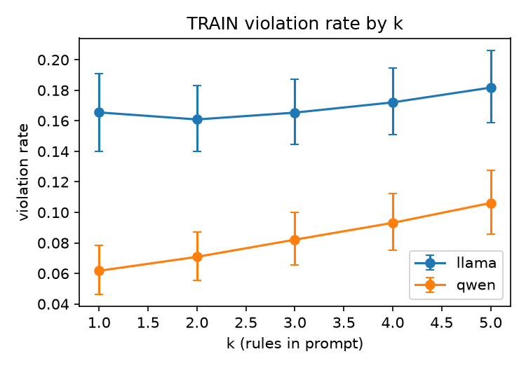
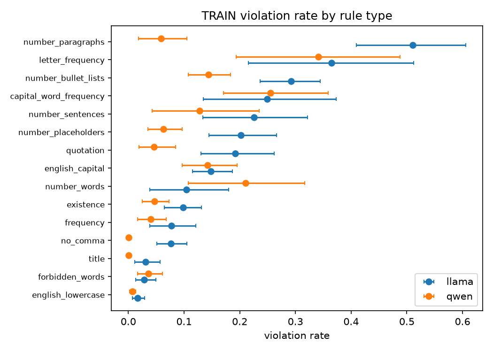

# ManyIFEval probing results

Generated by `python -m mife.cli probe-report` from `results/tables/`. CV (training-only) results and TEST results are kept in separate sections and tables.

## 1. Summary

_Pending: written after the test evaluation._

## 2. What was run

Pre-specification: [`prespec/analysis_plan.md`](prespec/analysis_plan.md) (frozen; hash in `prespec/FROZEN.json`).

## 3. Descriptive results (TRAIN only)

### Violation rate by k (TRAIN; 95% CI, cluster bootstrap over the 57 groups)

| model | k | n_groups | sum_n | estimate [95% CI] |
|---|---|---|---|---|
| llama | 1 | 57 | 20520.000 | 0.165 [0.140, 0.191] |
| llama | 2 | 57 | 82080.000 | 0.161 [0.140, 0.183] |
| llama | 3 | 57 | 369360.000 | 0.165 [0.145, 0.187] |
| llama | 4 | 57 | 984960.000 | 0.172 [0.151, 0.195] |
| llama | 5 | 57 | 2052000.000 | 0.182 [0.159, 0.206] |
| llama | all | 57 | 3508920.000 | 0.177 [0.155, 0.200] |
| qwen | 1 | 57 | 20520.000 | 0.062 [0.046, 0.078] |
| qwen | 2 | 57 | 82080.000 | 0.071 [0.055, 0.087] |
| qwen | 3 | 57 | 369360.000 | 0.082 [0.066, 0.100] |
| qwen | 4 | 57 | 984960.000 | 0.093 [0.075, 0.112] |
| qwen | 5 | 57 | 2052000.000 | 0.106 [0.086, 0.127] |
| qwen | all | 57 | 3508920.000 | 0.099 [0.080, 0.119] |

### Violation rate by rule type (TRAIN)

| model | type_id | n_groups | sum_n | estimate [95% CI] |
|---|---|---|---|---|
| llama | change_case:english_lowercase | 13 | 133380.000 | 0.016 [0.007, 0.029] |
| llama | detectable_format:title | 31 | 318060.000 | 0.031 [0.012, 0.057] |
| llama | keywords:forbidden_words | 31 | 318060.000 | 0.029 [0.013, 0.049] |
| llama | keywords:frequency | 20 | 205200.000 | 0.077 [0.038, 0.121] |
| llama | keywords:letter_frequency | 32 | 328320.000 | 0.365 [0.216, 0.513] |
| llama | length_constraints:number_paragraphs | 21 | 215460.000 | 0.511 [0.410, 0.605] |
| llama | change_case:capital_word_frequency | 15 | 153900.000 | 0.249 [0.134, 0.373] |
| llama | punctuation:no_comma | 30 | 307800.000 | 0.077 [0.051, 0.105] |
| llama | keywords:existence | 16 | 164160.000 | 0.098 [0.065, 0.131] |
| llama | startend:quotation | 26 | 266760.000 | 0.192 [0.130, 0.262] |
| llama | change_case:english_capital | 20 | 205200.000 | 0.148 [0.115, 0.187] |
| llama | detectable_format:number_bullet_lists | 28 | 287280.000 | 0.292 [0.237, 0.345] |
| llama | detectable_content:number_placeholders | 29 | 297540.000 | 0.202 [0.145, 0.266] |
| llama | length_constraints:number_words | 16 | 164160.000 | 0.104 [0.039, 0.180] |
| llama | length_constraints:number_sentences | 14 | 143640.000 | 0.226 [0.134, 0.322] |
| qwen | change_case:english_lowercase | 13 | 133380.000 | 0.007 [0.003, 0.013] |
| qwen | detectable_format:title | 31 | 318060.000 | 0.000 [0.000, 0.001] |
| qwen | keywords:forbidden_words | 31 | 318060.000 | 0.036 [0.016, 0.062] |
| qwen | keywords:frequency | 20 | 205200.000 | 0.040 [0.017, 0.068] |
| qwen | keywords:letter_frequency | 32 | 328320.000 | 0.341 [0.194, 0.488] |
| qwen | length_constraints:number_paragraphs | 21 | 215460.000 | 0.059 [0.018, 0.105] |
| qwen | change_case:capital_word_frequency | 15 | 153900.000 | 0.255 [0.171, 0.359] |
| qwen | punctuation:no_comma | 30 | 307800.000 | 0.001 [0.000, 0.002] |
| qwen | keywords:existence | 16 | 164160.000 | 0.047 [0.025, 0.073] |
| qwen | startend:quotation | 26 | 266760.000 | 0.046 [0.019, 0.085] |
| qwen | change_case:english_capital | 20 | 205200.000 | 0.142 [0.097, 0.195] |
| qwen | detectable_format:number_bullet_lists | 28 | 287280.000 | 0.144 [0.108, 0.183] |
| qwen | detectable_content:number_placeholders | 29 | 297540.000 | 0.063 [0.035, 0.097] |
| qwen | length_constraints:number_words | 16 | 164160.000 | 0.210 [0.108, 0.316] |
| qwen | length_constraints:number_sentences | 14 | 143640.000 | 0.128 [0.043, 0.235] |

### Violation rate by category (TRAIN)

| model | category | n_groups | sum_n | estimate [95% CI] |
|---|---|---|---|---|
| llama | formatting | 53 | 902880.000 | 0.171 [0.137, 0.206] |
| llama | keywords | 49 | 687420.000 | 0.060 [0.043, 0.078] |
| llama | length_counts | 55 | 851580.000 | 0.328 [0.253, 0.405] |
| llama | letter_case | 48 | 492480.000 | 0.144 [0.100, 0.195] |
| llama | punctuation | 30 | 307800.000 | 0.077 [0.051, 0.105] |
| llama | beginning_ending | 26 | 266760.000 | 0.192 [0.130, 0.262] |
| qwen | formatting | 53 | 902880.000 | 0.067 [0.049, 0.086] |
| qwen | keywords | 49 | 687420.000 | 0.040 [0.027, 0.056] |
| qwen | length_counts | 55 | 851580.000 | 0.208 [0.142, 0.276] |
| qwen | letter_case | 48 | 492480.000 | 0.141 [0.100, 0.188] |
| qwen | punctuation | 30 | 307800.000 | 0.001 [0.000, 0.002] |
| qwen | beginning_ending | 26 | 266760.000 | 0.046 [0.019, 0.085] |

### Violation rate by position within k (TRAIN)

| model | k | position | n_groups | sum_n | estimate [95% CI] |
|---|---|---|---|---|---|
| llama | 1 | 1 | 57 | 20520.000 | 0.165 [0.140, 0.191] |
| llama | 2 | 1 | 57 | 41040.000 | 0.156 [0.134, 0.180] |
| llama | 2 | 2 | 57 | 41040.000 | 0.166 [0.145, 0.187] |
| llama | 3 | 1 | 57 | 123120.000 | 0.159 [0.137, 0.182] |
| llama | 3 | 2 | 57 | 123120.000 | 0.164 [0.142, 0.186] |
| llama | 3 | 3 | 57 | 123120.000 | 0.173 [0.152, 0.195] |
| llama | 4 | 1 | 57 | 246240.000 | 0.166 [0.144, 0.189] |
| llama | 4 | 2 | 57 | 246240.000 | 0.170 [0.149, 0.192] |
| llama | 4 | 3 | 57 | 246240.000 | 0.173 [0.152, 0.195] |
| llama | 4 | 4 | 57 | 246240.000 | 0.180 [0.159, 0.202] |
| llama | 5 | 1 | 57 | 410400.000 | 0.177 [0.153, 0.202] |
| llama | 5 | 2 | 57 | 410400.000 | 0.179 [0.156, 0.203] |
| llama | 5 | 3 | 57 | 410400.000 | 0.182 [0.159, 0.206] |
| llama | 5 | 4 | 57 | 410400.000 | 0.183 [0.160, 0.208] |
| llama | 5 | 5 | 57 | 410400.000 | 0.189 [0.165, 0.213] |
| qwen | 1 | 1 | 57 | 20520.000 | 0.062 [0.046, 0.078] |
| qwen | 2 | 1 | 57 | 41040.000 | 0.067 [0.052, 0.083] |
| qwen | 2 | 2 | 57 | 41040.000 | 0.075 [0.059, 0.092] |
| qwen | 3 | 1 | 57 | 123120.000 | 0.079 [0.062, 0.097] |
| qwen | 3 | 2 | 57 | 123120.000 | 0.083 [0.067, 0.100] |
| qwen | 3 | 3 | 57 | 123120.000 | 0.085 [0.068, 0.104] |
| qwen | 4 | 1 | 57 | 246240.000 | 0.089 [0.071, 0.108] |
| qwen | 4 | 2 | 57 | 246240.000 | 0.094 [0.076, 0.113] |
| qwen | 4 | 3 | 57 | 246240.000 | 0.096 [0.078, 0.115] |
| qwen | 4 | 4 | 57 | 246240.000 | 0.094 [0.076, 0.114] |
| qwen | 5 | 1 | 57 | 410400.000 | 0.104 [0.083, 0.126] |
| qwen | 5 | 2 | 57 | 410400.000 | 0.109 [0.089, 0.131] |
| qwen | 5 | 3 | 57 | 410400.000 | 0.108 [0.087, 0.130] |
| qwen | 5 | 4 | 57 | 410400.000 | 0.105 [0.084, 0.127] |
| qwen | 5 | 5 | 57 | 410400.000 | 0.105 [0.084, 0.127] |

### Violation rate by task family (TRAIN)

| model | task_family | n_groups | sum_n | estimate [95% CI] |
|---|---|---|---|---|
| llama | CREATIVE | 41 | 841320.000 | 0.189 [0.156, 0.222] |
| llama | INFO | 28 | 574560.000 | 0.169 [0.139, 0.199] |
| llama | PRACTICAL | 47 | 964440.000 | 0.200 [0.172, 0.229] |
| llama | PERSUASIVE | 26 | 533520.000 | 0.152 [0.114, 0.192] |
| llama | ANALYTICAL | 17 | 348840.000 | 0.149 [0.100, 0.201] |
| llama | TRANSFORM | 12 | 246240.000 | 0.155 [0.100, 0.221] |
| qwen | CREATIVE | 41 | 841320.000 | 0.112 [0.085, 0.140] |
| qwen | INFO | 28 | 574560.000 | 0.102 [0.078, 0.126] |
| qwen | PRACTICAL | 47 | 964440.000 | 0.090 [0.069, 0.113] |
| qwen | PERSUASIVE | 26 | 533520.000 | 0.092 [0.060, 0.130] |
| qwen | ANALYTICAL | 17 | 348840.000 | 0.091 [0.058, 0.129] |
| qwen | TRANSFORM | 12 | 246240.000 | 0.106 [0.067, 0.148] |

### Distribution of p_hat and q_hat (TRAIN)

| model | statistic | estimate [95% CI] |
|---|---|---|
| llama | share of prompt-rule rows with v = 0 | 0.532 [0.497, 0.566] |
| llama | share of prompt-rule rows with v = 20 | 0.054 [0.037, 0.070] |
| llama | mean p_hat | 0.177 [0.155, 0.200] |
| llama | mean q_hat | 0.175 [0.154, 0.197] |
| llama | share of prompts with q_hat = 0 | 0.104 [0.083, 0.125] |
| llama | q_hat quantile 0.1 | 0.000 [nan, nan] |
| llama | q_hat quantile 0.25 | 0.050 [nan, nan] |
| llama | q_hat quantile 0.5 | 0.150 [nan, nan] |
| llama | q_hat quantile 0.75 | 0.263 [nan, nan] |
| llama | q_hat quantile 0.9 | 0.380 [nan, nan] |
| qwen | share of prompt-rule rows with v = 0 | 0.746 [0.713, 0.776] |
| qwen | share of prompt-rule rows with v = 20 | 0.039 [0.026, 0.054] |
| qwen | mean p_hat | 0.099 [0.080, 0.119] |
| qwen | mean q_hat | 0.096 [0.078, 0.116] |
| qwen | share of prompts with q_hat = 0 | 0.343 [0.296, 0.393] |
| qwen | q_hat quantile 0.1 | 0.000 [nan, nan] |
| qwen | q_hat quantile 0.25 | 0.000 [nan, nan] |
| qwen | q_hat quantile 0.5 | 0.033 [nan, nan] |
| qwen | q_hat quantile 0.75 | 0.188 [nan, nan] |
| qwen | q_hat quantile 0.9 | 0.263 [nan, nan] |

### Truncation (hit max_new_tokens) by k (TRAIN)

| model | k | n_groups | sum_one | estimate [95% CI] |
|---|---|---|---|---|
| llama | 1 | 57 | 20520.000 | 0.0005 [0.0001, 0.0010] |
| llama | 2 | 57 | 41040.000 | 0.0011 [0.0006, 0.0017] |
| llama | 3 | 57 | 123120.000 | 0.0016 [0.0009, 0.0024] |
| llama | 4 | 57 | 246240.000 | 0.0017 [0.0011, 0.0024] |
| llama | 5 | 57 | 410400.000 | 0.0021 [0.0013, 0.0031] |
| llama | all | 57 | 841320.000 | 0.0018 [0.0012, 0.0026] |
| qwen | 1 | 57 | 20520.000 | 0.0084 [0.0044, 0.0138] |
| qwen | 2 | 57 | 41040.000 | 0.0095 [0.0047, 0.0165] |
| qwen | 3 | 57 | 123120.000 | 0.0164 [0.0075, 0.0309] |
| qwen | 4 | 57 | 246240.000 | 0.0230 [0.0111, 0.0415] |
| qwen | 5 | 57 | 410400.000 | 0.0310 [0.0154, 0.0529] |
| qwen | all | 57 | 841320.000 | 0.0249 [0.0124, 0.0434] |

### `english_capital`: violations caused only by the langdetect step (TRAIN)

| model | statistic | estimate [95% CI] |
|---|---|---|
| llama | english_capital checks (response x rule) | 205200.000 [nan, nan] |
| llama | violation rate (official checker) | 0.148 [0.114, 0.186] |
| llama | share of violations caused only by langdetect | 0.042 [0.015, 0.083] |
| llama | violation rate if langdetect-only failures counted as followed (sensitivity) | 0.142 [0.107, 0.180] |
| qwen | english_capital checks (response x rule) | 205200.000 [nan, nan] |
| qwen | violation rate (official checker) | 0.142 [0.098, 0.189] |
| qwen | share of violations caused only by langdetect | 0.431 [0.194, 0.609] |
| qwen | violation rate if langdetect-only failures counted as followed (sensitivity) | 0.081 [0.058, 0.106] |

### Repetition loops (TRAIN)

| model | statistic | count | estimate [95% CI] |
|---|---|---|---|
| llama | loop share of all responses | 704 | 0.0008 [0.0004, 0.0014] |
| llama | loop share among truncated responses | 685 | 0.4431 [0.2834, 0.5967] |
| llama | truncated share among looping responses | 685 | 0.9730 [0.9412, 0.9925] |
| llama | looping responses (count) | 704 | 704.0000 [nan, nan] |
| qwen | loop share of all responses | 17269 | 0.0205 [0.0096, 0.0357] |
| qwen | loop share among truncated responses | 15161 | 0.7230 [0.5906, 0.8278] |
| qwen | truncated share among looping responses | 15161 | 0.8779 [0.8264, 0.9295] |
| qwen | looping responses (count) | 17269 | 17269.0000 [nan, nan] |

### Llama vs Qwen by type (TRAIN)

| type_id | llama | qwen | llama_minus_qwen | diff_lo | diff_hi |
|---|---|---|---|---|---|
| change_case:english_lowercase | 0.016 | 0.007 | 0.009 | -0.000 | 0.022 |
| detectable_format:title | 0.031 | 0.000 | 0.031 | 0.011 | 0.057 |
| keywords:forbidden_words | 0.029 | 0.036 | -0.007 | -0.016 | -0.000 |
| keywords:frequency | 0.077 | 0.040 | 0.036 | 0.016 | 0.061 |
| keywords:letter_frequency | 0.365 | 0.341 | 0.024 | 0.002 | 0.049 |
| length_constraints:number_paragraphs | 0.511 | 0.059 | 0.452 | 0.367 | 0.533 |
| change_case:capital_word_frequency | 0.249 | 0.255 | -0.006 | -0.094 | 0.083 |
| punctuation:no_comma | 0.077 | 0.001 | 0.076 | 0.051 | 0.104 |
| keywords:existence | 0.098 | 0.047 | 0.051 | 0.013 | 0.092 |
| startend:quotation | 0.192 | 0.046 | 0.146 | 0.088 | 0.208 |
| change_case:english_capital | 0.148 | 0.142 | 0.007 | -0.042 | 0.050 |
| detectable_format:number_bullet_lists | 0.292 | 0.144 | 0.148 | 0.088 | 0.210 |
| detectable_content:number_placeholders | 0.202 | 0.063 | 0.139 | 0.078 | 0.204 |
| length_constraints:number_words | 0.104 | 0.210 | -0.106 | -0.186 | -0.038 |
| length_constraints:number_sentences | 0.226 | 0.128 | 0.098 | 0.029 | 0.178 |

### Per-prompt rank correlation of q_hat, Llama vs Qwen (TRAIN)

| statistic | n_prompts | estimate [95% CI] |
|---|---|---|
| Spearman rho of q_hat (per prompt) | 42066 | 0.434 [0.358, 0.506] |

### Type × k violation rate (TRAIN)

| model | type_id | k=1 | k=2 | k=3 | k=4 | k=5 |
|---|---|---|---|---|---|---|
| llama | change_case:capital_word_frequency | 0.308 | 0.260 | 0.258 | 0.251 | 0.246 |
| llama | change_case:english_capital | 0.223 | 0.179 | 0.154 | 0.151 | 0.144 |
| llama | change_case:english_lowercase | 0.023 | 0.021 | 0.017 | 0.016 | 0.016 |
| llama | detectable_content:number_placeholders | 0.140 | 0.138 | 0.163 | 0.187 | 0.220 |
| llama | detectable_format:number_bullet_lists | 0.365 | 0.312 | 0.308 | 0.286 | 0.290 |
| llama | detectable_format:title | 0.000 | 0.009 | 0.016 | 0.028 | 0.037 |
| llama | keywords:existence | 0.094 | 0.089 | 0.089 | 0.096 | 0.101 |
| llama | keywords:forbidden_words | 0.032 | 0.032 | 0.031 | 0.028 | 0.028 |
| llama | keywords:frequency | 0.044 | 0.072 | 0.074 | 0.079 | 0.077 |
| llama | keywords:letter_frequency | 0.352 | 0.351 | 0.353 | 0.364 | 0.368 |
| llama | length_constraints:number_paragraphs | 0.513 | 0.494 | 0.511 | 0.505 | 0.514 |
| llama | length_constraints:number_sentences | 0.227 | 0.189 | 0.194 | 0.212 | 0.239 |
| llama | length_constraints:number_words | 0.010 | 0.028 | 0.060 | 0.093 | 0.121 |
| llama | punctuation:no_comma | 0.086 | 0.064 | 0.070 | 0.075 | 0.079 |
| llama | startend:quotation | 0.061 | 0.145 | 0.150 | 0.176 | 0.211 |
| qwen | change_case:capital_word_frequency | 0.226 | 0.212 | 0.220 | 0.244 | 0.269 |
| qwen | change_case:english_capital | 0.123 | 0.128 | 0.138 | 0.139 | 0.144 |
| qwen | change_case:english_lowercase | 0.005 | 0.007 | 0.004 | 0.007 | 0.008 |
| qwen | detectable_content:number_placeholders | 0.013 | 0.022 | 0.046 | 0.057 | 0.071 |
| qwen | detectable_format:number_bullet_lists | 0.023 | 0.056 | 0.088 | 0.118 | 0.171 |
| qwen | detectable_format:title | 0.000 | 0.001 | 0.000 | 0.001 | 0.000 |
| qwen | keywords:existence | 0.005 | 0.031 | 0.036 | 0.046 | 0.050 |
| qwen | keywords:forbidden_words | 0.047 | 0.038 | 0.036 | 0.036 | 0.036 |
| qwen | keywords:frequency | 0.035 | 0.042 | 0.036 | 0.042 | 0.041 |
| qwen | keywords:letter_frequency | 0.341 | 0.339 | 0.331 | 0.336 | 0.345 |
| qwen | length_constraints:number_paragraphs | 0.009 | 0.003 | 0.022 | 0.047 | 0.073 |
| qwen | length_constraints:number_sentences | 0.020 | 0.077 | 0.082 | 0.105 | 0.150 |
| qwen | length_constraints:number_words | 0.011 | 0.076 | 0.162 | 0.200 | 0.231 |
| qwen | punctuation:no_comma | 0.011 | 0.003 | 0.001 | 0.001 | 0.001 |
| qwen | startend:quotation | 0.002 | 0.015 | 0.035 | 0.045 | 0.050 |

## 4. Cross-validation and selected settings

### Summary (training-only grouped CV; these are not TEST results)

- Shared hidden row: llama Objective 1 row 16 (50% depth); llama Objective 2 row 16 (50% depth); qwen Objective 1 row 18 (50% depth); qwen Objective 2 row 27 (75% depth).
- A1 pooling: llama Objective 1 sum; llama Objective 2 sum; qwen Objective 1 sum; qwen Objective 2 sum.
- B2 (lora): llama Objective 1 LR 0.0001, 1 epoch(s); llama Objective 2 LR 0.0002, 3 epoch(s); qwen Objective 1 LR 0.0001, 1 epoch(s); qwen Objective 2 LR 0.0002, 1 epoch(s).
- **llama, Objective 1** (CV binomial NLL): lowest loss A1 (0.3316); best probe-only A1 (0.3316), best B1 family B1+H1+A1 (0.339), best B2 family B2+H1+H2+A1 (0.3341); B1 alone 0.3868, B2 alone 0.37, structure reference 0.3779, type × k reference 0.4152; 22 of 23 configurations below the structure reference.
- **llama, Objective 2** (CV MSE): lowest loss B2+H2+A1 (0.01562); best probe-only H1+A1 (0.01585), best B1 family B1+H1+A1 (0.01638), best B2 family B2+H2+A1 (0.01562); B1 alone 0.01838, B2 alone 0.01613, structure reference 0.01847, type × k reference 0.02036; 23 of 23 configurations below the structure reference.
- **qwen, Objective 1** (CV binomial NLL): lowest loss B2+H1+H2+A1 (0.2324); best probe-only H1+H2+A1 (0.2358), best B1 family B1+H1+H2+A1 (0.2374), best B2 family B2+H1+H2+A1 (0.2324); B1 alone 0.2646, B2 alone 0.2606, structure reference 0.2573, type × k reference 0.2756; 20 of 23 configurations below the structure reference.
- **qwen, Objective 2** (CV MSE): lowest loss H1+A1 (0.01103); best probe-only H1+A1 (0.01103), best B1 family B1+H1+A1 (0.01199), best B2 family B2+H2+A1 (0.01342); B1 alone 0.0136, B2 alone 0.01379, structure reference 0.01275, type × k reference 0.0135; 13 of 23 configurations below the structure reference.
- Hidden + attention in CV (combined minus the better single block; negative = the combination helps): llama Obj 1 H1+A1 +0.027; llama Obj 1 H2+A1 +0.0049; llama Obj 2 H1+A1 -0.00071; llama Obj 2 H2+A1 -0.00041; qwen Obj 1 H1+A1 +0.019; qwen Obj 1 H2+A1 +0.0026; qwen Obj 2 H1+A1 -0.00027; qwen Obj 2 H2+A1 -0.00027.
- Selected L2 among the 23 configurations plus the structure reference (0.01, 0.1, 1): llama Obj 1 2/22/0; llama Obj 2 8/9/7; qwen Obj 1 1/18/5; qwen Obj 2 6/18/0. Edge selections and the loss one grid step inwards are in `cv_l2_edges.csv`.

### Best configuration per family (grouped CV)

| model | objective | metric | best_config | best_cv_loss | best_probe_only | best_probe_only_cv_loss | best_B1_family | best_B1_family_cv_loss | best_B2_family | best_B2_family_cv_loss | B1_cv_loss | B2_cv_loss | REF_structure_cv_loss | REF_type_k_cv_loss | REF_constant_cv_loss | n_of_23_below_REF_structure |
|---|---|---|---|---|---|---|---|---|---|---|---|---|---|---|---|---|
| llama | 1 | binomial NLL | A1 | 0.3316 | A1 | 0.3316 | B1+H1+A1 | 0.339 | B2+H1+H2+A1 | 0.3341 | 0.3868 | 0.37 | 0.3779 | 0.4152 | 0.4705 | 22 |
| llama | 2 | MSE | B2+H2+A1 | 0.01562 | H1+A1 | 0.01585 | B1+H1+A1 | 0.01638 | B2+H2+A1 | 0.01562 | 0.01838 | 0.01613 | 0.01847 | 0.02036 | 0.02364 | 23 |
| qwen | 1 | binomial NLL | B2+H1+H2+A1 | 0.2324 | H1+H2+A1 | 0.2358 | B1+H1+H2+A1 | 0.2374 | B2+H1+H2+A1 | 0.2324 | 0.2646 | 0.2606 | 0.2573 | 0.2756 | 0.3256 | 20 |
| qwen | 2 | MSE | H1+A1 | 0.01103 | H1+A1 | 0.01103 | B1+H1+A1 | 0.01199 | B2+H2+A1 | 0.01342 | 0.0136 | 0.01379 | 0.01275 | 0.0135 | 0.01577 | 13 |

### Folds (GroupKFold over the 57 TRAIN groups)

| fold | groups | prompts | min_fitting_rows_per_type | min_fitting_groups_per_type |
|---|---|---|---|---|
| 0 | 12 | 8856 | 5130 | 10 |
| 1 | 12 | 8856 | 4617 | 9 |
| 2 | 11 | 8118 | 5643 | 11 |
| 3 | 11 | 8118 | 5130 | 10 |
| 4 | 11 | 8118 | 4617 | 9 |

### Hidden-layer selection (H1, grouped CV)

| model | objective | hidden_row | depth | best_cv_loss | selected |
|---|---|---|---|---|---|
| llama | 1 | 16 | 50% | 0.3761 | True |
| llama | 1 | 24 | 75% | 0.3973 | False |
| llama | 1 | 33 | 100% (pre-norm) | 0.3982 | False |
| llama | 2 | 16 | 50% | 0.01656 | True |
| llama | 2 | 24 | 75% | 0.01872 | False |
| llama | 2 | 33 | 100% (pre-norm) | 0.01889 | False |
| qwen | 1 | 18 | 50% | 0.2613 | True |
| qwen | 1 | 27 | 75% | 0.265 | False |
| qwen | 1 | 37 | 100% (pre-norm) | 0.2742 | False |
| qwen | 2 | 18 | 50% | 0.01186 | False |
| qwen | 2 | 27 | 75% | 0.0113 | True |
| qwen | 2 | 37 | 100% (pre-norm) | 0.01269 | False |

### A1 pooling selection (A1, grouped CV)

| model | objective | pooling | best_cv_loss | selected |
|---|---|---|---|---|
| llama | 1 | mean | 0.3332 | False |
| llama | 1 | sum | 0.3316 | True |
| llama | 2 | mean | 0.01737 | False |
| llama | 2 | sum | 0.01693 | True |
| qwen | 1 | mean | 0.2367 | False |
| qwen | 1 | sum | 0.2361 | True |
| qwen | 2 | mean | 0.01284 | False |
| qwen | 2 | sum | 0.01274 | True |

### B2 learning rate × epochs (grouped CV, B2 head loss)

| model | objective | adapt | lr | epochs | cv_loss | selected |
|---|---|---|---|---|---|---|
| llama | 1 | lora | 0.0001 | 1 | 0.3724 | True |
| llama | 1 | lora | 0.0001 | 3 | 0.3784 | False |
| llama | 1 | lora | 0.0002 | 1 | 0.3771 | False |
| llama | 1 | lora | 0.0002 | 3 | 0.382 | False |
| llama | 2 | lora | 0.0001 | 1 | 0.01926 | False |
| llama | 2 | lora | 0.0001 | 3 | 0.01703 | False |
| llama | 2 | lora | 0.0002 | 1 | 0.01787 | False |
| llama | 2 | lora | 0.0002 | 3 | 0.01647 | True |
| qwen | 1 | lora | 0.0001 | 1 | 0.2687 | True |
| qwen | 1 | lora | 0.0001 | 3 | 0.298 | False |
| qwen | 1 | lora | 0.0002 | 1 | 0.2772 | False |
| qwen | 1 | lora | 0.0002 | 3 | 0.2923 | False |
| qwen | 2 | lora | 0.0001 | 1 | 0.01547 | False |
| qwen | 2 | lora | 0.0001 | 3 | 0.01437 | False |
| qwen | 2 | lora | 0.0002 | 1 | 0.01433 | True |
| qwen | 2 | lora | 0.0002 | 3 | 0.01529 | False |

### Selected head settings per configuration (grouped CV; training data only)

| model | objective | family | config | key | setting | epoch | cv_loss | fold_sd | n_features | per_type_heads | minus_ref_structure |
|---|---|---|---|---|---|---|---|---|---|---|---|
| llama | 1 | reference | REF_constant | REF_constant | fitting-fold rates |  | 0.4705 | 0.05859 |  |  | 0.09259 |
| llama | 1 | reference | REF_type | REF_type | fitting-fold rates |  | 0.4155 | 0.04295 |  |  | 0.03762 |
| llama | 1 | reference | REF_type_k | REF_type_k | fitting-fold rates |  | 0.4152 | 0.04277 |  |  | 0.03728 |
| llama | 1 | reference | REF_structure | REF_structure | mlp_l2=0.01 | 10 | 0.3779 | 0.04095 | 75 | False | 0 |
| llama | 1 | probe-only | H1 | H1__h16 | mlp_l2=0.1 | 23 | 0.3761 | 0.03001 | 4096 | True | -0.001765 |
| llama | 1 | probe-only | H2 | H2__h16 | mlp_l2=0.1 | 6 | 0.339 | 0.03262 | 5120 | True | -0.03894 |
| llama | 1 | probe-only | A1 | A1__asum | mlp_l2=0.01 | 9 | 0.3316 | 0.0263 | 1024 | True | -0.04632 |
| llama | 1 | probe-only | H1+H2 | H1+H2__h16 | mlp_l2=0.1 | 11 | 0.3396 | 0.03481 | 5120 | True | -0.03828 |
| llama | 1 | probe-only | H1+A1 | H1+A1__h16__asum | mlp_l2=0.1 | 7 | 0.3583 | 0.03613 | 5120 | True | -0.01958 |
| llama | 1 | probe-only | H2+A1 | H2+A1__h16__asum | mlp_l2=0.1 | 7 | 0.3364 | 0.0318 | 6144 | True | -0.04145 |
| llama | 1 | probe-only | H1+H2+A1 | H1+H2+A1__h16__asum | mlp_l2=0.1 | 7 | 0.3363 | 0.03472 | 6144 | True | -0.04161 |
| llama | 1 | B1 family | B1 | B1 | mlp_l2=0.1 | 4 | 0.3868 | 0.04322 | 2123 | False | 0.008932 |
| llama | 1 | B1 family | B1+H1 | B1+H1__h16 | mlp_l2=0.1 | 8 | 0.3429 | 0.02916 | 6219 | True | -0.03497 |
| llama | 1 | B1 family | B1+H2 | B1+H2__h16 | mlp_l2=0.1 | 8 | 0.3415 | 0.03319 | 6219 | True | -0.03637 |
| llama | 1 | B1 family | B1+A1 | B1+A1__asum | mlp_l2=0.1 | 5 | 0.3451 | 0.03129 | 3147 | True | -0.03275 |
| llama | 1 | B1 family | B1+H1+H2 | B1+H1+H2__h16 | mlp_l2=0.1 | 6 | 0.3393 | 0.03499 | 6219 | True | -0.03857 |
| llama | 1 | B1 family | B1+H1+A1 | B1+H1+A1__h16__asum | mlp_l2=0.1 | 6 | 0.339 | 0.02899 | 7243 | True | -0.03893 |
| llama | 1 | B1 family | B1+H2+A1 | B1+H2+A1__h16__asum | mlp_l2=0.1 | 19 | 0.341 | 0.02673 | 7243 | True | -0.03691 |
| llama | 1 | B1 family | B1+H1+H2+A1 | B1+H1+H2+A1__h16__asum | mlp_l2=0.1 | 6 | 0.3407 | 0.03478 | 7243 | True | -0.03719 |
| llama | 1 | B2 family | B2 | B2 | mlp_l2=0.1 | 1 | 0.37 | 0.03887 | 2123 | False | -0.007859 |
| llama | 1 | B2 family | B2+H1 | B2+H1__h16 | mlp_l2=0.1 | 3 | 0.3365 | 0.02838 | 6219 | True | -0.04142 |
| llama | 1 | B2 family | B2+H2 | B2+H2__h16 | mlp_l2=0.1 | 5 | 0.3347 | 0.02934 | 7243 | True | -0.04321 |
| llama | 1 | B2 family | B2+A1 | B2+A1__asum | mlp_l2=0.1 | 3 | 0.3472 | 0.03374 | 3147 | True | -0.03065 |
| llama | 1 | B2 family | B2+H1+H2 | B2+H1+H2__h16 | mlp_l2=0.1 | 11 | 0.3345 | 0.03039 | 7243 | True | -0.04338 |
| llama | 1 | B2 family | B2+H1+A1 | B2+H1+A1__h16__asum | mlp_l2=0.1 | 19 | 0.335 | 0.02847 | 7243 | True | -0.04293 |
| llama | 1 | B2 family | B2+H2+A1 | B2+H2+A1__h16__asum | mlp_l2=0.1 | 16 | 0.3353 | 0.02835 | 8267 | True | -0.04257 |
| llama | 1 | B2 family | B2+H1+H2+A1 | B2+H1+H2+A1__h16__asum | mlp_l2=0.1 | 10 | 0.3341 | 0.02537 | 8267 | True | -0.04383 |
| llama | 2 | reference | REF_constant | REF_constant | fitting-fold rates |  | 0.02364 | 0.0006832 |  |  | 0.005169 |
| llama | 2 | reference | REF_type | REF_type | fitting-fold rates |  | 0.02046 | 0.001076 |  |  | 0.00199 |
| llama | 2 | reference | REF_type_k | REF_type_k | fitting-fold rates |  | 0.02036 | 0.001019 |  |  | 0.001895 |
| llama | 2 | reference | REF_structure | REF_structure | linear_l2=0.01 |  | 0.01847 | 0.001989 | 175 | False | 0 |
| llama | 2 | probe-only | H1 | H1__h16 | linear_l2=0.01 |  | 0.01656 | 0.002226 | 4197 | False | -0.001908 |
| llama | 2 | probe-only | H2 | H2__h16 | linear_l2=0.1 |  | 0.01643 | 0.001988 | 9317 | False | -0.002032 |
| llama | 2 | probe-only | A1 | A1__asum | linear_l2=0.01 |  | 0.01693 | 0.001929 | 5131 | False | -0.001537 |
| llama | 2 | probe-only | H1+H2 | H1+H2__h16 | linear_l2=0.1 |  | 0.01643 | 0.001988 | 9317 | False | -0.002032 |
| llama | 2 | probe-only | H1+A1 | H1+A1__h16__asum | linear_l2=0.01 |  | 0.01585 | 0.002216 | 9322 | False | -0.002619 |
| llama | 2 | probe-only | H2+A1 | H2+A1__h16__asum | linear_l2=0.1 |  | 0.01603 | 0.002067 | 1.444e+04 | False | -0.00244 |
| llama | 2 | probe-only | H1+H2+A1 | H1+H2+A1__h16__asum | linear_l2=0.1 |  | 0.01603 | 0.002067 | 1.444e+04 | False | -0.00244 |
| llama | 2 | B1 family | B1 | B1 | mlp_l2=0.01 | 23 | 0.01838 | 0.001706 | 6319 | False | -8.362e-05 |
| llama | 2 | B1 family | B1+H1 | B1+H1__h16 | mlp_l2=0.01 | 25 | 0.01642 | 0.001935 | 1.042e+04 | False | -0.002046 |
| llama | 2 | B1 family | B1+H2 | B1+H2__h16 | mlp_l2=0.01 | 18 | 0.01669 | 0.001603 | 1.042e+04 | False | -0.001779 |
| llama | 2 | B1 family | B1+A1 | B1+A1__asum | linear_l2=0.1 |  | 0.01774 | 0.002133 | 1.144e+04 | False | -0.0007281 |
| llama | 2 | B1 family | B1+H1+H2 | B1+H1+H2__h16 | mlp_l2=0.01 | 26 | 0.01691 | 0.002068 | 1.042e+04 | False | -0.001554 |
| llama | 2 | B1 family | B1+H1+A1 | B1+H1+A1__h16__asum | linear_l2=0.1 |  | 0.01638 | 0.002068 | 1.554e+04 | False | -0.002082 |
| llama | 2 | B1 family | B1+H2+A1 | B1+H2+A1__h16__asum | linear_l2=0.1 |  | 0.01638 | 0.002068 | 1.554e+04 | False | -0.002082 |
| llama | 2 | B1 family | B1+H1+H2+A1 | B1+H1+H2+A1__h16__asum | linear_l2=0.1 |  | 0.01638 | 0.002068 | 1.554e+04 | False | -0.002082 |
| llama | 2 | B2 family | B2 | B2 | mlp_l2=0.1 | 1 | 0.01613 | 0.001502 | 6319 | False | -0.002341 |
| llama | 2 | B2 family | B2+H1 | B2+H1__h16 | linear_l2=1 |  | 0.01583 | 0.002345 | 1.042e+04 | False | -0.002638 |
| llama | 2 | B2 family | B2+H2 | B2+H2__h16 | linear_l2=1 |  | 0.01565 | 0.002313 | 1.554e+04 | False | -0.002812 |
| llama | 2 | B2 family | B2+A1 | B2+A1__asum | linear_l2=1 |  | 0.01594 | 0.002285 | 1.144e+04 | False | -0.002522 |
| llama | 2 | B2 family | B2+H1+H2 | B2+H1+H2__h16 | linear_l2=1 |  | 0.01565 | 0.002313 | 1.554e+04 | False | -0.002812 |
| llama | 2 | B2 family | B2+H1+A1 | B2+H1+A1__h16__asum | linear_l2=1 |  | 0.01573 | 0.002361 | 1.554e+04 | False | -0.002739 |
| llama | 2 | B2 family | B2+H2+A1 | B2+H2+A1__h16__asum | linear_l2=1 |  | 0.01562 | 0.002335 | 2.066e+04 | False | -0.002848 |
| llama | 2 | B2 family | B2+H1+H2+A1 | B2+H1+H2+A1__h16__asum | linear_l2=1 |  | 0.01562 | 0.002335 | 2.066e+04 | False | -0.002848 |
| qwen | 1 | reference | REF_constant | REF_constant | fitting-fold rates |  | 0.3256 | 0.04863 |  |  | 0.06823 |
| qwen | 1 | reference | REF_type | REF_type | fitting-fold rates |  | 0.2765 | 0.03687 |  |  | 0.01912 |
| qwen | 1 | reference | REF_type_k | REF_type_k | fitting-fold rates |  | 0.2756 | 0.03653 |  |  | 0.01829 |
| qwen | 1 | reference | REF_structure | REF_structure | mlp_l2=0.01 | 3 | 0.2573 | 0.04349 | 75 | False | 0 |
| qwen | 1 | probe-only | H1 | H1__h18 | mlp_l2=1 | 2 | 0.2613 | 0.03711 | 4096 | True | 0.003975 |
| qwen | 1 | probe-only | H2 | H2__h18 | mlp_l2=0.1 | 21 | 0.2396 | 0.03667 | 5120 | True | -0.01769 |
| qwen | 1 | probe-only | A1 | A1__asum | mlp_l2=0.1 | 8 | 0.2361 | 0.03077 | 1152 | True | -0.02128 |
| qwen | 1 | probe-only | H1+H2 | H1+H2__h18 | mlp_l2=0.1 | 15 | 0.2403 | 0.0398 | 5120 | True | -0.01707 |
| qwen | 1 | probe-only | H1+A1 | H1+A1__h18__asum | mlp_l2=0.1 | 24 | 0.2556 | 0.03101 | 5248 | True | -0.001787 |
| qwen | 1 | probe-only | H2+A1 | H2+A1__h18__asum | mlp_l2=0.1 | 12 | 0.2386 | 0.03933 | 6272 | True | -0.0187 |
| qwen | 1 | probe-only | H1+H2+A1 | H1+H2+A1__h18__asum | mlp_l2=0.1 | 5 | 0.2358 | 0.03666 | 6272 | True | -0.02156 |
| qwen | 1 | B1 family | B1 | B1 | mlp_l2=0.1 | 2 | 0.2646 | 0.02974 | 2123 | False | 0.007281 |
| qwen | 1 | B1 family | B1+H1 | B1+H1__h18 | mlp_l2=0.1 | 5 | 0.2396 | 0.03693 | 6219 | True | -0.01771 |
| qwen | 1 | B1 family | B1+H2 | B1+H2__h18 | mlp_l2=0.1 | 11 | 0.2401 | 0.03028 | 6219 | True | -0.0172 |
| qwen | 1 | B1 family | B1+A1 | B1+A1__asum | mlp_l2=0.1 | 17 | 0.2379 | 0.0334 | 3275 | True | -0.0194 |
| qwen | 1 | B1 family | B1+H1+H2 | B1+H1+H2__h18 | mlp_l2=0.1 | 4 | 0.2395 | 0.03704 | 6219 | True | -0.01786 |
| qwen | 1 | B1 family | B1+H1+A1 | B1+H1+A1__h18__asum | mlp_l2=0.1 | 12 | 0.2387 | 0.03302 | 7371 | True | -0.01867 |
| qwen | 1 | B1 family | B1+H2+A1 | B1+H2+A1__h18__asum | mlp_l2=0.1 | 26 | 0.2387 | 0.03562 | 7371 | True | -0.01861 |
| qwen | 1 | B1 family | B1+H1+H2+A1 | B1+H1+H2+A1__h18__asum | mlp_l2=0.1 | 21 | 0.2374 | 0.031 | 7371 | True | -0.01992 |
| qwen | 1 | B2 family | B2 | B2 | mlp_l2=1 | 21 | 0.2606 | 0.0303 | 2123 | False | 0.003231 |
| qwen | 1 | B2 family | B2+H1 | B2+H1__h18 | mlp_l2=0.1 | 17 | 0.2359 | 0.0403 | 6219 | True | -0.02139 |
| qwen | 1 | B2 family | B2+H2 | B2+H2__h18 | mlp_l2=1 | 2 | 0.2349 | 0.03428 | 7243 | True | -0.02243 |
| qwen | 1 | B2 family | B2+A1 | B2+A1__asum | mlp_l2=1 | 2 | 0.2409 | 0.0355 | 3275 | True | -0.01646 |
| qwen | 1 | B2 family | B2+H1+H2 | B2+H1+H2__h18 | mlp_l2=0.1 | 23 | 0.2331 | 0.04056 | 7243 | True | -0.02426 |
| qwen | 1 | B2 family | B2+H1+A1 | B2+H1+A1__h18__asum | mlp_l2=1 | 2 | 0.2358 | 0.03583 | 7371 | True | -0.02152 |
| qwen | 1 | B2 family | B2+H2+A1 | B2+H2+A1__h18__asum | mlp_l2=0.1 | 17 | 0.2348 | 0.04309 | 8395 | True | -0.02257 |
| qwen | 1 | B2 family | B2+H1+H2+A1 | B2+H1+H2+A1__h18__asum | mlp_l2=0.1 | 28 | 0.2324 | 0.03871 | 8395 | True | -0.02496 |
| qwen | 2 | reference | REF_constant | REF_constant | fitting-fold rates |  | 0.01577 | 0.002348 |  |  | 0.003019 |
| qwen | 2 | reference | REF_type | REF_type | fitting-fold rates |  | 0.01379 | 0.001632 |  |  | 0.001038 |
| qwen | 2 | reference | REF_type_k | REF_type_k | fitting-fold rates |  | 0.0135 | 0.00156 |  |  | 0.0007499 |
| qwen | 2 | reference | REF_structure | REF_structure | linear_l2=0.01 |  | 0.01275 | 0.002309 | 175 | False | 0 |
| qwen | 2 | probe-only | H1 | H1__h27 | linear_l2=0.01 |  | 0.0113 | 0.001776 | 4197 | False | -0.001452 |
| qwen | 2 | probe-only | H2 | H2__h27 | linear_l2=0.1 |  | 0.01192 | 0.0007668 | 9317 | False | -0.0008318 |
| qwen | 2 | probe-only | A1 | A1__asum | linear_l2=0.01 |  | 0.01274 | 0.0009268 | 5771 | False | -8.715e-06 |
| qwen | 2 | probe-only | H1+H2 | H1+H2__h27 | linear_l2=0.1 |  | 0.01192 | 0.0007668 | 9317 | False | -0.0008318 |
| qwen | 2 | probe-only | H1+A1 | H1+A1__h27__asum | linear_l2=0.01 |  | 0.01103 | 0.001696 | 9962 | False | -0.001723 |
| qwen | 2 | probe-only | H2+A1 | H2+A1__h27__asum | linear_l2=0.1 |  | 0.01164 | 0.000748 | 1.508e+04 | False | -0.001105 |
| qwen | 2 | probe-only | H1+H2+A1 | H1+H2+A1__h27__asum | linear_l2=0.1 |  | 0.01164 | 0.000748 | 1.508e+04 | False | -0.001105 |
| qwen | 2 | B1 family | B1 | B1 | mlp_l2=0.01 | 16 | 0.0136 | 0.001478 | 6319 | False | 0.0008506 |
| qwen | 2 | B1 family | B1+H1 | B1+H1__h27 | linear_l2=0.1 |  | 0.01224 | 0.000924 | 1.042e+04 | False | -0.0005042 |
| qwen | 2 | B1 family | B1+H2 | B1+H2__h27 | linear_l2=0.1 |  | 0.01224 | 0.000924 | 1.042e+04 | False | -0.0005042 |
| qwen | 2 | B1 family | B1+A1 | B1+A1__asum | linear_l2=0.1 |  | 0.01323 | 0.0008665 | 1.208e+04 | False | 0.0004767 |
| qwen | 2 | B1 family | B1+H1+H2 | B1+H1+H2__h27 | mlp_l2=0.01 | 25 | 0.01209 | 0.0006087 | 1.042e+04 | False | -0.0006601 |
| qwen | 2 | B1 family | B1+H1+A1 | B1+H1+A1__h27__asum | linear_l2=0.1 |  | 0.01199 | 0.0008627 | 1.618e+04 | False | -0.0007573 |
| qwen | 2 | B1 family | B1+H2+A1 | B1+H2+A1__h27__asum | linear_l2=0.1 |  | 0.01199 | 0.0008627 | 1.618e+04 | False | -0.0007573 |
| qwen | 2 | B1 family | B1+H1+H2+A1 | B1+H1+H2+A1__h27__asum | linear_l2=0.1 |  | 0.01199 | 0.0008627 | 1.618e+04 | False | -0.0007573 |
| qwen | 2 | B2 family | B2 | B2 | mlp_l2=0.1 | 28 | 0.01379 | 0.001699 | 6319 | False | 0.001039 |
| qwen | 2 | B2 family | B2+H1 | B2+H1__h27 | mlp_l2=0.1 | 5 | 0.01375 | 0.001741 | 1.042e+04 | False | 0.001003 |
| qwen | 2 | B2 family | B2+H2 | B2+H2__h27 | mlp_l2=0.1 | 30 | 0.01348 | 0.001393 | 1.554e+04 | False | 0.0007317 |
| qwen | 2 | B2 family | B2+A1 | B2+A1__asum | mlp_l2=0.1 | 30 | 0.01365 | 0.00191 | 1.208e+04 | False | 0.000903 |
| qwen | 2 | B2 family | B2+H1+H2 | B2+H1+H2__h27 | mlp_l2=0.1 | 22 | 0.01357 | 0.001645 | 1.554e+04 | False | 0.0008234 |
| qwen | 2 | B2 family | B2+H1+A1 | B2+H1+A1__h27__asum | mlp_l2=0.1 | 17 | 0.01365 | 0.001751 | 1.618e+04 | False | 0.0009045 |
| qwen | 2 | B2 family | B2+H2+A1 | B2+H2+A1__h27__asum | mlp_l2=0.1 | 15 | 0.01342 | 0.001297 | 2.13e+04 | False | 0.0006719 |
| qwen | 2 | B2 family | B2+H1+H2+A1 | B2+H1+H2+A1__h27__asum | mlp_l2=0.1 | 4 | 0.01357 | 0.00149 | 2.13e+04 | False | 0.0008233 |

### Hidden + attention complementarity (grouped CV)

| model | objective | hidden | combined | cv_loss_hidden | cv_loss_A1 | cv_loss_combined | combined_minus_better_single |
|---|---|---|---|---|---|---|---|
| llama | 1 | H1 | H1+A1 | 0.3761 | 0.3316 | 0.3583 | 0.02674 |
| llama | 1 | H2 | H2+A1 | 0.339 | 0.3316 | 0.3364 | 0.00487 |
| llama | 2 | H1 | H1+A1 | 0.01656 | 0.01693 | 0.01585 | -0.0007114 |
| llama | 2 | H2 | H2+A1 | 0.01643 | 0.01693 | 0.01603 | -0.0004081 |
| qwen | 1 | H1 | H1+A1 | 0.2613 | 0.2361 | 0.2556 | 0.01949 |
| qwen | 1 | H2 | H2+A1 | 0.2396 | 0.2361 | 0.2386 | 0.002578 |
| qwen | 2 | H1 | H1+A1 | 0.0113 | 0.01274 | 0.01103 | -0.0002705 |
| qwen | 2 | H2 | H2+A1 | 0.01192 | 0.01274 | 0.01164 | -0.0002736 |

### Selected L2 values

| model | objective | selected_l2=0.01 | selected_l2=0.1 | selected_l2=1 |
|---|---|---|---|---|
| llama | 1 | 2 | 22 | 0 |
| llama | 2 | 8 | 9 | 7 |
| qwen | 1 | 1 | 18 | 5 |
| qwen | 2 | 6 | 18 | 0 |

### Edge selections of the L2 grid

| model | objective | config | selected | edge | cv_loss | cv_loss_at_l2=0.1 | gap_pct | fold_sd |
|---|---|---|---|---|---|---|---|---|
| llama | 1 | REF_structure | mlp_l2=0.01 | lowest l2 | 0.3779 | 0.4077 | 7.875 | 0.04095 |
| llama | 1 | A1 | mlp_l2=0.01 | lowest l2 | 0.3316 | 0.3411 | 2.868 | 0.0263 |
| llama | 2 | REF_structure | linear_l2=0.01 | lowest l2 | 0.01847 | 0.02005 | 8.59 | 0.001989 |
| llama | 2 | H1 | linear_l2=0.01 | lowest l2 | 0.01656 | 0.01736 | 4.813 | 0.002226 |
| llama | 2 | A1 | linear_l2=0.01 | lowest l2 | 0.01693 | 0.01793 | 5.887 | 0.001929 |
| llama | 2 | H1+A1 | linear_l2=0.01 | lowest l2 | 0.01585 | 0.01654 | 4.345 | 0.002216 |
| llama | 2 | B1 | mlp_l2=0.01 | lowest l2 | 0.01838 | 0.02106 | 14.57 | 0.001706 |
| llama | 2 | B1+H1 | mlp_l2=0.01 | lowest l2 | 0.01642 | 0.02026 | 23.36 | 0.001935 |
| llama | 2 | B1+H2 | mlp_l2=0.01 | lowest l2 | 0.01669 | 0.02058 | 23.33 | 0.001603 |
| llama | 2 | B1+H1+H2 | mlp_l2=0.01 | lowest l2 | 0.01691 | 0.02054 | 21.46 | 0.002068 |
| llama | 2 | B2+H1 | linear_l2=1 | highest l2 | 0.01583 | 0.01627 | 2.8 | 0.002345 |
| llama | 2 | B2+H2 | linear_l2=1 | highest l2 | 0.01565 | 0.01616 | 3.24 | 0.002313 |
| llama | 2 | B2+A1 | linear_l2=1 | highest l2 | 0.01594 | 0.01639 | 2.797 | 0.002285 |
| llama | 2 | B2+H1+H2 | linear_l2=1 | highest l2 | 0.01565 | 0.01616 | 3.24 | 0.002313 |
| llama | 2 | B2+H1+A1 | linear_l2=1 | highest l2 | 0.01573 | 0.01619 | 2.92 | 0.002361 |
| llama | 2 | B2+H2+A1 | linear_l2=1 | highest l2 | 0.01562 | 0.0161 | 3.055 | 0.002335 |
| llama | 2 | B2+H1+H2+A1 | linear_l2=1 | highest l2 | 0.01562 | 0.0161 | 3.055 | 0.002335 |
| qwen | 1 | REF_structure | mlp_l2=0.01 | lowest l2 | 0.2573 | 0.281 | 9.194 | 0.04349 |
| qwen | 1 | H1 | mlp_l2=1 | highest l2 | 0.2613 | 0.2625 | 0.4351 | 0.03711 |
| qwen | 1 | B2 | mlp_l2=1 | highest l2 | 0.2606 | 0.2641 | 1.354 | 0.0303 |
| qwen | 1 | B2+H2 | mlp_l2=1 | highest l2 | 0.2349 | 0.2353 | 0.1805 | 0.03428 |
| qwen | 1 | B2+A1 | mlp_l2=1 | highest l2 | 0.2409 | 0.2502 | 3.86 | 0.0355 |
| qwen | 1 | B2+H1+A1 | mlp_l2=1 | highest l2 | 0.2358 | 0.2371 | 0.5386 | 0.03583 |
| qwen | 2 | REF_structure | linear_l2=0.01 | lowest l2 | 0.01275 | 0.01416 | 11.07 | 0.002309 |
| qwen | 2 | H1 | linear_l2=0.01 | lowest l2 | 0.0113 | 0.0122 | 8.009 | 0.001776 |
| qwen | 2 | A1 | linear_l2=0.01 | lowest l2 | 0.01274 | 0.01362 | 6.929 | 0.0009268 |
| qwen | 2 | H1+A1 | linear_l2=0.01 | lowest l2 | 0.01103 | 0.01175 | 6.586 | 0.001696 |
| qwen | 2 | B1 | mlp_l2=0.01 | lowest l2 | 0.0136 | 0.01493 | 9.756 | 0.001478 |
| qwen | 2 | B1+H1+H2 | mlp_l2=0.01 | lowest l2 | 0.01209 | 0.0147 | 21.62 | 0.0006087 |

### Grid-boundary hits (all candidates, including unselected rows and poolings)

| model | objective | key | setting | edge |
|---|---|---|---|---|
| llama | 1 | A1__amean | mlp_l2=0.01 | l2 at grid edge |
| llama | 1 | A1__asum | mlp_l2=0.01 | l2 at grid edge |
| llama | 1 | B2 | mlp_l2=0.1 | MLP epoch 1 (schedule edge) |
| llama | 1 | H1__h24 | mlp_l2=1 | l2 at grid edge |
| llama | 1 | H1__h24 | mlp_l2=1 | MLP epoch 1 (schedule edge) |
| llama | 1 | H1__h33 | mlp_l2=1 | l2 at grid edge |
| llama | 1 | H1__h33 | mlp_l2=1 | MLP epoch 1 (schedule edge) |
| llama | 1 | REF_structure | mlp_l2=0.01 | l2 at grid edge |
| llama | 2 | A1__amean | linear_l2=0.01 | l2 at grid edge |
| llama | 2 | A1__asum | linear_l2=0.01 | l2 at grid edge |
| llama | 2 | B1+H1+H2__h16 | mlp_l2=0.01 | l2 at grid edge |
| llama | 2 | B1+H1__h16 | mlp_l2=0.01 | l2 at grid edge |
| llama | 2 | B1+H2__h16 | mlp_l2=0.01 | l2 at grid edge |
| llama | 2 | B1 | mlp_l2=0.01 | l2 at grid edge |
| llama | 2 | B2+A1__asum | linear_l2=1 | l2 at grid edge |
| llama | 2 | B2+H1+A1__h16__asum | linear_l2=1 | l2 at grid edge |
| llama | 2 | B2+H1+H2+A1__h16__asum | linear_l2=1 | l2 at grid edge |
| llama | 2 | B2+H1+H2__h16 | linear_l2=1 | l2 at grid edge |
| llama | 2 | B2+H1__h16 | linear_l2=1 | l2 at grid edge |
| llama | 2 | B2+H2+A1__h16__asum | linear_l2=1 | l2 at grid edge |
| llama | 2 | B2+H2__h16 | linear_l2=1 | l2 at grid edge |
| llama | 2 | B2 | mlp_l2=0.1 | MLP epoch 1 (schedule edge) |
| llama | 2 | H1+A1__h16__asum | linear_l2=0.01 | l2 at grid edge |
| llama | 2 | H1__h16 | linear_l2=0.01 | l2 at grid edge |
| llama | 2 | H1__h24 | mlp_l2=0.01 | l2 at grid edge |
| llama | 2 | H1__h33 | mlp_l2=0.01 | l2 at grid edge |
| llama | 2 | REF_structure | linear_l2=0.01 | l2 at grid edge |
| qwen | 1 | B2+A1__asum | mlp_l2=1 | l2 at grid edge |
| qwen | 1 | B2+H1+A1__h18__asum | mlp_l2=1 | l2 at grid edge |
| qwen | 1 | B2+H2__h18 | mlp_l2=1 | l2 at grid edge |
| qwen | 1 | B2 | mlp_l2=1 | l2 at grid edge |
| qwen | 1 | H1__h18 | mlp_l2=1 | l2 at grid edge |
| qwen | 1 | H1__h27 | linear_l2=1 | l2 at grid edge |
| qwen | 1 | H1__h37 | mlp_l2=1 | l2 at grid edge |
| qwen | 1 | REF_structure | mlp_l2=0.01 | l2 at grid edge |
| qwen | 2 | A1__amean | linear_l2=0.01 | l2 at grid edge |
| qwen | 2 | A1__asum | linear_l2=0.01 | l2 at grid edge |
| qwen | 2 | B1+H1+H2__h27 | mlp_l2=0.01 | l2 at grid edge |
| qwen | 2 | B1 | mlp_l2=0.01 | l2 at grid edge |
| qwen | 2 | B2+A1__asum | mlp_l2=0.1 | MLP epoch 30 (schedule edge) |
| qwen | 2 | B2+H2__h27 | mlp_l2=0.1 | MLP epoch 30 (schedule edge) |
| qwen | 2 | H1+A1__h27__asum | linear_l2=0.01 | l2 at grid edge |
| qwen | 2 | H1__h18 | mlp_l2=0.01 | l2 at grid edge |
| qwen | 2 | H1__h27 | linear_l2=0.01 | l2 at grid edge |
| qwen | 2 | H1__h37 | linear_l2=0.01 | l2 at grid edge |
| qwen | 2 | REF_structure | linear_l2=0.01 | l2 at grid edge |

### Configurations with identical feature blocks (design property)

| objective | configurations | blocks |
|---|---|---|
| 1 | H2 = H1+H2 | H + ER |
| 1 | H2+A1 = H1+H2+A1 | H + ER + A |
| 1 | B1+H1 = B1+H2 = B1+H1+H2 | EP + ER + S1 + H |
| 1 | B1+H1+A1 = B1+H2+A1 = B1+H1+H2+A1 | EP + ER + S1 + H + A |
| 1 | B2+H2 = B2+H1+H2 | EP_B2 + ER_B2 + S1 + H + ER |
| 1 | B2+H2+A1 = B2+H1+H2+A1 | EP_B2 + ER_B2 + S1 + H + ER + A |
| 2 | H2 = H1+H2 | H + M2 + ER5 |
| 2 | H2+A1 = H1+H2+A1 | H + M2 + ER5 + A5 |
| 2 | B1+H1 = B1+H2 = B1+H1+H2 | EP + ER5 + S2 + H |
| 2 | B1+H1+A1 = B1+H2+A1 = B1+H1+H2+A1 | EP + ER5 + S2 + H + A5 |
| 2 | B2+H2 = B2+H1+H2 | EP_B2 + ER5_B2 + S2 + H + ER5 |
| 2 | B2+H2+A1 = B2+H1+H2+A1 | EP_B2 + ER5_B2 + S2 + H + ER5 + A5 |

### Rule types with few violated responses in a fitting fold

| model | objective | key | fold | type_id | violated_responses_fitting |
|---|---|---|---|---|---|
| qwen | 1 | A1__amean | 3 | detectable_format:title | 1 |
| qwen | 1 | A1__asum | 3 | detectable_format:title | 1 |
| qwen | 1 | B1+A1__asum | 3 | detectable_format:title | 1 |
| qwen | 1 | B1+H1+A1__h18__asum | 3 | detectable_format:title | 1 |
| qwen | 1 | B1+H1+H2+A1__h18__asum | 3 | detectable_format:title | 1 |
| qwen | 1 | B1+H1+H2__h18 | 3 | detectable_format:title | 1 |
| qwen | 1 | B1+H1__h18 | 3 | detectable_format:title | 1 |
| qwen | 1 | B1+H2+A1__h18__asum | 3 | detectable_format:title | 1 |
| qwen | 1 | B1+H2__h18 | 3 | detectable_format:title | 1 |
| qwen | 1 | B2+A1__asum | 3 | detectable_format:title | 1 |
| qwen | 1 | B2+H1+A1__h18__asum | 3 | detectable_format:title | 1 |
| qwen | 1 | B2+H1+H2+A1__h18__asum | 3 | detectable_format:title | 1 |
| qwen | 1 | B2+H1+H2__h18 | 3 | detectable_format:title | 1 |
| qwen | 1 | B2+H1__h18 | 3 | detectable_format:title | 1 |
| qwen | 1 | B2+H2+A1__h18__asum | 3 | detectable_format:title | 1 |
| qwen | 1 | B2+H2__h18 | 3 | detectable_format:title | 1 |
| qwen | 1 | H1+A1__h18__asum | 3 | detectable_format:title | 1 |
| qwen | 1 | H1+H2+A1__h18__asum | 3 | detectable_format:title | 1 |
| qwen | 1 | H1+H2__h18 | 3 | detectable_format:title | 1 |
| qwen | 1 | H1__h18 | 3 | detectable_format:title | 1 |
| qwen | 1 | H1__h27 | 3 | detectable_format:title | 1 |
| qwen | 1 | H1__h37 | 3 | detectable_format:title | 1 |
| qwen | 1 | H2+A1__h18__asum | 3 | detectable_format:title | 1 |
| qwen | 1 | H2__h18 | 3 | detectable_format:title | 1 |

## 5. Evaluation 1

_Pending: test evaluation (after the pre-specification is frozen and unblinding approved)._

## 6. Hypothesis contrasts

_Pending: test evaluation._

## 7. Evaluation 2 (controlled analyses A–E)

_Pending: test evaluation._

## 8. Sensitivity analyses

### Labels excluding truncated responses (TRAIN descriptive)

| model | labels | k | n_groups | sum_one | estimate [95% CI] |
|---|---|---|---|---|---|
| llama | primary (all responses) | 1 | 57 | 20520.000 | 0.165 [0.140, 0.191] |
| llama | primary (all responses) | 2 | 57 | 82080.000 | 0.161 [0.140, 0.183] |
| llama | primary (all responses) | 3 | 57 | 369360.000 | 0.165 [0.145, 0.187] |
| llama | primary (all responses) | 4 | 57 | 984960.000 | 0.172 [0.151, 0.195] |
| llama | primary (all responses) | 5 | 57 | 2052000.000 | 0.182 [0.159, 0.206] |
| llama | excluding truncated responses | 1 | 57 | 20510.000 | 0.165 [0.140, 0.191] |
| llama | excluding truncated responses | 2 | 57 | 81986.000 | 0.161 [0.140, 0.183] |
| llama | excluding truncated responses | 3 | 57 | 368769.000 | 0.165 [0.144, 0.187] |
| llama | excluding truncated responses | 4 | 57 | 983272.000 | 0.172 [0.151, 0.194] |
| llama | excluding truncated responses | 5 | 57 | 2047650.000 | 0.181 [0.159, 0.206] |
| qwen | primary (all responses) | 1 | 57 | 20520.000 | 0.062 [0.046, 0.078] |
| qwen | primary (all responses) | 2 | 57 | 82080.000 | 0.071 [0.055, 0.087] |
| qwen | primary (all responses) | 3 | 57 | 369360.000 | 0.082 [0.066, 0.100] |
| qwen | primary (all responses) | 4 | 57 | 984960.000 | 0.093 [0.075, 0.112] |
| qwen | primary (all responses) | 5 | 57 | 2052000.000 | 0.106 [0.086, 0.127] |
| qwen | excluding truncated responses | 1 | 57 | 20347.000 | 0.062 [0.046, 0.078] |
| qwen | excluding truncated responses | 2 | 57 | 81300.000 | 0.069 [0.053, 0.086] |
| qwen | excluding truncated responses | 3 | 57 | 363315.000 | 0.079 [0.063, 0.097] |
| qwen | excluding truncated responses | 4 | 57 | 962260.000 | 0.087 [0.070, 0.106] |
| qwen | excluding truncated responses | 5 | 57 | 1988415.000 | 0.098 [0.079, 0.118] |

### Excluding `english_capital` (TRAIN descriptive)

| model | labels | k | n_groups | sum_one | estimate [95% CI] |
|---|---|---|---|---|---|
| llama | primary (all responses) | 1 | 57 | 20520.000 | 0.165 [0.140, 0.191] |
| llama | primary (all responses) | 2 | 57 | 82080.000 | 0.161 [0.140, 0.183] |
| llama | primary (all responses) | 3 | 57 | 369360.000 | 0.165 [0.145, 0.187] |
| llama | primary (all responses) | 4 | 57 | 984960.000 | 0.172 [0.151, 0.195] |
| llama | primary (all responses) | 5 | 57 | 2052000.000 | 0.182 [0.159, 0.206] |
| llama | excluding english_capital | 1 | 57 | 19320.000 | 0.162 [0.137, 0.188] |
| llama | excluding english_capital | 2 | 57 | 77280.000 | 0.160 [0.138, 0.184] |
| llama | excluding english_capital | 3 | 57 | 347760.000 | 0.166 [0.144, 0.190] |
| llama | excluding english_capital | 4 | 57 | 927360.000 | 0.173 [0.151, 0.197] |
| llama | excluding english_capital | 5 | 57 | 1932000.000 | 0.184 [0.160, 0.210] |
| qwen | primary (all responses) | 1 | 57 | 20520.000 | 0.062 [0.046, 0.078] |
| qwen | primary (all responses) | 2 | 57 | 82080.000 | 0.071 [0.055, 0.087] |
| qwen | primary (all responses) | 3 | 57 | 369360.000 | 0.082 [0.066, 0.100] |
| qwen | primary (all responses) | 4 | 57 | 984960.000 | 0.093 [0.075, 0.112] |
| qwen | primary (all responses) | 5 | 57 | 2052000.000 | 0.106 [0.086, 0.127] |
| qwen | excluding english_capital | 1 | 57 | 19320.000 | 0.058 [0.041, 0.075] |
| qwen | excluding english_capital | 2 | 57 | 77280.000 | 0.067 [0.051, 0.085] |
| qwen | excluding english_capital | 3 | 57 | 347760.000 | 0.079 [0.061, 0.098] |
| qwen | excluding english_capital | 4 | 57 | 927360.000 | 0.090 [0.072, 0.110] |
| qwen | excluding english_capital | 5 | 57 | 1932000.000 | 0.104 [0.083, 0.126] |

## 9. Compute and runtime

### B2 benchmark on this Mac (Apple M4 Max, MPS, float32; Objective 1 training steps of 32 TRAIN prompts)

| adapt | train_s_per_prompt | infer_s_per_prompt | trainable_params | mps_driver_allocated_gb |
|---|---|---|---|---|
| full | 0.0453 | 0.0094 | 566707261 | 36.2311 |
| lora | 0.0403 | 0.0105 | 7079997 | 33.3641 |

### Projected B2 wall time (5 folds, 2 objectives, 2 generators, plus final refits)

| scenario | adapt | description | hours_total | hours_cv_part | hours_refits |
|---|---|---|---|---|---|
| spec_full | full | As specified: full FT, LR {1e-5, 3e-5} x epochs {1, 3}, separate runs | 78.5 | 71.6 | 6.9 |
| spec_lora | lora | As specified: LoRA, LR {1e-4, 2e-4} x epochs {1, 3}, separate runs | 70.9 | 64.6 | 6.3 |
| spec_full_snapshot | full | Same 4 grid points, but the 1-epoch point is a snapshot of the 3-epoch run (constant LR after warm-up instead of linear decay) | 61.6 | 54.7 | 6.9 |
| small_full_1lr | full | Smaller grid frozen in advance: full FT, LR 1e-5 only, epochs {1, 3} (snapshot) | 35.3 | 28.4 | 6.9 |
| small_full_1pt | full | Smaller grid frozen in advance: full FT, LR 1e-5, 1 epoch (no B2 search) | 13.8 | 11.1 | 2.7 |

Every scenario that keeps the specified grid exceeds the 24 h limit set in the prompt, so the options below went to the project owner, who chose **option 1 (Betty)**. No grid or data was shrunk. Options as put:

1. **Betty sbatch array** (scripts under `scripts/betty/`): each fold × grid point × objective × generator is an independent fine-tuning job, so the protocol parallelises across GPUs. At the time it had not been benchmarked on Betty (the B200 timing is in the table below). Constraints as stated then: queue waits; the home quota could not hold BGE-M3's weights without freeing space (resolved by deleting the Betty generator checkpoints, § 10); B1 stays on MPS, so B1 vs B2 could differ by encoder backend (checked: see the frozen-encoder consistency table).
2. **LoRA instead of full fine-tuning** on the Mac: barely faster here (see table), so it does not bring the protocol under 24 h on its own.
3. **A smaller grid frozen in advance** on the Mac (rows `spec_full_snapshot`, `small_full_1lr`, `small_full_1pt`), chosen before any B2 result is seen.
4. **Run the specified grid on the Mac** and accept the projected multi-day wall time.

### B2 on Betty: full-vs-LoRA check, which doubles as the B200 benchmark (Llama, Objective 1, fold 0)

| stage | adapt | lr | epochs | heldout_nll_fold0 | train_s_per_epoch | wall_s | chosen |
|---|---|---|---|---|---|---|---|
| full-vs-LoRA check (Betty dgx-b200, 1 x B200) | full | 0.0000 | 1 | 0.4173 | 95.1872 | 116.1449 | False |
| full-vs-LoRA check (Betty dgx-b200, 1 x B200) | lora | 0.0001 | 1 | 0.4141 | 113.0063 | 141.2795 | True |

The project owner chose the Betty option; the LR × epoch grid of the chosen method runs as a 20-task array (`scripts/betty/b2_grid.sbatch`).

### Frozen-encoder consistency, Mac (MPS) vs Betty (CPU)

| check | n_prompts | min_cosine | max_abs_diff |
|---|---|---|---|
| frozen BGE-M3, first 8 TRAIN prompts: Mac MPS cache vs Betty CPU (offline, pinned snapshot) | 8 | 1 | 2.98e-07 |

### Runtime of completed stages

| stage | where | seconds | note | hours |
|---|---|---|---|---|
| describe | Mac (MPS/CPU) | 84.9 |  | 0.0 |
| features_train_bge_llm | Mac (MPS/CPU) | 430.1 |  | 0.1 |
| cv_heads_llama_obj1 | Mac (CPU, 4 threads) | 16012.1 | sum over 30 grid files (all CV stages); the four model × objective processes ran in parallel | 4.4 |
| cv_heads_llama_obj2 | Mac (CPU, 4 threads) | 7912.7 | sum over 30 grid files (all CV stages); the four model × objective processes ran in parallel | 2.2 |
| cv_heads_qwen_obj1 | Mac (CPU, 4 threads) | 15941.3 | sum over 30 grid files (all CV stages); the four model × objective processes ran in parallel | 4.4 |
| cv_heads_qwen_obj2 | Mac (CPU, 4 threads) | 8028.0 | sum over 30 grid files (all CV stages); the four model × objective processes ran in parallel | 2.2 |
| b2_grid | Betty (dgx-b200, 1 GPU per task) | 21512.0 | sum over 80 LoRA and 1 full fine-tuning runs (array tasks ran concurrently) | 6.0 |
| b2_final | Betty (dgx-b200, 1 GPU per task) | 960.6 | sum over 4 LoRA and 0 full fine-tuning runs (array tasks ran concurrently) | 0.3 |
| refit_llama_obj1 | Mac (CPU) | 261.5 | final heads on all 57 TRAIN groups | 0.1 |
| refit_llama_obj2 | Mac (CPU) | 150.2 | final heads on all 57 TRAIN groups | 0.0 |
| refit_qwen_obj1 | Mac (CPU) | 347.4 | final heads on all 57 TRAIN groups | 0.1 |
| refit_qwen_obj2 | Mac (CPU) | 192.3 | final heads on all 57 TRAIN groups | 0.1 |

## 10. Open issues, deviations and discrepancies

| issue | kind | detail / what was followed |
|---|---|---|
| Tracker §7 / §9 said 'ten' held-out groups | Discrepancy (fixed) | The test split has 15 groups (tracker §1, §3A). Fixed both lines in docs/decision_tracker.md; logged in v1.16. |
| Hidden-row count in the prompt ('33 / 37 hidden rows') | Discrepancy (documentation) | Stored arrays have L+2 rows (34 Llama / 38 Qwen): row 0 embeddings, rows 1..L hidden_states, row L+1 pre-final-norm output (docs/storage_schema.md, features_meta.json). The prompt's own Phase 2 refers to rows L and L+1, so the data match the schema; followed the stored schema. Not treated as a count mismatch. |
| '100% depth' hidden row | Decision (pre-CV) | 100% = row L+1, the pre-final-norm output of the last layer (Llama 33, Qwen 37), so all three candidates (50%, 75%, 100%) are un-normalised residual-stream states. Row L is the same state after the final RMSNorm (a per-prompt rescaling plus a fixed per-dimension weight, largely absorbed by fold-wise standardisation). |
| No git repository | Deviation | The project folder is not a git repository, so no git hash exists. run_manifest.json and FROZEN.json record a SHA-256 over the source tree (src/, configs/, scripts/, tests/) instead. |
| configs/experiment.yaml hash | Note | Adding the `probing:` section changed the file hash. The manifest records the hash before the change (manifest_summary.json config_sha256); nothing reads it back, and no generation-phase value changed. |
| research_plan.md vs docx | Note | research_plan.md is the v3.6 summary; method detail (§8–11) was taken from docs/research_plan_original_v3.4.docx with its 144-task / 48-group / 10-test-group counts replaced by the tracker's 216 / 72 / 15 (as instructed). Docx §9.1 fold sizes (8/8/8/7/7 for 38 groups) are replaced by the tracker's 12/12/11/11/11 for 57. |
| Test-set statistic seen before this phase | Disclosure | During the bulk-run integrity check (2026-11-13, before this phase) truncation counts (hit_max_tokens) were computed over all prompts, TEST included, and reported in chat. No probing choice uses them; every probing choice comes from TRAIN-only grouped CV. |
| B2 compute | Stop point (resolved) | The projected B2 wall time on the Mac exceeded 24 h (§9). The project owner chose the Betty option: B2 runs as a GPU job array on Betty (dgx-b200) from a TRAIN-only input bundle; B1 stays on the Mac (MPS). Frozen BGE-M3 embeddings computed on Betty's CPU match the Mac's MPS embeddings (`results/tables/b2_encoder_xcheck.csv`), so both baselines start from the same encoder; the B2 adaptation itself runs in fp32 with TF32 matmuls on CUDA. |
| B2 full vs LoRA | Decision (training-only) | Chosen by the rule fixed in `b2.py` before any B2 result was seen (lower held-out NLL on Llama, Objective 1, CV fold 0, one epoch, each method's lower LR; tie -> full). Result in `data/probing_features/b2_runs/method.json` and the pre-specification. The chosen method is used for every B2 run. |
| Betty storage | Note | To fit BGE-M3 and the B2 outputs in the 50 GB Betty home quota, the generator checkpoints on Betty (Llama-3.1-8B, Qwen3-8B) were deleted with the project owner's approval; generation is finished and the Mac keeps its own copies. /vast/projects/zives exists but is not writable by this account. |
| BGE-M3 weight file | Provenance | transformers loaded the safetensors conversion of BAAI/bge-m3 (refs/pr/130). All 391 tensors are bit-identical to pytorch_model.bin at the pinned revision, so the embeddings are those of the pinned weights. |
| Configurations with identical features | Design property | With one shared hidden row and deduplicated blocks, several of the 23 configurations have exactly the same feature blocks: H1+H2 = H2, H1+H2+A1 = H2+A1, B1+H1 = B1+H2 = B1+H1+H2 (B1 already contains the frozen rule embedding that H2 adds), B1+H1+A1 = B1+H2+A1 = B1+H1+H2+A1, B2+H1+H2 = B2+H2 and B2+H1+H2+A1 = B2+H2+A1, in both objectives (`cv_identical_features.csv`). Linear heads give identical results within such a set; MLP heads differ only through their seeds. All 23 are kept, as the tracker lists them. |
| L2 grid edge | Flag (raised at the pre-specification stop) | CV selects an edge of the fixed grid {0.01, 0.1, 1} for part of the configurations in use (`cv_l2_counts.csv`, `cv_l2_edges.csv`). Objective 1 selects mostly the interior value; the edge cases are the structure reference and Llama A1 at the lowest value, and Qwen H1 and Qwen B2-family heads at the highest. Objective 2 selects the lowest value for the structure reference, H1, A1, H1+A1, B1 and several B1 combinations in both generators, and the highest value for every Llama B2 combination. `cv_l2_edges.csv` gives the CV loss one grid step inwards: for several lowest-edge Objective 2 selections it is markedly worse, so the CV optimum may lie outside the grid. One likely cause for Objective 2 is the loss scale: the same penalty is added to a mean squared error that is far smaller than the Objective 1 NLL, so a given l2 regularises Objective 2 heads much more strongly. The grid was not extended (tracker §3A). |
| MLP epoch edge | Flag | A few MLP selections sit at the first or last epoch of the schedule (`cv_boundary_hits.csv`, kind 'schedule edge'). The epoch count is chosen inside CV, so this is reported rather than changed. |
| Hidden + attention fusion | Observation (training-only) | In Objective 1 CV, H1+A1 has a higher loss than A1 alone for both generators, and H2+A1 is slightly worse than the better single block (`cv_complementarity.csv`); in Objective 2 both combinations are slightly better. All blocks share one penalty after standardisation, so a high-dimensional block can dominate a smaller one. The plan's complementarity contrast tests this on TEST; no block-specific penalty was added. |
| L2 penalty scale | Definition (pre-CV) | The grid {0.01, 0.1, 1} is applied as (l2/2)·||W||² added to the mean per-completion binomial NLL (Objective 1) or mean per-prompt squared error (Objective 2), after fold-wise standardisation; biases are not penalised. The plan does not fix the scale; this convention is recorded in the pre-specification. |
