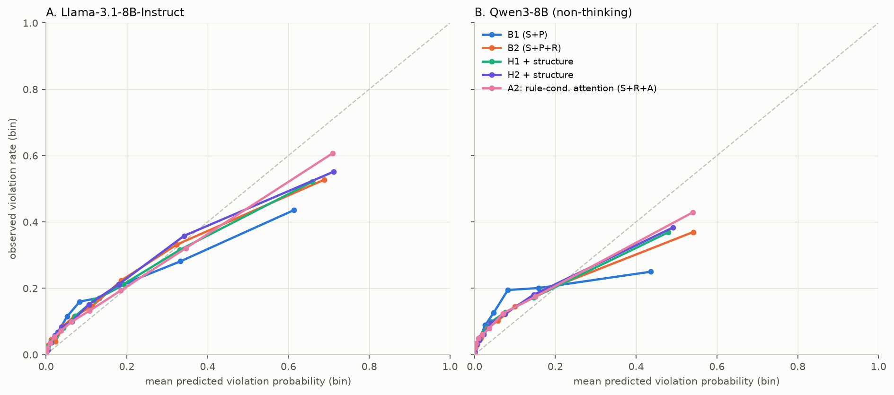
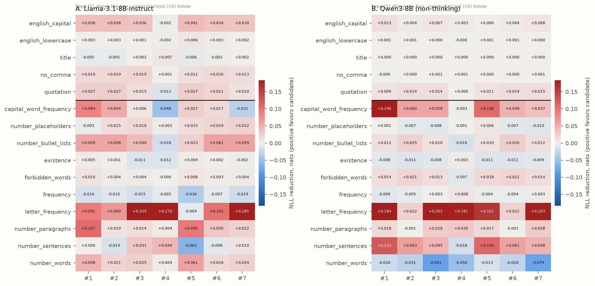
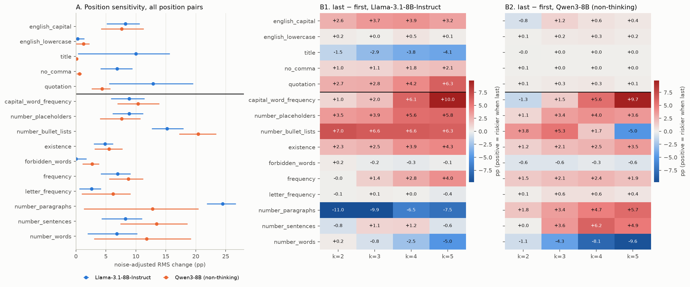
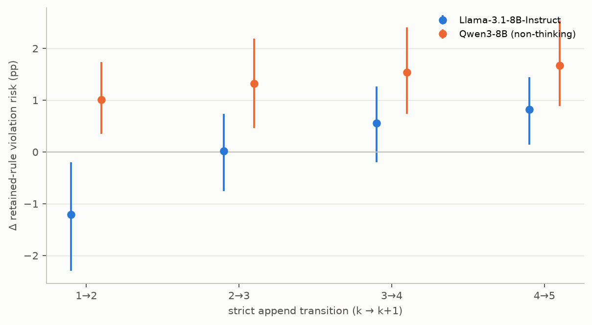
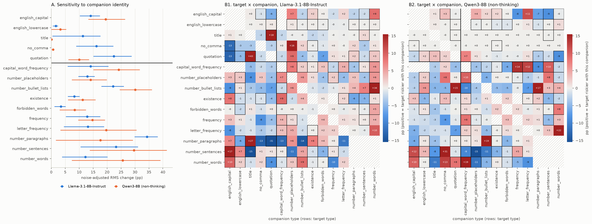
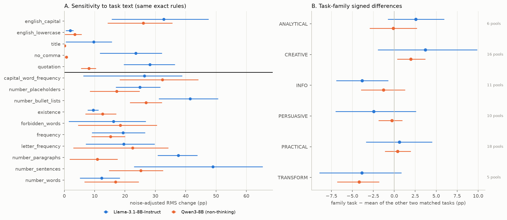
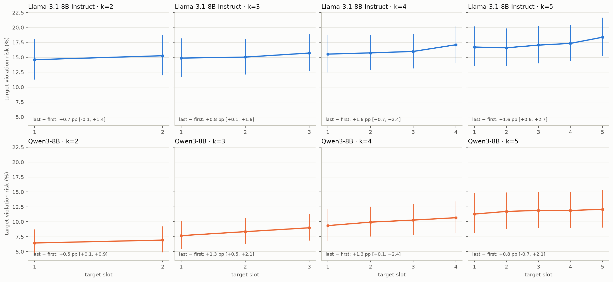
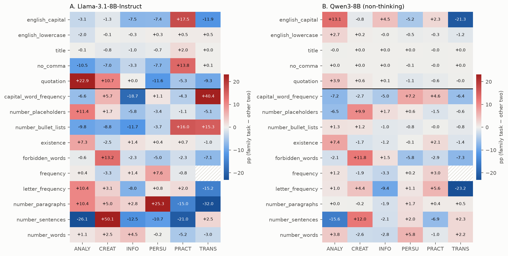

# ManyIFEval S3 TEST results — Objective 1 (rule-level violation risk)

Generated from `results/eval_s3/tables/*.csv` by `mife.eval_s3.report`. Every number below comes from a saved table.
Scope: **Objective 1 only** (Evaluation 1 and Evaluation 2), following the agreed layout of
`manyifeval_s3_complete_evaluation_analysis_and_reporting_plan.md` (revised reporting draft, 2026-11-23). Objective 2 is
not analysed here.

## 0. What was evaluated, and how

- **Design (S3 TEST):** 22 six-rule pools, 66 tasks, 456 ordered configurations per task, **30,096 prompts and 115,236
  prompt–rule rows per generator**, 20 verified responses per prompt (16,236 original prompts from run `main`, 13,860
  expansion prompts from run `expansion_s3_20261123`, vLLM on Betty, per-sample seeds; same decoding settings).
- **Predictors:** the frozen V2 refits on the 50 S3 TRAIN pools (`results/v2_s3/models/`), applied once to TEST. No
  model, layer, penalty, calibration edge or weight was chosen on TEST. Hidden row: Llama layer 12, Qwen layer 18.
- **Comparisons (positive always favours the candidate, right of the arrow):** primary #1 B1 → H1, #2 B2 → H2,
  #3 B2 → A2 (rule-conditioned attention, S+R+A), #4 H2 → A2; secondary #5 B1 → B1+H, #6 B2 → B2+H, #7 B2 → B2+A.
- **Uncertainty:** paired cluster bootstrap over the 22 TEST pools (B = 10,000, seed 20261203), percentile 95%
  intervals, pointwise and unadjusted for multiplicity. All predictors and contrasts use identical pool draws.
- **Evaluation 2 weighting:** the plan's *proposed* recipe (§§5.1, 6.3), which was not separately signed off before
  scoring: equal weight per pool, then per task, per matched context, per comparison; equal-k (or equal-transition)
  macro across strata. Δ-MSE is in pp² (squared percentage points); observed effects are in percentage points.
- **Noise-adjusted RMS** (position, companion and task Panel A): weighted mean of (d̂² − V̂) over matched comparisons,
  aggregated first, then √max(0, ·) once. Synthetic validation (Appendix V) shows the squared estimate is
  unbiased, intervals cover 92–100%, and RMS values under ~1.5 pp cannot be told apart from zero.
- **Disclosure:** 16 of the 22 S3 TEST pools were TRAIN pools under the 2026-11-14 split, so their original-prompt
  outcomes informed earlier V1/V2 development. The S3 refits themselves never saw them.
- **Authorization:** TEST unblinding for Objective 1 was approved by the project owner in the project thread on
  2026-11-24.

**Table 1. TEST inventory and controlled coverage (per generator; identical for Llama and Qwen).**

| Item | Count |
|---|---:|
| Pools / tasks / prompts / prompt–rule rows | 22 / 66 / 30,096 / 115,236 |
| Response × rule outcomes | 2,304,720 |
| Position: exact contexts / all-pair target contrasts (k = 2–5) | 11,880 / 57,420 |
| Strict append: prompt pairs / retained-rule contrasts | 25,740 / 69,300 |
| Companion replacement: prompt pairs / retained-target contrasts | 73,656 / 177,408 |
| Task context: task-prompt pairs / exact-rule contrasts | 30,096 / 115,236 |

All counts equal the plan's design counts exactly (Appendix QC). Every original and expansion prompt has 20 distinct
verified responses (expansion: Llama 277,200, Qwen 277,200; one settings hash per
model; 0.1% / 2.2% hit the token limit).

---

## 1. Evaluation 1, Objective 1: rule-level violation-risk prediction

**Table 2. Rule-level violation-risk prediction on S3 TEST.** Each method predicts the probability that an included
rule is violated in one generated response. Binomial NLL is scored against the 20 observed binary verification outcomes
per prompt–rule pair and pooled over the same 115,236 TEST rows per generator (unit: one response × rule outcome).
NLL reduction = NLL(comparator) − NLL(candidate); AUROC gain = AUROC(candidate) − AUROC(comparator); positive favours
the candidate. Types improved counts rule types with strictly positive per-type NLL reduction (descriptive, not 15
significance tests). Paired pointwise 95% CIs over the 22 TEST pools. Primary comparisons in bold.

**Panel A: Llama-3.1-8B-Instruct**

| Method comparison (comparator → candidate) | NLL reduction [95% CI] ↑ | AUROC gain [95% CI] ↑ | Types improved (of 15) ↑ |
|---|---:|---:|---:|
| **#1 B1 → H1 + structure** | **+0.0312 [-0.0105, +0.0708]** | +0.046 [+0.009, +0.077] | 12/15 |
| **#2 B2 → H2 + structure** | **+0.0209 [+0.0003, +0.0422]** | +0.016 [+0.003, +0.029] | 12/15 |
| **#3 B2 → A2 (rule-conditioned attention)** | **+0.0433 [+0.0134, +0.0774]** | +0.020 [+0.005, +0.035] | 13/15 |
| **#4 H2 → A2** | **+0.0224 [-0.0035, +0.0523]** | +0.003 [-0.015, +0.021] | 7/15 |
| #5 B1 → B1 + H | +0.0131 [-0.0327, +0.0562] | +0.047 [+0.011, +0.077] | 11/15 |
| #6 B2 → B2 + H | +0.0236 [+0.0075, +0.0416] | +0.019 [+0.010, +0.028] | 12/15 |
| #7 B2 → B2 + A | +0.0372 [+0.0174, +0.0596] | +0.021 [+0.012, +0.030] | 12/15 |

**Panel B: Qwen3-8B (non-thinking)**

| Method comparison (comparator → candidate) | NLL reduction [95% CI] ↑ | AUROC gain [95% CI] ↑ | Types improved (of 15) ↑ |
|---|---:|---:|---:|
| **#1 B1 → H1 + structure** | **+0.0351 [+0.0064, +0.0654]** | +0.048 [+0.025, +0.070] | 10/15 |
| **#2 B2 → H2 + structure** | **+0.0104 [-0.0059, +0.0284]** | +0.017 [+0.003, +0.033] | 9/15 |
| **#3 B2 → A2 (rule-conditioned attention)** | **+0.0242 [+0.0090, +0.0424]** | +0.031 [+0.018, +0.046] | 11/15 |
| **#4 H2 → A2** | **+0.0138 [+0.0018, +0.0263]** | +0.014 [+0.000, +0.027] | 7/15 |
| #5 B1 → B1 + H | +0.0286 [+0.0053, +0.0545] | +0.043 [+0.025, +0.061] | 11/15 |
| #6 B2 → B2 + H | +0.0099 [-0.0059, +0.0276] | +0.016 [+0.002, +0.032] | 9/15 |
| #7 B2 → B2 + A | +0.0236 [+0.0084, +0.0420] | +0.030 [+0.017, +0.046] | 11/15 |

### Appendix A1. Compact overall metrics

**Llama-3.1-8B-Instruct: raw pooled metrics** (unit: one response × included-rule outcome)

| Predictor | NLL [95% CI] | Brier [95% CI] | AUROC [95% CI] | ECE [95% CI] |
|---|---:|---:|---:|---:|
| B1 (S+P) | 0.4023 [0.3537, 0.4519] | 0.1245 [0.1072, 0.1416] | 0.766 [0.724, 0.807] | 0.0548 [0.0406, 0.0707] |
| B2 (S+P+R) | 0.3880 [0.3225, 0.4609] | 0.1164 [0.0957, 0.1378] | 0.813 [0.760, 0.861] | 0.0430 [0.0234, 0.0712] |
| H1 + structure | 0.3711 [0.3269, 0.4130] | 0.1123 [0.0978, 0.1262] | 0.812 [0.774, 0.847] | 0.0417 [0.0275, 0.0582] |
| H2 + structure | 0.3671 [0.3123, 0.4269] | 0.1097 [0.0933, 0.1268] | 0.830 [0.785, 0.869] | 0.0420 [0.0262, 0.0634] |
| A2: rule-cond. attention (S+R+A) | 0.3447 [0.2967, 0.3990] | 0.1031 [0.0878, 0.1198] | 0.833 [0.784, 0.875] | 0.0317 [0.0173, 0.0518] |
| B1 + H | 0.3892 [0.3406, 0.4340] | 0.1145 [0.0993, 0.1289] | 0.813 [0.776, 0.847] | 0.0558 [0.0405, 0.0727] |
| B2 + H | 0.3644 [0.3082, 0.4252] | 0.1083 [0.0911, 0.1260] | 0.832 [0.785, 0.875] | 0.0397 [0.0233, 0.0619] |
| B2 + A | 0.3508 [0.2976, 0.4113] | 0.1046 [0.0878, 0.1226] | 0.834 [0.783, 0.878] | 0.0349 [0.0201, 0.0585] |
| Structure only (ref.) | 0.4077 [0.3636, 0.4534] | 0.1266 [0.1107, 0.1424] | 0.747 [0.695, 0.794] | 0.0502 [0.0302, 0.0726] |

**Llama-3.1-8B-Instruct: all seven contrasts with raw scores**

| Comparison | NLL(comparator) | NLL(candidate) | NLL reduction | Brier reduction | AUROC gain |
|---|---:|---:|---:|---:|---:|
| **#1 B1 → H1 + structure** | 0.4023 | 0.3711 | +0.0312 [-0.0105, +0.0708] | +0.0122 [-0.0017, +0.0255] | +0.046 [+0.009, +0.077] |
| **#2 B2 → H2 + structure** | 0.3880 | 0.3671 | +0.0209 [+0.0003, +0.0422] | +0.0067 [-0.0007, +0.0139] | +0.016 [+0.003, +0.029] |
| **#3 B2 → A2 (rule-conditioned attention)** | 0.3880 | 0.3447 | +0.0433 [+0.0134, +0.0774] | +0.0132 [+0.0042, +0.0232] | +0.020 [+0.005, +0.035] |
| **#4 H2 → A2** | 0.3671 | 0.3447 | +0.0224 [-0.0035, +0.0523] | +0.0066 [-0.0007, +0.0146] | +0.003 [-0.015, +0.021] |
| #5 B1 → B1 + H | 0.4023 | 0.3892 | +0.0131 [-0.0327, +0.0562] | +0.0100 [-0.0042, +0.0239] | +0.047 [+0.011, +0.077] |
| #6 B2 → B2 + H | 0.3880 | 0.3644 | +0.0236 [+0.0075, +0.0416] | +0.0081 [+0.0023, +0.0141] | +0.019 [+0.010, +0.028] |
| #7 B2 → B2 + A | 0.3880 | 0.3508 | +0.0372 [+0.0174, +0.0596] | +0.0118 [+0.0055, +0.0188] | +0.021 [+0.012, +0.030] |

**Qwen3-8B (non-thinking): raw pooled metrics** (unit: one response × included-rule outcome)

| Predictor | NLL [95% CI] | Brier [95% CI] | AUROC [95% CI] | ECE [95% CI] |
|---|---:|---:|---:|---:|
| B1 (S+P) | 0.3310 [0.2702, 0.3961] | 0.0914 [0.0728, 0.1112] | 0.758 [0.692, 0.818] | 0.0621 [0.0405, 0.0862] |
| B2 (S+P+R) | 0.2986 [0.2361, 0.3730] | 0.0836 [0.0635, 0.1076] | 0.800 [0.727, 0.862] | 0.0439 [0.0200, 0.0776] |
| H1 + structure | 0.2959 [0.2407, 0.3579] | 0.0817 [0.0655, 0.0995] | 0.806 [0.741, 0.861] | 0.0402 [0.0233, 0.0613] |
| H2 + structure | 0.2882 [0.2327, 0.3521] | 0.0802 [0.0634, 0.0991] | 0.817 [0.752, 0.871] | 0.0387 [0.0208, 0.0614] |
| A2: rule-cond. attention (S+R+A) | 0.2744 [0.2170, 0.3413] | 0.0743 [0.0581, 0.0930] | 0.831 [0.763, 0.887] | 0.0382 [0.0202, 0.0611] |
| B1 + H | 0.3024 [0.2447, 0.3678] | 0.0833 [0.0664, 0.1021] | 0.801 [0.735, 0.858] | 0.0460 [0.0277, 0.0684] |
| B2 + H | 0.2887 [0.2329, 0.3529] | 0.0803 [0.0634, 0.0993] | 0.817 [0.751, 0.872] | 0.0391 [0.0211, 0.0621] |
| B2 + A | 0.2750 [0.2174, 0.3421] | 0.0744 [0.0581, 0.0931] | 0.830 [0.762, 0.886] | 0.0387 [0.0204, 0.0619] |
| Structure only (ref.) | 0.3197 [0.2642, 0.3812] | 0.0886 [0.0722, 0.1066] | 0.761 [0.691, 0.824] | 0.0500 [0.0296, 0.0765] |

**Qwen3-8B (non-thinking): all seven contrasts with raw scores**

| Comparison | NLL(comparator) | NLL(candidate) | NLL reduction | Brier reduction | AUROC gain |
|---|---:|---:|---:|---:|---:|
| **#1 B1 → H1 + structure** | 0.3310 | 0.2959 | +0.0351 [+0.0064, +0.0654] | +0.0098 [-0.0002, +0.0204] | +0.048 [+0.025, +0.070] |
| **#2 B2 → H2 + structure** | 0.2986 | 0.2882 | +0.0104 [-0.0059, +0.0284] | +0.0034 [-0.0030, +0.0109] | +0.017 [+0.003, +0.033] |
| **#3 B2 → A2 (rule-conditioned attention)** | 0.2986 | 0.2744 | +0.0242 [+0.0090, +0.0424] | +0.0093 [+0.0025, +0.0171] | +0.031 [+0.018, +0.046] |
| **#4 H2 → A2** | 0.2882 | 0.2744 | +0.0138 [+0.0018, +0.0263] | +0.0059 [+0.0021, +0.0099] | +0.014 [+0.000, +0.027] |
| #5 B1 → B1 + H | 0.3310 | 0.3024 | +0.0286 [+0.0053, +0.0545] | +0.0081 [-0.0003, +0.0174] | +0.043 [+0.025, +0.061] |
| #6 B2 → B2 + H | 0.2986 | 0.2887 | +0.0099 [-0.0059, +0.0276] | +0.0033 [-0.0031, +0.0108] | +0.016 [+0.002, +0.032] |
| #7 B2 → B2 + A | 0.2986 | 0.2750 | +0.0236 [+0.0084, +0.0420] | +0.0093 [+0.0025, +0.0170] | +0.030 [+0.017, +0.046] |

### Appendix A2. Calibration (reliability curves)

Bins are the deciles of each predictor's S3 TRAIN out-of-fold predictions (fixed before TEST); unit = response × rule
outcome. Numerical ECE for every predictor is in A1.

### Appendix A3. Per-rule-type NLL reduction (15 types × 7 comparisons)

Cells show NLL(comparator) − NLL(candidate) in nats on that type's TEST outcomes; positive (red) favours the candidate.
The five fixed types are above the line, the ten parameterized types below. Per-cell CIs, support and NLLs are in
`tables/eval1_per_type.csv` (210 rows).

### Appendix A3b. Fixed vs parameterized rule types (secondary, exploratory)

*NLL reductions of the same seven predictor comparisons, calculated separately on rule-level outcomes from the five fixed
and ten parameterized ManyIFEval rule types. Positive improvement favours the candidate (right of the arrow). The
fixed-minus-parameterized column compares improvements between subgroups, not raw violation rates. Intervals are paired
pointwise 95% confidence intervals from resampling the 22 TEST rule pools; all seven subgroup differences are
exploratory.*

**Panel A: Llama-3.1-8B-Instruct.** Observed violation rate: fixed 8.2% (803,160 response×rule outcomes, 22 pools); parameterized 20.6% (1,501,560 outcomes, 22 pools).

| Comparator → candidate | Fixed (5 types): ΔNLL [95% CI] ↑ | Parameterized (10 types): ΔNLL [95% CI] ↑ | Fixed − parameterized improvement [95% CI] | Type-equal-weight sensitivity (fixed / param.) |
|---|---:|---:|---:|---:|
| **#1 B1 → H1 + structure** | +0.0162 [+0.0044, +0.0315] | +0.0393 [-0.0240, +0.0996] | -0.0232 [-0.0850, +0.0403] | +0.0163 / +0.0385 |
| **#2 B2 → H2 + structure** | +0.0162 [+0.0044, +0.0315] | +0.0234 [-0.0094, +0.0581] | -0.0073 [-0.0473, +0.0313] | +0.0163 / +0.0207 |
| **#3 B2 → A2 (rule-conditioned attention)** | +0.0147 [+0.0042, +0.0275] | +0.0586 [+0.0133, +0.1115] | -0.0439 [-0.0979, +0.0034] | +0.0146 / +0.0449 |
| **#4 H2 → A2** | -0.0015 [-0.0073, +0.0048] | +0.0351 [-0.0042, +0.0816] | -0.0366 [-0.0839, +0.0033] | -0.0017 / +0.0242 |
| #5 B1 → B1 + H | +0.0151 [-0.0005, +0.0348] | +0.0120 [-0.0581, +0.0770] | +0.0031 [-0.0647, +0.0753] | +0.0159 / +0.0131 |
| #6 B2 → B2 + H | +0.0142 [+0.0044, +0.0268] | +0.0286 [+0.0027, +0.0580] | -0.0144 [-0.0480, +0.0175] | +0.0144 / +0.0236 |
| #7 B2 → B2 + A | +0.0120 [+0.0040, +0.0216] | +0.0507 [+0.0202, +0.0858] | -0.0388 [-0.0762, -0.0055] | +0.0122 / +0.0372 |

**Panel B: Qwen3-8B (non-thinking).** Observed violation rate: fixed 3.1% (803,160 response×rule outcomes, 22 pools); parameterized 13.9% (1,501,560 outcomes, 22 pools).

| Comparator → candidate | Fixed (5 types): ΔNLL [95% CI] ↑ | Parameterized (10 types): ΔNLL [95% CI] ↑ | Fixed − parameterized improvement [95% CI] | Type-equal-weight sensitivity (fixed / param.) |
|---|---:|---:|---:|---:|
| **#1 B1 → H1 + structure** | +0.0042 [-0.0013, +0.0108] | +0.0517 [+0.0073, +0.0982] | -0.0474 [-0.0949, -0.0026] | +0.0045 / +0.0512 |
| **#2 B2 → H2 + structure** | +0.0038 [-0.0022, +0.0106] | +0.0139 [-0.0114, +0.0418] | -0.0101 [-0.0395, +0.0171] | +0.0038 / +0.0136 |
| **#3 B2 → A2 (rule-conditioned attention)** | +0.0046 [-0.0002, +0.0098] | +0.0346 [+0.0118, +0.0632] | -0.0300 [-0.0589, -0.0067] | +0.0045 / +0.0263 |
| **#4 H2 → A2** | +0.0008 [-0.0029, +0.0046] | +0.0207 [+0.0022, +0.0411] | -0.0200 [-0.0411, -0.0006] | +0.0008 / +0.0126 |
| #5 B1 → B1 + H | +0.0026 [-0.0013, +0.0069] | +0.0426 [+0.0062, +0.0831] | -0.0400 [-0.0810, -0.0023] | +0.0024 / +0.0401 |
| #6 B2 → B2 + H | +0.0039 [-0.0020, +0.0106] | +0.0132 [-0.0115, +0.0411] | -0.0093 [-0.0386, +0.0177] | +0.0038 / +0.0126 |
| #7 B2 → B2 + A | +0.0048 [+0.0003, +0.0101] | +0.0337 [+0.0107, +0.0632] | -0.0288 [-0.0587, -0.0048] | +0.0048 / +0.0248 |

### Appendix A4. Technical uncertainty and QC

- llama: 115,236 prompt–rule rows, 2,304,720 response×rule outcomes (374,220 violations), 30,096 prompts, 22 pools, 66 tasks; rows clipped at 1e-6: 28.
- qwen: 115,236 prompt–rule rows, 2,304,720 response×rule outcomes (234,085 violations), 30,096 prompts, 22 pools, 66 tasks; rows clipped at 1e-6: 1547.
- Probabilities clipped to [1e-6, 1 − 1e-6] before the log. Paired cluster bootstrap over the 22 TEST pools, B = 10,000, seed 20261203, percentile intervals (pointwise, unadjusted). No sparse-type fallback head fired in the S3 refits (every type has its own ridge-logistic head).
- Rule types with fewer than 8 contributing TEST pools (per-type estimates less stable): llama/english_lowercase (6 pools), llama/capital_word_frequency (6 pools), llama/existence (7 pools), llama/number_sentences (7 pools), llama/number_words (6 pools), qwen/english_lowercase (6 pools), qwen/capital_word_frequency (6 pools), qwen/existence (7 pools), qwen/number_sentences (7 pools), qwen/number_words (6 pools).

Sensitivity of the Table 2 NLL reductions to the interval method:

| Generator | Comparison | NLL reduction | bootstrap 95% CI | t(21) jackknife CI | leave-one-pool-out range |
|---|---:|---:|---:|---:|---:|
| llama | #1 | +0.0312 | [-0.0105, +0.0708] | [-0.0124, +0.0749] | [+0.0237, +0.0433] |
| llama | #2 | +0.0209 | [+0.0003, +0.0422] | [-0.0015, +0.0432] | [+0.0154, +0.0275] |
| llama | #3 | +0.0433 | [+0.0134, +0.0774] | [+0.0085, +0.0781] | [+0.0333, +0.0471] |
| llama | #4 | +0.0224 | [-0.0035, +0.0523] | [-0.0078, +0.0526] | [+0.0118, +0.0259] |
| llama | #5 | +0.0131 | [-0.0327, +0.0562] | [-0.0346, +0.0608] | [+0.0056, +0.0265] |
| llama | #6 | +0.0236 | [+0.0075, +0.0416] | [+0.0052, +0.0419] | [+0.0177, +0.0278] |
| llama | #7 | +0.0372 | [+0.0174, +0.0596] | [+0.0141, +0.0603] | [+0.0309, +0.0398] |
| qwen | #1 | +0.0351 | [+0.0064, +0.0654] | [+0.0036, +0.0667] | [+0.0267, +0.0413] |
| qwen | #2 | +0.0104 | [-0.0059, +0.0284] | [-0.0079, +0.0287] | [+0.0058, +0.0147] |
| qwen | #3 | +0.0242 | [+0.0090, +0.0424] | [+0.0063, +0.0420] | [+0.0187, +0.0271] |
| qwen | #4 | +0.0138 | [+0.0018, +0.0263] | [+0.0004, +0.0272] | [+0.0108, +0.0167] |
| qwen | #5 | +0.0286 | [+0.0053, +0.0545] | [+0.0020, +0.0553] | [+0.0204, +0.0332] |
| qwen | #6 | +0.0099 | [-0.0059, +0.0276] | [-0.0081, +0.0279] | [+0.0054, +0.0139] |
| qwen | #7 | +0.0236 | [+0.0084, +0.0420] | [+0.0055, +0.0418] | [+0.0179, +0.0264] |

---

## 2. Evaluation 2, Objective 1: matched prompt changes

### 2.1 Position (Figure E2-Pos)

**Figure E2-Pos. Target-type heterogeneity in observed rule-position effects.** All comparisons hold the exact target
rule, task, included companions and k fixed; target-position risks are COA-balanced averages over the k−1 orderings
that place the target in each slot. **(A)** Noise-adjusted RMS change over all position pairs for each of the 15 target
types (equal-k macro, k = 2–5; 95% pool-cluster intervals). **(B)** Signed last − first risk change (pp) by target type
and k; positive = higher violation risk when last; hatched = unsupported. Moving a target also changes the placement of
other rules and the distance to the prompt end, so this is not a pure recency effect.

### 2.2 Strict append (Figure E2-Append)

**Figure E2-Append.** Mean observed change in the violation probability of the already-included (retained) rules
when exactly one rule is appended at the end (strict prefix matches; the added rule itself is not evaluated).
Retained targets are averaged within each prompt pair, then pairs → tasks → pools. 95% pool-cluster CIs. Only part of the
4- and 5-rule COA orders have an included exact prefix (3→4 and 4→5 coverage is partial by design).

| Transition | Llama-3.1-8B-Instruct Δ risk pp [95% CI] | Qwen3-8B Δ risk pp [95% CI] | prompt pairs / retained targets / pools |
|---|---:|---:|---:|
| 1→2 | -1.21 [-2.30, -0.20] | +1.01 [+0.35, +1.73] | 1,980 / 1,980 / 22 |
| 2→3 | +0.02 [-0.75, +0.73] | +1.32 [+0.46, +2.19] | 7,920 / 15,840 / 22 |
| 3→4 | +0.55 [-0.20, +1.26] | +1.53 [+0.74, +2.41] | 11,880 / 35,640 / 22 |
| 4→5 | +0.82 [+0.14, +1.44] | +1.67 [+0.88, +2.54] | 3,960 / 15,840 / 22 |

### 2.3 Companion replacement (Figure E2-Companion)

**Figure E2-Companion.** Strict one-companion replacement with the exact target, its slot, k, task and every other rule
fixed; earlier and later companions are pooled. **(A)** Noise-adjusted RMS change of the target's risk across companion
substitutions, by target type (equal-k macro; 95% pool-cluster CIs). **(B)** Directed signed effects: risk of the target
(row) with the named companion type (column) minus the mean over the other companions available in the same fixed
context (pp). Hatched = no valid strict match (including the diagonal); black outline = fewer than 3 supporting pools.
Not symmetric by construction; exploratory across 210 directed cells, pointwise only.

### 2.4 Task context (Figure E2-Task)

**Figure E2-Task.** The same exact ordered rules under the group's three different tasks (three different
researcher-defined task families). **(A)** Noise-adjusted RMS task-change sensitivity by target type (k = 1–5, equal-k
macro; 95% pool-cluster CIs). **(B)** Risk under the family-F task minus the mean of the other two matched tasks in the
same pool, pooled over targets, configurations and k; pool counts shown at right. The reference differs by pool, and a
family label is confounded with the whole task text, so these are associations, not causal family effects.

| Family | Llama-3.1-8B-Instruct pp [95% CI] | Qwen3-8B pp [95% CI] | pools |
|---|---:|---:|---:|
| ANALYTICAL | +2.58 [-0.76, +5.96] | -0.11 [-2.94, +2.70] | 6 |
| CREATIVE | +3.70 [-1.97, +9.91] | +1.96 [+0.34, +3.72] | 16 |
| INFO | -3.84 [-6.93, -0.70] | -1.29 [-3.97, +1.31] | 11 |
| PERSUASIVE | -2.44 [-7.01, +2.58] | -0.28 [-1.90, +0.96] | 10 |
| PRACTICAL | +0.62 [-3.37, +4.52] | +0.40 [-1.13, +1.97] | 18 |
| TRANSFORM | -3.85 [-8.93, +0.85] | -4.19 [-6.82, -1.81] | 5 |

### 2.5 Table 4: predicting matched changes (shared across factors)

**Table 4. Evaluation 2, Objective 1 predictor skill.** Δ-MSE = weighted mean of (predicted change − observed change)²
over the same matched comparisons for both methods; entries are Δ-MSE(comparator) − Δ-MSE(candidate) in pp²
(positive favours the candidate). Position: 57,420 all-pair contrasts, equal-k macro; strict append: 69,300 retained-rule
contrasts, equal-transition macro; companion: 177,408 retained-target contrasts, equal-k macro; task: 115,236 exact-rule
task-pair contrasts, equal-k macro (k = 1–5). Paired 95% pool-cluster CIs.

**Panel A: Llama-3.1-8B-Instruct**

| V2 comparison | Position: Δ-MSE reduction [95% CI] ↑ | Strict append: Δ-MSE reduction [95% CI] ↑ | Companion replacement: Δ-MSE reduction [95% CI] ↑ | Task context: Δ-MSE reduction [95% CI] ↑ |
|---|---:|---:|---:|---:|
| **#1 B1 → H1 + structure** | -0.46 [-4.56, +3.71] | -7.07 [-18.63, +3.12] | -10.42 [-32.86, +11.71] | +94.14 [-52.49, +216.78] |
| **#2 B2 → H2 + structure** | +5.24 [+1.89, +8.78] | +1.68 [-5.45, +8.49] | +3.70 [-10.68, +17.93] | +1.16 [-134.57, +119.10] |
| **#3 B2 → A2 (rule-conditioned attention)** | -40.35 [-58.45, -22.61] | -22.83 [-35.18, -9.73] | -30.46 [-47.59, -13.69] | +25.03 [-54.20, +111.09] |
| **#4 H2 → A2** | -45.58 [-65.23, -26.77] | -24.51 [-36.86, -11.67] | -34.16 [-52.18, -15.64] | +23.87 [-73.91, +139.44] |
| #5 B1 → B1 + H | -1.53 [-7.76, +4.94] | -5.66 [-17.58, +6.62] | -6.83 [-27.82, +17.07] | -7.90 [-169.79, +130.94] |
| #6 B2 → B2 + H | +7.34 [+3.94, +11.11] | +6.05 [-1.90, +13.62] | +14.09 [+1.17, +26.80] | +20.48 [-73.37, +110.53] |
| #7 B2 → B2 + A | -18.25 [-32.44, -4.57] | -2.41 [-11.88, +7.89] | +0.09 [-11.52, +12.48] | +46.34 [-19.35, +120.05] |

**Panel B: Qwen3-8B (non-thinking)**

| V2 comparison | Position: Δ-MSE reduction [95% CI] ↑ | Strict append: Δ-MSE reduction [95% CI] ↑ | Companion replacement: Δ-MSE reduction [95% CI] ↑ | Task context: Δ-MSE reduction [95% CI] ↑ |
|---|---:|---:|---:|---:|
| **#1 B1 → H1 + structure** | -6.43 [-11.59, -1.56] | -5.57 [-14.25, +2.91] | -15.48 [-41.08, +9.34] | -9.70 [-96.66, +65.68] |
| **#2 B2 → H2 + structure** | -4.45 [-8.64, -0.36] | -5.21 [-11.65, +1.42] | -9.44 [-27.44, +9.79] | -83.68 [-153.43, -21.87] |
| **#3 B2 → A2 (rule-conditioned attention)** | -24.49 [-38.95, -11.58] | -18.83 [-32.53, -6.44] | -6.81 [-26.47, +11.40] | -51.32 [-113.97, +4.72] |
| **#4 H2 → A2** | -20.05 [-31.84, -9.86] | -13.63 [-24.83, -2.24] | +2.62 [-20.83, +28.05] | +32.36 [-30.07, +107.22] |
| #5 B1 → B1 + H | -4.01 [-8.01, +0.04] | -2.17 [-8.96, +4.44] | -7.99 [-28.68, +12.05] | -21.85 [-83.61, +34.98] |
| #6 B2 → B2 + H | -4.18 [-8.28, -0.23] | -4.35 [-10.55, +2.00] | -8.05 [-25.67, +10.41] | -84.05 [-151.37, -24.67] |
| #7 B2 → B2 + A | -22.54 [-36.38, -10.17] | -16.55 [-29.57, -4.78] | -3.89 [-23.41, +14.23] | -48.58 [-110.18, +5.83] |

---

## Appendix Pos-A. Position profiles and all 20 pair strata

Observed target violation risk at every slot (COA-balanced, 95% pool CIs) with the paired last − first difference.

| k | slot i → j | Llama-3.1-8B-Instruct effect pp [95% CI] | Qwen3-8B effect pp [95% CI] | contexts / pools |
|---|---:|---:|---:|---:|
| 2 | 1 → 2 | +0.66 [-0.13, +1.43] | +0.48 [+0.06, +0.92] | 1,980 / 22 |
| 3 | 1 → 2 | +0.17 [-0.40, +0.73] | +0.67 [+0.07, +1.28] | 3,960 / 22 |
| 3 | 1 → 3 | +0.85 [+0.07, +1.61] | +1.31 [+0.53, +2.12] | 3,960 / 22 |
| 3 | 2 → 3 | +0.68 [+0.33, +1.02] | +0.65 [+0.25, +1.11] | 3,960 / 22 |
| 4 | 1 → 2 | +0.21 [-0.41, +0.84] | +0.58 [-0.16, +1.35] | 3,960 / 22 |
| 4 | 1 → 3 | +0.44 [-0.34, +1.25] | +0.93 [-0.12, +1.91] | 3,960 / 22 |
| 4 | 1 → 4 | +1.57 [+0.70, +2.43] | +1.32 [+0.14, +2.41] | 3,960 / 22 |
| 4 | 2 → 3 | +0.24 [-0.03, +0.51] | +0.35 [-0.06, +0.74] | 3,960 / 22 |
| 4 | 2 → 4 | +1.36 [+0.77, +1.95] | +0.74 [+0.10, +1.40] | 3,960 / 22 |
| 4 | 3 → 4 | +1.12 [+0.52, +1.70] | +0.40 [+0.04, +0.77] | 3,960 / 22 |
| 5 | 1 → 2 | -0.13 [-0.75, +0.51] | +0.44 [-0.48, +1.33] | 1,980 / 22 |
| 5 | 1 → 3 | +0.32 [-0.40, +1.05] | +0.61 [-0.50, +1.62] | 1,980 / 22 |
| 5 | 1 → 4 | +0.61 [-0.23, +1.47] | +0.60 [-0.74, +1.77] | 1,980 / 22 |
| 5 | 1 → 5 | +1.64 [+0.59, +2.67] | +0.80 [-0.72, +2.10] | 1,980 / 22 |
| 5 | 2 → 3 | +0.45 [+0.19, +0.69] | +0.17 [-0.19, +0.48] | 1,980 / 22 |
| 5 | 2 → 4 | +0.74 [+0.22, +1.28] | +0.16 [-0.45, +0.65] | 1,980 / 22 |
| 5 | 2 → 5 | +1.77 [+0.79, +2.83] | +0.36 [-0.51, +1.18] | 1,980 / 22 |
| 5 | 3 → 4 | +0.29 [-0.08, +0.68] | -0.01 [-0.31, +0.26] | 1,980 / 22 |
| 5 | 3 → 5 | +1.32 [+0.33, +2.33] | +0.19 [-0.38, +0.78] | 1,980 / 22 |
| 5 | 4 → 5 | +1.03 [+0.23, +1.88] | +0.20 [-0.28, +0.77] | 1,980 / 22 |

## Appendix Pos-B. Predicting position changes by k

**Llama-3.1-8B-Instruct: Δ-MSE reduction (pp²) [95% CI]**

| Comparison | k=2 | k=3 | k=4 | k=5 | Macro (Table 4) |
|---|---:|---:|---:|---:|---:|
| **#1 B1 → H1 + structure** | +1.69 [-8.29, +11.96] | +0.88 [-4.62, +5.95] | -2.57 [-5.53, +0.30] | -1.83 [-5.37, +1.24] | -0.46 [-4.56, +3.71] |
| **#2 B2 → H2 + structure** | +11.28 [+3.85, +19.68] | +5.45 [+1.13, +9.89] | +2.03 [-0.85, +5.07] | +2.19 [-0.74, +5.40] | +5.24 [+1.89, +8.78] |
| **#3 B2 → A2 (rule-conditioned attention)** | -75.75 [-112.18, -42.76] | -41.12 [-61.51, -20.02] | -28.47 [-41.35, -14.92] | -16.06 [-27.98, -3.35] | -40.35 [-58.45, -22.61] |
| **#4 H2 → A2** | -87.03 [-127.64, -50.76] | -46.57 [-68.21, -24.81] | -30.50 [-43.19, -17.51] | -18.24 [-29.92, -6.04] | -45.58 [-65.23, -26.77] |
| #5 B1 → B1 + H | -4.92 [-19.27, +9.30] | -2.91 [-11.20, +5.32] | -1.30 [-6.55, +3.94] | +3.01 [-3.59, +9.69] | -1.53 [-7.76, +4.94] |
| #6 B2 → B2 + H | +15.15 [+6.99, +24.73] | +7.43 [+3.37, +11.68] | +3.49 [+1.28, +5.84] | +3.28 [+0.46, +6.34] | +7.34 [+3.94, +11.11] |
| #7 B2 → B2 + A | -45.04 [-77.31, -17.11] | -19.05 [-35.70, -2.20] | -10.16 [-19.53, -0.19] | +1.26 [-8.40, +12.46] | -18.25 [-32.44, -4.57] |

| Comparison | Δ-MAE reduction, macro (pp) [95% CI] |
|---|---:|
| #1 B1 → H1 + structure | -0.206 [-0.351, -0.073] |
| #2 B2 → H2 + structure | -0.030 [-0.092, +0.032] |
| #3 B2 → A2 (rule-conditioned attention) | -1.462 [-1.825, -1.108] |
| #4 H2 → A2 | -1.432 [-1.799, -1.071] |
| #5 B1 → B1 + H | -0.300 [-0.495, -0.136] |
| #6 B2 → B2 + H | +0.024 [-0.047, +0.096] |
| #7 B2 → B2 + A | -0.810 [-1.060, -0.572] |

Raw Δ-MSE (pp²) of each predictor and of the zero-change reference (Llama-3.1-8B-Instruct):

| Change predictor | k=2 | k=3 | k=4 | k=5 | Macro |
|---|---:|---:|---:|---:|---:|
| zero change (d=0) | 186.5 | 127.4 | 111.3 | 107.7 | 133.2 |
| B1 (S+P) | 181.1 | 122.8 | 106.9 | 106.2 | 129.2 |
| B2 (S+P+R) | 179.6 | 121.8 | 106.5 | 106.3 | 128.6 |
| H1 + structure | 179.4 | 121.9 | 109.4 | 108.1 | 129.7 |
| H2 + structure | 168.3 | 116.4 | 104.5 | 104.1 | 123.3 |
| A2: rule-cond. attention (S+R+A) | 255.3 | 163.0 | 135.0 | 122.3 | 168.9 |
| B1 + H | 186.0 | 125.7 | 108.2 | 103.2 | 130.8 |
| B2 + H | 164.4 | 114.4 | 103.0 | 103.0 | 121.2 |
| B2 + A | 224.6 | 140.9 | 116.7 | 105.0 | 146.8 |

**Qwen3-8B (non-thinking): Δ-MSE reduction (pp²) [95% CI]**

| Comparison | k=2 | k=3 | k=4 | k=5 | Macro (Table 4) |
|---|---:|---:|---:|---:|---:|
| **#1 B1 → H1 + structure** | -17.68 [-28.18, -7.67] | -5.85 [-11.26, -0.74] | -2.50 [-6.02, +0.91] | +0.32 [-2.86, +3.71] | -6.43 [-11.59, -1.56] |
| **#2 B2 → H2 + structure** | -13.17 [-21.30, -5.43] | -2.98 [-7.26, +1.34] | -1.72 [-5.16, +1.54] | +0.08 [-2.83, +3.22] | -4.45 [-8.64, -0.36] |
| **#3 B2 → A2 (rule-conditioned attention)** | -36.90 [-58.90, -18.00] | -24.47 [-41.54, -9.28] | -21.67 [-36.49, -9.26] | -14.93 [-28.17, -3.84] | -24.49 [-38.95, -11.58] |
| **#4 H2 → A2** | -23.73 [-42.85, -7.24] | -21.49 [-35.54, -9.01] | -19.95 [-32.70, -9.35] | -15.02 [-27.06, -5.11] | -20.05 [-31.84, -9.86] |
| #5 B1 → B1 + H | -13.07 [-21.69, -4.48] | -3.45 [-7.52, +0.53] | -0.97 [-3.66, +1.73] | +1.43 [-1.23, +4.38] | -4.01 [-8.01, +0.04] |
| #6 B2 → B2 + H | -12.52 [-20.50, -4.93] | -2.74 [-6.84, +1.43] | -1.60 [-4.95, +1.56] | +0.14 [-2.72, +3.23] | -4.18 [-8.28, -0.23] |
| #7 B2 → B2 + A | -34.55 [-55.79, -16.37] | -22.14 [-38.42, -7.64] | -19.81 [-33.77, -8.07] | -13.67 [-26.39, -2.99] | -22.54 [-36.38, -10.17] |

| Comparison | Δ-MAE reduction, macro (pp) [95% CI] |
|---|---:|
| #1 B1 → H1 + structure | -0.401 [-0.578, -0.231] |
| #2 B2 → H2 + structure | -0.397 [-0.531, -0.266] |
| #3 B2 → A2 (rule-conditioned attention) | -1.122 [-1.513, -0.783] |
| #4 H2 → A2 | -0.725 [-1.031, -0.467] |
| #5 B1 → B1 + H | -0.316 [-0.449, -0.187] |
| #6 B2 → B2 + H | -0.386 [-0.515, -0.259] |
| #7 B2 → B2 + A | -1.071 [-1.453, -0.741] |

Raw Δ-MSE (pp²) of each predictor and of the zero-change reference (Qwen3-8B (non-thinking)):

| Change predictor | k=2 | k=3 | k=4 | k=5 | Macro |
|---|---:|---:|---:|---:|---:|
| zero change (d=0) | 111.2 | 105.6 | 98.2 | 83.4 | 99.6 |
| B1 (S+P) | 111.2 | 104.5 | 96.4 | 81.4 | 98.4 |
| B2 (S+P+R) | 109.7 | 102.8 | 94.0 | 78.4 | 96.2 |
| H1 + structure | 128.9 | 110.3 | 98.9 | 81.1 | 104.8 |
| H2 + structure | 122.9 | 105.8 | 95.7 | 78.3 | 100.7 |
| A2: rule-cond. attention (S+R+A) | 146.6 | 127.3 | 115.6 | 93.3 | 120.7 |
| B1 + H | 124.3 | 107.9 | 97.4 | 80.0 | 102.4 |
| B2 + H | 122.2 | 105.5 | 95.6 | 78.2 | 100.4 |
| B2 + A | 144.3 | 124.9 | 113.8 | 92.0 | 118.7 |

## Appendix Pos-C. Numerical type-level position effects

Noise-adjusted RMS sensitivity (Panel A), corrected squared component and estimated sampling-noise floor (pp²), mean
baseline risk of the compared cells, and supporting pools:

| Target type | Llama RMS pp [95% CI] | Llama corrected sq. / noise floor (pp²) | Llama base risk | Llama pools | Qwen RMS pp [95% CI] | Qwen corrected sq. / noise floor (pp²) | Qwen base risk | Qwen pools |
|---|---:|---:|---:|---:|---:|---:|---:|---:|
| english_capital (fixed) | 8.2 [5.1, 10.6] | 68.0 / 46.3 | 15% | 8 | 7.6 [4.2, 11.3] | 58.5 / 38.3 | 14% | 8 |
| english_lowercase (fixed) | 0.3 [0.0, 1.4] | 0.1 / 3.0 | 1% | 6 | 1.3 [0.0, 2.3] | 1.6 / 1.4 | 1% | 6 |
| title (fixed) | 10.0 [0.3, 15.7] | 100.5 / 2.5 | 2% | 11 | 0.1 [0.0, 0.1] | 0.0 / 0.0 | 0% | 11 |
| no_comma (fixed) | 6.9 [4.1, 9.4] | 47.0 / 19.9 | 7% | 11 | 0.6 [0.1, 0.9] | 0.3 / 0.2 | 0% | 11 |
| quotation (fixed) | 12.9 [5.5, 19.5] | 165.4 / 36.9 | 15% | 10 | 4.4 [2.6, 5.8] | 19.2 / 6.8 | 3% | 10 |
| capital_word_frequency | 8.9 [5.8, 11.4] | 79.1 / 19.5 | 10% | 6 | 10.4 [6.9, 13.9] | 107.9 / 33.1 | 20% | 6 |
| number_placeholders | 8.9 [6.1, 11.2] | 79.4 / 48.3 | 19% | 10 | 7.6 [4.0, 10.8] | 58.2 / 19.0 | 9% | 10 |
| number_bullet_lists | 15.2 [12.7, 18.0] | 231.4 / 43.8 | 25% | 11 | 20.4 [17.2, 23.4] | 416.1 / 17.2 | 14% | 11 |
| existence | 4.8 [3.0, 6.2] | 23.5 / 28.1 | 8% | 7 | 5.5 [3.1, 7.8] | 30.6 / 15.5 | 5% | 7 |
| forbidden_words | 0.0 [0.0, 1.8] | -0.3 / 10.0 | 4% | 11 | 2.7 [1.1, 3.9] | 7.3 / 15.7 | 5% | 11 |
| frequency | 7.0 [4.1, 9.1] | 48.4 / 36.1 | 12% | 8 | 8.8 [5.5, 11.2] | 76.9 / 24.0 | 7% | 8 |
| letter_frequency | 2.6 [0.6, 4.2] | 6.7 / 18.0 | 34% | 12 | 6.2 [1.0, 9.1] | 38.7 / 12.9 | 33% | 12 |
| number_paragraphs | 24.5 [21.9, 26.7] | 600.0 / 70.4 | 52% | 8 | 12.8 [1.3, 20.5] | 163.1 / 4.5 | 5% | 8 |
| number_sentences | 8.3 [4.3, 11.0] | 68.4 / 32.3 | 27% | 7 | 13.4 [7.4, 18.6] | 180.8 / 19.0 | 21% | 7 |
| number_words | 6.8 [1.9, 10.2] | 46.9 / 13.0 | 6% | 6 | 11.8 [3.0, 19.2] | 139.0 / 21.3 | 17% | 6 |

Signed last − first effect (pp) [95% CI] (supporting pools), by target type and k (Panel B numbers):

| Target type | L k=2 | L k=3 | L k=4 | L k=5 | Q k=2 | Q k=3 | Q k=4 | Q k=5 |
|---|---:|---:|---:|---:|---:|---:|---:|---:|
| english_capital (fixed) | +2.6 [-0.9, +6.5] (8) | +3.7 [+2.0, +5.3] (8) | +3.9 [+2.2, +5.9] (8) | +3.2 [+1.3, +4.8] (8) | -0.8 [-3.1, +2.3] (8) | +1.2 [-1.0, +4.4] (8) | +0.6 [-1.6, +4.0] (8) | +0.4 [-2.4, +4.2] (8) |
| english_lowercase (fixed) | +0.2 [+0.1, +0.3] (6) | +0.0 [-0.2, +0.3] (6) | +0.5 [+0.2, +0.8] (6) | +0.1 [-0.3, +0.6] (6) | +0.1 [+0.0, +0.2] (6) | +0.2 [-0.2, +0.9] (6) | +0.3 [-0.0, +0.9] (6) | +0.2 [+0.0, +0.4] (6) |
| title (fixed) | -1.5 [-3.7, +0.0] (11) | -2.9 [-7.5, +0.0] (11) | -3.8 [-9.3, +0.1] (11) | -4.1 [-10.3, +0.2] (11) | -0.0 [-0.1, +0.0] (11) | +0.0 [+0.0, +0.0] (11) | +0.0 [+0.0, +0.0] (11) | +0.0 [+0.0, +0.0] (11) |
| no_comma (fixed) | +1.0 [-0.6, +2.8] (11) | +1.1 [-0.4, +2.8] (11) | +1.8 [+0.5, +3.2] (11) | +2.1 [+0.7, +3.5] (11) | +0.1 [-0.1, +0.3] (11) | +0.0 [-0.0, +0.1] (11) | +0.0 [-0.0, +0.1] (11) | +0.0 [-0.0, +0.1] (11) |
| quotation (fixed) | +2.7 [+0.5, +5.5] (10) | +2.8 [-0.2, +6.6] (10) | +4.2 [+1.5, +8.2] (10) | +6.3 [+1.2, +13.4] (10) | +0.1 [-0.3, +0.8] (10) | +0.3 [-0.4, +1.0] (10) | +0.3 [-0.4, +1.0] (10) | +0.1 [-0.4, +0.6] (10) |
| capital_word_frequency | +1.0 [-1.3, +3.1] (6) | +2.0 [-0.9, +4.0] (6) | +6.1 [+1.1, +10.9] (6) | +10.0 [+2.4, +17.6] (6) | -1.3 [-3.6, +0.3] (6) | +1.5 [+0.1, +2.8] (6) | +5.6 [+1.8, +9.8] (6) | +9.7 [+3.5, +16.2] (6) |
| number_placeholders | +3.5 [+1.4, +5.6] (10) | +3.9 [+0.7, +7.2] (10) | +5.6 [+1.0, +10.8] (10) | +5.8 [-0.1, +12.1] (10) | +1.1 [+0.4, +1.9] (10) | +3.4 [+0.9, +6.4] (10) | +4.0 [+0.7, +8.0] (10) | +3.6 [+0.4, +7.5] (10) |
| number_bullet_lists | +7.0 [+2.8, +11.2] (11) | +6.6 [+2.4, +11.1] (11) | +6.6 [+2.6, +10.9] (11) | +6.3 [+2.1, +10.7] (11) | +3.8 [+0.7, +6.8] (11) | +5.3 [+1.7, +9.3] (11) | +1.7 [-3.7, +7.5] (11) | -5.0 [-12.1, +1.4] (11) |
| existence | +2.3 [+1.3, +3.2] (7) | +2.5 [+1.0, +4.1] (7) | +3.9 [+2.2, +5.9] (7) | +4.3 [+0.9, +7.6] (7) | +1.2 [+0.4, +2.1] (7) | +2.1 [+0.9, +3.3] (7) | +2.5 [+0.6, +4.6] (7) | +3.5 [+1.0, +6.8] (7) |
| forbidden_words | +0.2 [-0.2, +0.7] (11) | -0.2 [-0.5, +0.0] (11) | -0.3 [-0.8, +0.1] (11) | -0.1 [-0.4, +0.1] (11) | -0.6 [-1.4, +0.2] (11) | -0.6 [-1.2, -0.1] (11) | -0.3 [-0.8, +0.1] (11) | -0.6 [-1.8, +0.1] (11) |
| frequency | -0.0 [-2.9, +2.8] (8) | +1.4 [+0.1, +2.6] (8) | +2.8 [+0.0, +5.7] (8) | +4.0 [+0.7, +8.0] (8) | +1.5 [-1.0, +4.3] (8) | +2.1 [-0.3, +4.4] (8) | +2.4 [-0.1, +4.9] (8) | +1.9 [-1.8, +5.4] (8) |
| letter_frequency | -0.1 [-0.7, +0.8] (12) | +0.1 [-1.0, +1.1] (12) | +0.0 [-0.8, +0.7] (12) | -0.4 [-1.4, +0.4] (12) | +0.1 [-1.9, +2.0] (12) | +0.6 [-0.7, +2.2] (12) | +0.6 [-0.4, +1.9] (12) | +0.4 [-0.8, +1.9] (12) |
| number_paragraphs | -11.0 [-18.3, -2.2] (8) | -9.9 [-16.2, -1.6] (8) | -6.5 [-14.1, +0.8] (8) | -7.5 [-17.4, +3.8] (8) | +1.8 [+0.1, +3.9] (8) | +3.4 [+0.4, +7.4] (8) | +4.7 [+0.4, +12.0] (8) | +5.7 [+0.2, +17.0] (8) |
| number_sentences | -0.8 [-3.7, +0.9] (7) | +1.1 [-1.9, +4.0] (7) | +1.2 [-1.2, +3.4] (7) | -0.6 [-2.2, +1.0] (7) | +0.0 [-4.0, +4.9] (7) | +3.6 [-3.3, +12.2] (7) | +6.2 [-1.9, +15.6] (7) | +4.9 [+0.2, +10.8] (7) |
| number_words | +0.2 [-1.7, +1.8] (6) | -0.8 [-4.4, +2.5] (6) | -2.5 [-9.1, +3.0] (6) | -5.0 [-15.6, +3.3] (6) | -1.1 [-4.0, +0.9] (6) | -4.3 [-11.8, +0.2] (6) | -8.1 [-21.0, -0.7] (6) | -9.6 [-27.4, +1.0] (6) |

## Appendix K-A. Strict append effect by retained-rule slot

| Transition | Retained slot j | Llama-3.1-8B-Instruct Δ risk pp [95% CI] | Qwen3-8B Δ risk pp [95% CI] | prompt pairs / pools |
|---|---:|---:|---:|---:|
| 1→2 | 1 | -1.21 [-2.30, -0.20] | +1.01 [+0.35, +1.73] | 1,980 / 22 |
| 2→3 | 1 | +0.27 [-0.54, +1.03] | +1.23 [+0.33, +2.18] | 7,920 / 22 |
| 2→3 | 2 | -0.23 [-1.06, +0.56] | +1.41 [+0.51, +2.33] | 7,920 / 22 |
| 3→4 | 1 | +0.70 [-0.13, +1.51] | +1.70 [+0.78, +2.70] | 11,880 / 22 |
| 3→4 | 2 | +0.66 [-0.09, +1.37] | +1.55 [+0.75, +2.47] | 11,880 / 22 |
| 3→4 | 3 | +0.29 [-0.54, +1.09] | +1.35 [+0.58, +2.17] | 11,880 / 22 |
| 4→5 | 1 | +0.89 [-0.03, +1.80] | +2.42 [+1.22, +3.84] | 3,960 / 22 |
| 4→5 | 2 | +1.21 [+0.53, +1.88] | +1.70 [+0.88, +2.55] | 3,960 / 22 |
| 4→5 | 3 | +1.32 [+0.65, +2.09] | +1.42 [+0.64, +2.31] | 3,960 / 22 |
| 4→5 | 4 | -0.16 [-1.09, +0.76] | +1.14 [+0.40, +1.92] | 3,960 / 22 |

## Appendix K-B. Predicting strict-append changes by transition

**Llama-3.1-8B-Instruct: Δ-MSE reduction (pp²) [95% CI]**

| Comparison | 1→2 | 2→3 | 3→4 | 4→5 | Macro (Table 4) |
|---|---:|---:|---:|---:|---:|
| **#1 B1 → H1 + structure** | -16.08 [-40.06, +4.69] | -7.60 [-19.03, +2.82] | -2.28 [-10.80, +5.54] | -2.34 [-10.85, +6.01] | -7.07 [-18.63, +3.12] |
| **#2 B2 → H2 + structure** | +0.51 [-12.92, +14.16] | +3.92 [-4.23, +11.85] | +3.44 [-3.64, +10.62] | -1.16 [-9.40, +6.84] | +1.68 [-5.45, +8.49] |
| **#3 B2 → A2 (rule-conditioned attention)** | -26.91 [-52.84, -0.00] | -20.38 [-34.88, -5.17] | -17.50 [-27.71, -7.03] | -26.53 [-37.45, -15.62] | -22.83 [-35.18, -9.73] |
| **#4 H2 → A2** | -27.43 [-55.52, +2.19] | -24.30 [-36.96, -11.41] | -20.93 [-30.71, -11.80] | -25.37 [-38.12, -13.20] | -24.51 [-36.86, -11.67] |
| #5 B1 → B1 + H | -10.77 [-33.94, +12.41] | -12.88 [-27.06, +1.23] | -0.72 [-11.32, +10.11] | +1.71 [-9.48, +13.20] | -5.66 [-17.58, +6.62] |
| #6 B2 → B2 + H | +3.08 [-11.56, +17.60] | +9.90 [+1.19, +18.53] | +8.15 [+1.39, +14.87] | +3.07 [-3.53, +9.55] | +6.05 [-1.90, +13.62] |
| #7 B2 → B2 + A | +0.66 [-19.29, +23.18] | -0.57 [-12.04, +11.15] | -0.86 [-8.85, +7.38] | -8.88 [-16.42, -0.86] | -2.41 [-11.88, +7.89] |

| Comparison | Δ-MAE reduction, macro (pp) [95% CI] |
|---|---:|
| #1 B1 → H1 + structure | -0.157 [-0.345, +0.021] |
| #2 B2 → H2 + structure | -0.090 [-0.260, +0.075] |
| #3 B2 → A2 (rule-conditioned attention) | -0.692 [-0.960, -0.410] |
| #4 H2 → A2 | -0.602 [-0.823, -0.375] |
| #5 B1 → B1 + H | -0.049 [-0.250, +0.150] |
| #6 B2 → B2 + H | +0.064 [-0.085, +0.215] |
| #7 B2 → B2 + A | -0.188 [-0.378, +0.013] |

Raw Δ-MSE (pp²) of each predictor and of the zero-change reference (Llama-3.1-8B-Instruct):

| Change predictor | 1→2 | 2→3 | 3→4 | 4→5 | Macro |
|---|---:|---:|---:|---:|---:|
| zero change (d=0) | 276.4 | 229.0 | 219.0 | 208.2 | 233.1 |
| B1 (S+P) | 279.1 | 223.8 | 212.2 | 203.2 | 229.6 |
| B2 (S+P+R) | 268.7 | 219.0 | 204.7 | 192.8 | 221.3 |
| H1 + structure | 295.2 | 231.4 | 214.5 | 205.5 | 236.6 |
| H2 + structure | 268.2 | 215.1 | 201.3 | 194.0 | 219.6 |
| A2: rule-cond. attention (S+R+A) | 295.6 | 239.4 | 222.2 | 219.4 | 244.2 |
| B1 + H | 289.9 | 236.7 | 212.9 | 201.5 | 235.2 |
| B2 + H | 265.6 | 209.1 | 196.6 | 189.8 | 215.3 |
| B2 + A | 268.1 | 219.6 | 205.6 | 201.7 | 223.7 |

**Qwen3-8B (non-thinking): Δ-MSE reduction (pp²) [95% CI]**

| Comparison | 1→2 | 2→3 | 3→4 | 4→5 | Macro (Table 4) |
|---|---:|---:|---:|---:|---:|
| **#1 B1 → H1 + structure** | -8.27 [-22.13, +4.18] | -5.94 [-15.47, +3.23] | -4.43 [-13.65, +5.73] | -3.63 [-14.48, +7.98] | -5.57 [-14.25, +2.91] |
| **#2 B2 → H2 + structure** | -7.73 [-16.32, +0.15] | -6.02 [-13.26, +1.11] | -3.31 [-9.91, +4.02] | -3.77 [-12.49, +4.58] | -5.21 [-11.65, +1.42] |
| **#3 B2 → A2 (rule-conditioned attention)** | -21.76 [-43.81, -2.52] | -19.26 [-34.71, -4.17] | -13.53 [-25.25, -2.83] | -20.78 [-34.24, -8.33] | -18.83 [-32.53, -6.44] |
| **#4 H2 → A2** | -14.03 [-33.57, +3.17] | -13.23 [-27.71, +2.77] | -10.22 [-21.05, +0.47] | -17.02 [-29.33, -4.74] | -13.63 [-24.83, -2.24] |
| #5 B1 → B1 + H | -2.00 [-10.44, +6.63] | -5.27 [-13.44, +2.39] | -1.72 [-9.26, +6.02] | +0.30 [-7.90, +8.92] | -2.17 [-8.96, +4.44] |
| #6 B2 → B2 + H | -6.20 [-13.83, +1.22] | -5.61 [-12.75, +1.26] | -2.69 [-9.03, +4.35] | -2.89 [-11.23, +5.10] | -4.35 [-10.55, +2.00] |
| #7 B2 → B2 + A | -19.18 [-40.42, -1.09] | -17.29 [-31.81, -3.00] | -11.43 [-22.81, -1.06] | -18.28 [-31.21, -6.29] | -16.55 [-29.57, -4.78] |

| Comparison | Δ-MAE reduction, macro (pp) [95% CI] |
|---|---:|
| #1 B1 → H1 + structure | -0.200 [-0.462, +0.049] |
| #2 B2 → H2 + structure | -0.131 [-0.336, +0.066] |
| #3 B2 → A2 (rule-conditioned attention) | -0.328 [-0.640, -0.054] |
| #4 H2 → A2 | -0.196 [-0.377, -0.010] |
| #5 B1 → B1 + H | -0.064 [-0.267, +0.141] |
| #6 B2 → B2 + H | -0.103 [-0.298, +0.088] |
| #7 B2 → B2 + A | -0.273 [-0.577, -0.006] |

Raw Δ-MSE (pp²) of each predictor and of the zero-change reference (Qwen3-8B (non-thinking)):

| Change predictor | 1→2 | 2→3 | 3→4 | 4→5 | Macro |
|---|---:|---:|---:|---:|---:|
| zero change (d=0) | 133.6 | 203.2 | 227.2 | 234.8 | 199.7 |
| B1 (S+P) | 143.0 | 209.5 | 230.8 | 236.0 | 204.8 |
| B2 (S+P+R) | 137.2 | 204.6 | 226.2 | 231.1 | 199.8 |
| H1 + structure | 151.3 | 215.4 | 235.2 | 239.6 | 210.4 |
| H2 + structure | 144.9 | 210.6 | 229.5 | 234.9 | 205.0 |
| A2: rule-cond. attention (S+R+A) | 158.9 | 223.8 | 239.8 | 251.9 | 218.6 |
| B1 + H | 145.0 | 214.8 | 232.5 | 235.7 | 207.0 |
| B2 + H | 143.4 | 210.2 | 228.9 | 234.0 | 204.1 |
| B2 + A | 156.3 | 221.9 | 237.7 | 249.4 | 216.3 |

Coverage: expected and realized strict prefix pairs are equal for every transition (1,980 / 7,920 / 11,880 / 3,960
prompt pairs; 1,980 / 15,840 / 35,640 / 15,840 retained targets per generator). Weights: retained targets equal within a
pair, pairs equal within task, tasks equal within pool, pools equal within transition, transitions equal in the macro.

## Appendix C-A. Companion effects: numbers and heterogeneity

| Target type | Llama RMS pp [95% CI] | Llama corrected sq. / noise floor (pp²) | Llama base risk | Llama pools | Qwen RMS pp [95% CI] | Qwen corrected sq. / noise floor (pp²) | Qwen base risk | Qwen pools |
|---|---:|---:|---:|---:|---:|---:|---:|---:|
| english_capital (fixed) | 14.1 [10.2, 17.4] | 200.0 / 84.2 | 16% | 8 | 19.5 [13.3, 26.4] | 380.4 / 75.6 | 14% | 8 |
| english_lowercase (fixed) | 1.7 [0.6, 2.4] | 2.7 / 5.6 | 1% | 6 | 3.3 [0.0, 5.3] | 10.7 / 3.3 | 0% | 6 |
| title (fixed) | 11.3 [0.4, 17.6] | 127.7 / 6.5 | 2% | 11 | 0.1 [0.0, 0.2] | 0.0 / 0.0 | 0% | 11 |
| no_comma (fixed) | 16.2 [8.9, 22.2] | 263.2 / 39.9 | 7% | 11 | 0.6 [0.2, 1.0] | 0.4 / 0.4 | 0% | 11 |
| quotation (fixed) | 22.4 [15.1, 28.8] | 503.7 / 72.8 | 14% | 10 | 10.1 [6.1, 13.5] | 101.1 / 16.0 | 2% | 10 |
| capital_word_frequency | 14.1 [5.9, 20.5] | 198.9 / 42.6 | 9% | 6 | 24.2 [15.1, 31.7] | 583.5 / 70.1 | 17% | 6 |
| number_placeholders | 13.0 [9.7, 15.6] | 168.1 / 99.3 | 18% | 10 | 14.1 [7.4, 19.9] | 199.9 / 41.5 | 8% | 10 |
| number_bullet_lists | 22.2 [17.9, 26.0] | 491.2 / 85.4 | 26% | 11 | 30.1 [24.5, 36.0] | 904.6 / 40.1 | 12% | 11 |
| existence | 8.3 [5.9, 10.2] | 68.1 / 61.5 | 8% | 7 | 11.2 [6.0, 15.9] | 126.5 / 33.1 | 4% | 7 |
| forbidden_words | 3.4 [1.1, 5.2] | 11.8 / 19.6 | 3% | 11 | 8.4 [3.0, 12.4] | 70.6 / 30.3 | 4% | 11 |
| frequency | 12.9 [5.2, 17.6] | 166.1 / 70.7 | 12% | 8 | 14.7 [9.7, 19.3] | 217.2 / 46.5 | 7% | 8 |
| letter_frequency | 13.2 [4.5, 18.9] | 173.3 / 33.6 | 32% | 12 | 19.7 [3.3, 30.6] | 388.0 / 25.1 | 32% | 12 |
| number_paragraphs | 34.3 [29.8, 38.2] | 1176.9 / 131.4 | 52% | 8 | 17.6 [1.6, 29.3] | 309.5 / 10.3 | 4% | 8 |
| number_sentences | 23.2 [10.5, 31.1] | 537.6 / 68.9 | 25% | 7 | 29.7 [13.8, 41.4] | 879.6 / 37.3 | 19% | 7 |
| number_words | 12.3 [3.9, 20.2] | 150.1 / 30.4 | 6% | 6 | 25.6 [7.4, 39.1] | 655.4 / 48.9 | 15% | 6 |

RMS sensitivity by k and companion placement (all target types):

| k | companion placement | Llama-3.1-8B-Instruct RMS pp [95% CI] | Qwen3-8B RMS pp [95% CI] | comparisons |
|---|---:|---:|---:|---:|
| 2 | earlier | 17.9 [15.6, 19.9] | 16.3 [12.9, 19.4] | 3,960 |
| 2 | later | 17.4 [15.2, 19.3] | 13.6 [10.7, 16.4] | 3,960 |
| 2 | both | 17.6 [15.5, 19.4] | 15.0 [11.9, 17.9] | 7,920 |
| 3 | earlier | 17.2 [15.2, 19.0] | 18.6 [15.2, 21.8] | 35,640 |
| 3 | later | 16.3 [14.1, 18.3] | 15.9 [12.8, 18.8] | 35,640 |
| 3 | both | 16.8 [14.7, 18.6] | 17.3 [14.1, 20.3] | 71,280 |
| 4 | earlier | 16.4 [14.4, 18.2] | 19.4 [15.8, 22.5] | 33,264 |
| 4 | later | 15.7 [13.5, 17.7] | 17.6 [13.9, 21.2] | 33,264 |
| 4 | both | 16.0 [14.0, 17.9] | 18.5 [15.0, 21.8] | 66,528 |
| 5 | earlier | 17.2 [14.8, 19.6] | 19.3 [15.8, 22.5] | 15,840 |
| 5 | later | 16.4 [13.8, 18.9] | 18.1 [14.6, 21.3] | 15,840 |
| 5 | both | 16.8 [14.3, 19.2] | 18.7 [15.3, 21.8] | 31,680 |
| macro | earlier | 17.2 [15.2, 19.0] | 18.4 [15.1, 21.5] | 88,704 |
| macro | later | 16.5 [14.4, 18.4] | 16.4 [13.2, 19.4] | 88,704 |

Directed signed matrix (Panel B): full numbers in `tables/eval2_companion_signed_matrix.csv`.

- Llama-3.1-8B-Instruct: 196 supported directed cells (of 210 off-diagonal), 70 with fewer than 3 pools; 33 of the 126 cells with ≥ 3 pools have a pointwise 95% CI excluding zero (about 6 expected by chance if all were null).
- Qwen3-8B (non-thinking): 196 supported directed cells (of 210 off-diagonal), 70 with fewer than 3 pools; 21 of the 126 cells with ≥ 3 pools have a pointwise 95% CI excluding zero (about 6 expected by chance if all were null).

## Appendix C-B. Predicting companion-replacement changes by k

**Llama-3.1-8B-Instruct: Δ-MSE reduction (pp²) [95% CI]**

| Comparison | k=2 | k=3 | k=4 | k=5 | Macro (Table 4) |
|---|---:|---:|---:|---:|---:|
| **#1 B1 → H1 + structure** | -3.84 [-32.63, +23.76] | -11.50 [-31.14, +8.97] | -16.99 [-38.22, +3.76] | -9.34 [-36.43, +15.89] | -10.42 [-32.86, +11.71] |
| **#2 B2 → H2 + structure** | +16.06 [-4.27, +37.21] | +5.36 [-8.39, +19.29] | -1.90 [-16.56, +12.03] | -4.73 [-22.32, +10.89] | +3.70 [-10.68, +17.93] |
| **#3 B2 → A2 (rule-conditioned attention)** | -37.14 [-58.66, -17.02] | -28.59 [-45.77, -10.73] | -31.61 [-51.69, -11.36] | -24.51 [-42.68, -6.80] | -30.46 [-47.59, -13.69] |
| **#4 H2 → A2** | -53.19 [-79.95, -27.21] | -33.96 [-51.37, -16.56] | -29.70 [-49.10, -10.03] | -19.78 [-39.44, +0.41] | -34.16 [-52.18, -15.64] |
| #5 B1 → B1 + H | -12.22 [-42.96, +21.14] | -10.49 [-31.34, +12.48] | -10.79 [-30.57, +9.85] | +6.20 [-19.04, +32.32] | -6.83 [-27.82, +17.07] |
| #6 B2 → B2 + H | +27.34 [+7.13, +48.06] | +16.06 [+3.25, +28.46] | +8.81 [-3.11, +20.27] | +4.15 [-9.27, +16.65] | +14.09 [+1.17, +26.80] |
| #7 B2 → B2 + A | +4.22 [-15.16, +22.89] | +1.13 [-12.20, +15.17] | -3.68 [-16.61, +10.04] | -1.31 [-14.93, +12.69] | +0.09 [-11.52, +12.48] |

| Comparison | Δ-MAE reduction, macro (pp) [95% CI] |
|---|---:|
| #1 B1 → H1 + structure | -0.145 [-0.497, +0.204] |
| #2 B2 → H2 + structure | -0.012 [-0.249, +0.226] |
| #3 B2 → A2 (rule-conditioned attention) | -0.655 [-0.975, -0.307] |
| #4 H2 → A2 | -0.643 [-0.921, -0.354] |
| #5 B1 → B1 + H | +0.011 [-0.332, +0.359] |
| #6 B2 → B2 + H | +0.211 [+0.016, +0.399] |
| #7 B2 → B2 + A | -0.046 [-0.270, +0.191] |

Raw Δ-MSE (pp²) of each predictor and of the zero-change reference (Llama-3.1-8B-Instruct):

| Change predictor | k=2 | k=3 | k=4 | k=5 | Macro |
|---|---:|---:|---:|---:|---:|
| zero change (d=0) | 363.3 | 335.1 | 314.7 | 344.1 | 339.3 |
| B1 (S+P) | 359.7 | 325.1 | 309.5 | 336.6 | 332.7 |
| B2 (S+P+R) | 345.8 | 310.3 | 293.9 | 311.4 | 315.4 |
| H1 + structure | 363.5 | 336.6 | 326.5 | 345.9 | 343.2 |
| H2 + structure | 329.8 | 304.9 | 295.8 | 316.1 | 311.7 |
| A2: rule-cond. attention (S+R+A) | 383.0 | 338.9 | 325.5 | 335.9 | 345.8 |
| B1 + H | 371.9 | 335.6 | 320.3 | 330.4 | 339.6 |
| B2 + H | 318.5 | 294.2 | 285.1 | 307.2 | 301.3 |
| B2 + A | 341.6 | 309.2 | 297.6 | 312.7 | 315.3 |

**Qwen3-8B (non-thinking): Δ-MSE reduction (pp²) [95% CI]**

| Comparison | k=2 | k=3 | k=4 | k=5 | Macro (Table 4) |
|---|---:|---:|---:|---:|---:|
| **#1 B1 → H1 + structure** | -35.02 [-75.63, +0.09] | -14.24 [-41.69, +13.78] | -6.46 [-27.26, +15.00] | -6.19 [-33.28, +20.96] | -15.48 [-41.08, +9.34] |
| **#2 B2 → H2 + structure** | -27.18 [-54.21, -2.69] | -11.97 [-33.23, +9.61] | -0.34 [-17.41, +18.05] | +1.75 [-17.17, +21.88] | -9.44 [-27.44, +9.79] |
| **#3 B2 → A2 (rule-conditioned attention)** | -1.98 [-31.99, +26.87] | -11.06 [-30.57, +6.16] | -10.73 [-32.54, +9.80] | -3.48 [-25.67, +20.39] | -6.81 [-26.47, +11.40] |
| **#4 H2 → A2** | +25.21 [-14.76, +72.90] | +0.91 [-22.95, +25.68] | -10.40 [-33.89, +11.60] | -5.22 [-28.89, +16.11] | +2.62 [-20.83, +28.05] |
| #5 B1 → B1 + H | -29.65 [-63.45, -1.10] | -9.34 [-31.99, +13.12] | +2.42 [-15.09, +20.92] | +4.63 [-17.62, +25.65] | -7.99 [-28.68, +12.05] |
| #6 B2 → B2 + H | -25.89 [-52.31, -2.25] | -11.04 [-31.87, +9.72] | +1.14 [-15.38, +19.00] | +3.57 [-14.52, +23.04] | -8.05 [-25.67, +10.41] |
| #7 B2 → B2 + A | -0.37 [-29.98, +28.57] | -8.45 [-27.83, +8.68] | -7.02 [-28.73, +13.32] | +0.28 [-21.32, +23.75] | -3.89 [-23.41, +14.23] |

| Comparison | Δ-MAE reduction, macro (pp) [95% CI] |
|---|---:|
| #1 B1 → H1 + structure | -0.343 [-0.759, +0.050] |
| #2 B2 → H2 + structure | -0.107 [-0.363, +0.169] |
| #3 B2 → A2 (rule-conditioned attention) | +0.001 [-0.338, +0.325] |
| #4 H2 → A2 | +0.108 [-0.179, +0.401] |
| #5 B1 → B1 + H | -0.173 [-0.516, +0.158] |
| #6 B2 → B2 + H | -0.075 [-0.323, +0.191] |
| #7 B2 → B2 + A | +0.057 [-0.280, +0.379] |

Raw Δ-MSE (pp²) of each predictor and of the zero-change reference (Qwen3-8B (non-thinking)):

| Change predictor | k=2 | k=3 | k=4 | k=5 | Macro |
|---|---:|---:|---:|---:|---:|
| zero change (d=0) | 248.5 | 328.5 | 374.7 | 385.7 | 334.4 |
| B1 (S+P) | 267.9 | 345.2 | 386.3 | 387.0 | 346.6 |
| B2 (S+P+R) | 259.3 | 333.6 | 379.3 | 382.1 | 338.6 |
| H1 + structure | 302.9 | 359.4 | 392.7 | 393.2 | 362.1 |
| H2 + structure | 286.5 | 345.6 | 379.7 | 380.3 | 348.0 |
| A2: rule-cond. attention (S+R+A) | 261.2 | 344.7 | 390.0 | 385.5 | 345.4 |
| B1 + H | 297.6 | 354.5 | 383.9 | 382.4 | 354.6 |
| B2 + H | 285.2 | 344.7 | 378.2 | 378.5 | 346.6 |
| B2 + A | 259.6 | 342.1 | 386.3 | 381.8 | 342.5 |

## Appendix C-C. Companion implementation checks

Strict one-companion replacements: same pool, task, k, target rule and slot, and every other rule and slot; exactly one
slot differs. Counts by k equal the plan (prompt pairs 7,920 / 35,640 / 22,176 / 7,920; retained-target comparisons
7,920 / 71,280 / 66,528 / 31,680). Each unordered pair is oriented by prompt id and counted once per retained target.
Panel B alternatives are the other companions actually present in the same fixed context (no prompt is manufactured).

## Appendix D-A. Task sensitivity by target type and k

Noise-adjusted RMS (pp) [95% CI]:

| Target type | L k=1 | L k=2 | L k=3 | L k=4 | L k=5 | Q k=1 | Q k=2 | Q k=3 | Q k=4 | Q k=5 |
|---|---:|---:|---:|---:|---:|---:|---:|---:|---:|---:|
| english_capital (fixed) | 35.5 [16.9, 51.8] | 32.1 [17.7, 43.3] | 32.8 [15.9, 48.7] | 32.1 [12.7, 50.0] | 31.4 [10.9, 50.2] | 23.3 [6.1, 33.9] | 24.5 [11.3, 34.7] | 26.5 [14.5, 37.2] | 28.5 [15.8, 38.6] | 26.9 [15.2, 36.4] |
| english_lowercase (fixed) | 2.4 [0.0, 4.2] | 2.2 [0.0, 3.5] | 0.9 [0.0, 1.5] | 2.0 [1.2, 2.5] | 1.9 [0.6, 2.6] | 0.0 [0.0, 0.0] | 1.1 [0.0, 1.9] | 4.5 [0.0, 7.6] | 4.0 [0.0, 6.4] | 4.9 [0.4, 7.9] |
| title (fixed) | 0.0 [0.0, 0.0] | 9.4 [0.0, 14.9] | 10.2 [0.4, 16.4] | 11.1 [0.6, 17.7] | 12.5 [0.5, 20.7] | 0.0 [0.0, 0.0] | 0.0 [0.0, 0.0] | 0.2 [0.0, 0.4] | 0.0 [0.0, 0.0] | 0.0 [0.0, 0.0] |
| no_comma (fixed) | 30.5 [8.7, 45.5] | 21.9 [9.3, 30.4] | 21.3 [11.7, 29.8] | 21.2 [11.3, 31.3] | 21.3 [10.9, 31.7] | 0.0 [0.0, 0.0] | 1.0 [0.0, 1.8] | 0.3 [0.0, 0.5] | 0.6 [0.0, 1.0] | 0.9 [0.0, 1.7] |
| quotation (fixed) | 31.4 [11.5, 45.6] | 27.7 [17.2, 38.9] | 25.9 [18.8, 32.7] | 27.2 [19.1, 34.3] | 28.6 [18.3, 37.2] | 0.0 [0.0, 0.0] | 5.6 [1.5, 8.1] | 8.9 [5.2, 12.4] | 10.1 [6.5, 13.2] | 10.9 [6.1, 15.4] |
| capital_word_frequency | 26.3 [0.0, 45.6] | 26.5 [3.2, 43.5] | 26.7 [5.5, 39.2] | 26.4 [8.4, 39.5] | 26.1 [9.3, 40.7] | 33.7 [0.0, 58.1] | 28.6 [5.7, 47.0] | 28.9 [15.2, 39.2] | 31.6 [20.2, 39.8] | 38.0 [23.1, 48.5] |
| number_placeholders | 21.8 [13.5, 28.7] | 24.2 [14.7, 31.5] | 23.9 [16.2, 30.2] | 26.1 [17.8, 32.9] | 28.1 [19.4, 35.5] | 5.3 [2.0, 7.5] | 13.0 [5.7, 18.1] | 17.8 [9.0, 25.0] | 21.0 [9.4, 30.9] | 23.3 [9.3, 34.4] |
| number_bullet_lists | 46.0 [29.4, 59.8] | 42.2 [31.8, 51.2] | 40.1 [30.7, 48.4] | 39.2 [29.3, 48.1] | 39.6 [27.8, 49.4] | 4.4 [0.0, 7.9] | 21.8 [16.8, 26.2] | 28.2 [23.4, 33.1] | 32.0 [24.8, 39.5] | 36.2 [27.9, 44.2] |
| existence | 6.2 [0.0, 10.3] | 8.7 [6.5, 10.6] | 9.5 [5.8, 12.4] | 10.7 [8.1, 12.9] | 11.6 [7.5, 14.8] | 4.5 [0.0, 7.3] | 12.6 [3.9, 19.7] | 12.5 [6.0, 17.7] | 13.4 [6.8, 18.2] | 16.7 [8.2, 24.0] |
| forbidden_words | 15.8 [0.0, 24.0] | 14.9 [0.9, 24.6] | 15.6 [1.0, 26.2] | 16.3 [1.7, 28.1] | 18.3 [2.0, 32.1] | 25.0 [0.0, 41.0] | 20.2 [4.5, 33.9] | 16.1 [3.4, 27.4] | 14.0 [3.0, 23.0] | 14.8 [2.6, 23.7] |
| frequency | 14.6 [0.0, 25.6] | 18.1 [4.2, 28.1] | 19.9 [7.3, 27.9] | 21.1 [11.2, 28.5] | 22.1 [12.7, 29.1] | 11.6 [0.0, 19.6] | 17.3 [9.6, 23.1] | 15.3 [8.6, 21.2] | 15.9 [9.4, 21.4] | 15.5 [10.0, 20.1] |
| letter_frequency | 24.2 [8.8, 37.1] | 23.4 [7.6, 36.0] | 18.7 [5.8, 28.1] | 15.7 [4.2, 23.8] | 13.7 [1.9, 20.8] | 25.7 [0.0, 40.4] | 24.6 [0.7, 37.9] | 22.8 [3.0, 34.4] | 20.5 [4.6, 30.4] | 18.2 [3.6, 27.4] |
| number_paragraphs | 41.0 [25.1, 53.7] | 39.0 [27.5, 49.5] | 36.9 [29.2, 43.4] | 35.9 [29.7, 42.7] | 34.9 [28.1, 42.5] | 0.0 [0.0, 0.0] | 12.3 [0.9, 19.0] | 11.5 [1.5, 18.3] | 11.8 [2.1, 19.3] | 13.2 [2.3, 20.8] |
| number_sentences | 52.3 [24.6, 69.8] | 49.8 [24.1, 66.4] | 48.8 [20.7, 65.8] | 47.8 [21.8, 64.0] | 46.1 [23.6, 61.8] | 3.2 [0.0, 4.8] | 28.2 [12.8, 38.7] | 30.2 [14.3, 40.5] | 28.3 [19.0, 35.4] | 25.5 [16.0, 32.4] |
| number_words | 12.8 [0.0, 22.2] | 11.4 [1.5, 19.1] | 10.4 [3.7, 16.6] | 12.3 [4.7, 19.4] | 14.3 [4.7, 22.3] | 0.0 [0.0, 0.0] | 16.1 [2.2, 25.1] | 19.2 [6.6, 28.3] | 19.6 [7.7, 29.5] | 20.3 [10.5, 29.6] |

Type-level numbers (Panel A):

| Target type | Llama RMS pp [95% CI] | Llama corrected sq. / noise floor (pp²) | Llama base risk | Llama pools | Qwen RMS pp [95% CI] | Qwen corrected sq. / noise floor (pp²) | Qwen base risk | Qwen pools |
|---|---:|---:|---:|---:|---:|---:|---:|---:|
| english_capital (fixed) | 32.8 [15.6, 47.5] | 1075.3 / 93.8 | 15% | 8 | 26.0 [14.3, 35.6] | 676.0 / 75.4 | 14% | 8 |
| english_lowercase (fixed) | 1.9 [0.5, 3.0] | 3.8 / 6.1 | 1% | 6 | 3.5 [0.2, 5.7] | 12.2 / 2.7 | 1% | 6 |
| title (fixed) | 9.7 [0.5, 15.7] | 94.3 / 4.9 | 2% | 11 | 0.1 [0.0, 0.2] | 0.0 / 0.0 | 0% | 11 |
| no_comma (fixed) | 23.5 [11.7, 32.2] | 554.4 / 41.1 | 7% | 11 | 0.7 [0.2, 1.0] | 0.5 / 0.3 | 0% | 11 |
| quotation (fixed) | 28.2 [19.6, 36.5] | 796.7 / 69.1 | 15% | 10 | 8.1 [5.5, 10.5] | 66.3 / 12.8 | 3% | 10 |
| capital_word_frequency | 26.4 [6.2, 38.9] | 697.0 / 38.6 | 10% | 6 | 32.3 [18.2, 44.2] | 1045.4 / 62.3 | 20% | 6 |
| number_placeholders | 24.9 [17.0, 31.7] | 620.2 / 98.1 | 19% | 10 | 17.3 [8.4, 24.9] | 299.2 / 37.1 | 9% | 10 |
| number_bullet_lists | 41.5 [31.1, 50.7] | 1722.3 / 79.7 | 25% | 11 | 26.9 [21.6, 32.2] | 724.0 / 33.9 | 14% | 11 |
| existence | 9.5 [7.7, 11.3] | 90.6 / 56.0 | 8% | 7 | 12.6 [6.9, 17.1] | 158.9 / 29.4 | 5% | 7 |
| forbidden_words | 16.2 [1.4, 26.9] | 263.4 / 20.1 | 4% | 11 | 18.5 [4.5, 30.6] | 342.0 / 29.4 | 5% | 11 |
| frequency | 19.4 [9.1, 26.6] | 374.4 / 66.5 | 12% | 8 | 15.2 [8.9, 20.1] | 232.2 / 48.4 | 7% | 8 |
| letter_frequency | 19.6 [7.1, 29.8] | 383.7 / 36.5 | 34% | 12 | 22.5 [2.9, 34.3] | 507.4 / 24.3 | 33% | 12 |
| number_paragraphs | 37.6 [30.8, 43.8] | 1414.2 / 139.0 | 52% | 8 | 10.9 [1.8, 17.5] | 119.5 / 8.3 | 5% | 8 |
| number_sentences | 49.0 [23.0, 65.4] | 2401.4 / 66.2 | 27% | 7 | 25.2 [14.7, 32.6] | 634.1 / 33.2 | 21% | 7 |
| number_words | 12.3 [5.1, 18.3] | 151.6 / 27.2 | 6% | 6 | 16.9 [6.6, 24.5] | 284.3 / 40.5 | 17% | 6 |

## Appendix D-B. Target type × task family

Directed family pairs within pools (task of family A minus task of family B, same exact rules), where ≥ 3 pools support
the pair:

| Family pair (A − B) | Llama-3.1-8B-Instruct pp [95% CI] | Qwen3-8B pp [95% CI] | pools |
|---|---:|---:|---:|
| ANALYTICAL − PRACTICAL | -1.21 [-5.55, +3.60] | +0.73 [-2.06, +3.74] | 4 |
| CREATIVE − INFO | +6.93 [-0.75, +14.97] | +2.95 [-0.24, +6.38] | 7 |
| CREATIVE − PERSUASIVE | +4.56 [-5.58, +15.19] | +1.92 [-0.53, +5.32] | 7 |
| CREATIVE − PRACTICAL | +2.07 [-4.85, +9.56] | +0.94 [-0.65, +2.63] | 15 |
| INFO − PRACTICAL | -1.98 [-6.07, +1.64] | -4.12 [-6.48, -1.75] | 8 |
| INFO − TRANSFORM | +1.28 [-8.28, +7.37] | +4.46 [+2.14, +8.47] | 4 |
| PERSUASIVE − PRACTICAL | -3.68 [-8.69, +0.52] | +1.49 [+0.33, +2.84] | 8 |

## Appendix D-C. Predicting task-context changes by k

**Llama-3.1-8B-Instruct: Δ-MSE reduction (pp²) [95% CI]**

| Comparison | k=1 | k=2 | k=3 | k=4 | k=5 | Macro (Table 4) |
|---|---:|---:|---:|---:|---:|---:|
| **#1 B1 → H1 + structure** | +53.13 [-213.81, +278.34] | +96.06 [-87.72, +238.67] | +113.77 [-20.47, +229.05] | +107.61 [-15.66, +218.10] | +100.12 [-15.31, +205.76] | +94.14 [-52.49, +216.78] |
| **#2 B2 → H2 + structure** | -24.52 [-274.71, +194.62] | -7.49 [-172.86, +134.74] | +9.00 [-111.91, +119.69] | +14.01 [-90.68, +112.48] | +14.81 [-77.33, +103.00] | +1.16 [-134.57, +119.10] |
| **#3 B2 → A2 (rule-conditioned attention)** | -28.61 [-238.11, +182.19] | +9.37 [-110.30, +127.85] | +36.17 [-40.09, +115.64] | +48.95 [-15.73, +118.32] | +59.27 [-0.50, +120.70] | +25.03 [-54.20, +111.09] |
| **#4 H2 → A2** | -4.09 [-223.39, +251.85] | +16.85 [-114.21, +165.11] | +27.18 [-50.19, +117.57] | +34.94 [-30.15, +106.79] | +44.46 [-12.23, +104.84] | +23.87 [-73.91, +139.44] |
| #5 B1 → B1 + H | -96.01 [-373.84, +151.73] | -19.38 [-224.88, +143.20] | +25.34 [-130.19, +161.97] | +24.28 [-124.34, +156.16] | +26.27 [-113.45, +149.44] | -7.90 [-169.79, +130.94] |
| #6 B2 → B2 + H | -19.27 [-216.14, +161.05] | +19.56 [-98.95, +132.53] | +33.04 [-49.94, +116.00] | +34.60 [-36.47, +106.56] | +34.47 [-26.41, +100.11] | +20.48 [-73.37, +110.53] |
| #7 B2 → B2 + A | +38.58 [-140.97, +221.17] | +43.37 [-40.03, +134.35] | +48.00 [-14.14, +113.52] | +48.50 [-4.34, +105.48] | +53.26 [+9.82, +100.99] | +46.34 [-19.35, +120.05] |

| Comparison | Δ-MAE reduction, macro (pp) [95% CI] |
|---|---:|
| #1 B1 → H1 + structure | +1.520 [+0.182, +2.737] |
| #2 B2 → H2 + structure | +0.151 [-1.119, +1.372] |
| #3 B2 → A2 (rule-conditioned attention) | +0.443 [-0.438, +1.394] |
| #4 H2 → A2 | +0.293 [-0.623, +1.305] |
| #5 B1 → B1 + H | +0.693 [-0.807, +2.032] |
| #6 B2 → B2 + H | +0.243 [-0.695, +1.193] |
| #7 B2 → B2 + A | +0.559 [-0.228, +1.440] |

Raw Δ-MSE (pp²) of each predictor and of the zero-change reference (Llama-3.1-8B-Instruct):

| Change predictor | k=1 | k=2 | k=3 | k=4 | k=5 | Macro |
|---|---:|---:|---:|---:|---:|---:|
| zero change (d=0) | 870.1 | 766.8 | 721.6 | 719.4 | 733.3 | 762.2 |
| B1 (S+P) | 997.8 | 890.2 | 849.7 | 846.3 | 849.9 | 886.8 |
| B2 (S+P+R) | 877.4 | 744.8 | 693.1 | 688.2 | 698.1 | 740.3 |
| H1 + structure | 944.7 | 794.1 | 735.9 | 738.7 | 749.7 | 792.6 |
| H2 + structure | 901.9 | 752.2 | 684.1 | 674.2 | 683.3 | 739.2 |
| A2: rule-cond. attention (S+R+A) | 906.0 | 735.4 | 656.9 | 639.3 | 638.8 | 715.3 |
| B1 + H | 1093.8 | 909.6 | 824.4 | 822.0 | 823.6 | 894.7 |
| B2 + H | 896.7 | 725.2 | 660.1 | 653.6 | 663.6 | 719.8 |
| B2 + A | 838.8 | 701.4 | 645.1 | 639.7 | 644.8 | 694.0 |

**Qwen3-8B (non-thinking): Δ-MSE reduction (pp²) [95% CI]**

| Comparison | k=1 | k=2 | k=3 | k=4 | k=5 | Macro (Table 4) |
|---|---:|---:|---:|---:|---:|---:|
| **#1 B1 → H1 + structure** | -11.39 [-127.92, +98.17] | -0.06 [-88.42, +78.81] | -8.11 [-103.18, +72.26] | -15.62 [-104.36, +60.09] | -13.34 [-93.12, +64.27] | -9.70 [-96.66, +65.68] |
| **#2 B2 → H2 + structure** | -72.11 [-166.88, +13.15] | -75.06 [-155.35, -4.91] | -79.93 [-150.01, -18.51] | -92.36 [-158.06, -33.94] | -98.93 [-158.96, -44.20] | -83.68 [-153.43, -21.87] |
| **#3 B2 → A2 (rule-conditioned attention)** | -55.73 [-147.38, +38.11] | -71.91 [-154.83, +4.33] | -58.66 [-128.28, -0.93] | -45.69 [-98.68, -0.29] | -24.58 [-61.62, +9.11] | -51.32 [-113.97, +4.72] |
| **#4 H2 → A2** | +16.38 [-69.94, +125.47] | +3.15 [-87.07, +106.72] | +21.27 [-43.27, +94.43] | +46.67 [-3.73, +104.83] | +74.35 [+29.64, +121.75] | +32.36 [-30.07, +107.22] |
| #5 B1 → B1 + H | -30.14 [-134.76, +68.62] | -11.03 [-77.93, +52.65] | -18.44 [-79.39, +36.03] | -24.96 [-77.31, +21.60] | -24.66 [-72.59, +23.78] | -21.85 [-83.61, +34.98] |
| #6 B2 → B2 + H | -74.21 [-167.65, +9.38] | -75.01 [-152.98, -7.38] | -80.17 [-147.36, -21.58] | -92.21 [-154.29, -36.65] | -98.66 [-155.83, -45.86] | -84.05 [-151.37, -24.67] |
| #7 B2 → B2 + A | -45.58 [-131.99, +43.59] | -68.08 [-146.85, +5.01] | -57.44 [-126.18, -1.08] | -45.58 [-99.02, -0.23] | -26.22 [-63.90, +6.81] | -48.58 [-110.18, +5.83] |

| Comparison | Δ-MAE reduction, macro (pp) [95% CI] |
|---|---:|
| #1 B1 → H1 + structure | +0.289 [-0.556, +1.064] |
| #2 B2 → H2 + structure | -1.396 [-2.163, -0.659] |
| #3 B2 → A2 (rule-conditioned attention) | -0.991 [-1.816, -0.219] |
| #4 H2 → A2 | +0.406 [-0.266, +1.094] |
| #5 B1 → B1 + H | -0.053 [-0.667, +0.527] |
| #6 B2 → B2 + H | -1.420 [-2.182, -0.697] |
| #7 B2 → B2 + A | -0.966 [-1.781, -0.209] |

Raw Δ-MSE (pp²) of each predictor and of the zero-change reference (Qwen3-8B (non-thinking)):

| Change predictor | k=1 | k=2 | k=3 | k=4 | k=5 | Macro |
|---|---:|---:|---:|---:|---:|---:|
| zero change (d=0) | 227.9 | 331.0 | 370.1 | 401.5 | 446.7 | 355.4 |
| B1 (S+P) | 308.6 | 429.5 | 467.4 | 501.0 | 555.3 | 452.3 |
| B2 (S+P+R) | 245.4 | 349.7 | 390.0 | 418.1 | 462.3 | 373.1 |
| H1 + structure | 320.0 | 429.6 | 475.5 | 516.6 | 568.6 | 462.0 |
| H2 + structure | 317.5 | 424.8 | 469.9 | 510.5 | 561.2 | 456.8 |
| A2: rule-cond. attention (S+R+A) | 301.1 | 421.7 | 448.6 | 463.8 | 486.9 | 424.4 |
| B1 + H | 338.7 | 440.5 | 485.8 | 525.9 | 579.9 | 474.2 |
| B2 + H | 319.6 | 424.8 | 470.1 | 510.4 | 561.0 | 457.2 |
| B2 + A | 291.0 | 417.8 | 447.4 | 463.7 | 488.5 | 421.7 |

## Appendix D-D. Task matching and families

Families come from `configs/task_families_v1.csv` (researcher-defined rubric, `docs/task_family_rubric.md`). Every TEST
pool has three tasks from three different families, so no within-family matched comparison exists. Each identical ordered
configuration yields exactly three unordered task pairs (oriented by task key); 30,096 task-prompt pairs and 115,236
exact-rule contrasts per generator.

## Appendix E. TRAIN-defined rule difficulty (descriptive)

Terciles from S3 TRAIN k = 1 violation rates per generator (frozen before TEST scoring; ties by name). Mean of the
type-level RMS sensitivities within each tercile:

| Generator | TRAIN tercile | types | mean position RMS (pp) | mean companion RMS (pp) | mean task RMS (pp) | TEST violation rate |
|---|---:|---:|---:|---:|---:|---:|
| Llama-3.1-8B-Instruct | easy | title, number_words, forbidden_words, quotation, frequency | 7.3 | 12.5 | 17.2 | 7.7% |
| Llama-3.1-8B-Instruct | medium | english_lowercase, no_comma, existence, number_placeholders, english_capital | 5.8 | 10.6 | 18.5 | 10.1% |
| Llama-3.1-8B-Instruct | hard | number_sentences, letter_frequency, capital_word_frequency, number_bullet_lists, number_paragraphs | 11.9 | 21.4 | 34.8 | 29.6% |
| Qwen3-8B | easy | title, quotation, existence, english_lowercase, number_words | 4.6 | 10.1 | 8.2 | 4.9% |
| Qwen3-8B | medium | number_paragraphs, no_comma, number_placeholders, frequency, number_bullet_lists | 10.0 | 15.4 | 14.2 | 7.2% |
| Qwen3-8B | hard | forbidden_words, number_sentences, english_capital, capital_word_frequency, letter_frequency | 8.1 | 20.3 | 24.9 | 18.6% |

## Appendix V. Validation and QC

**Noise-adjusted RMS estimator, synthetic data** (22 pools × 40 contexts, 20 responses per prompt; `tables/noise_validation_synthetic.csv`):

| cell_prompts_m | tau_logit | prompt_jitter_logit | true_rms_pp | mean_rms_est_pp | true_sq_x1e4 | mean_corrected_sq_x1e4 | share_truncated_at_0 | coverage_rms_95 | coverage_sq_95 | n_sims |
|---|---:|---:|---:|---:|---:|---:|---:|---:|---:|---:|
| 1.0 | 0.0 | 0.0 | 0.0 | 1.144 | 0.0 | -0.007 | 0.507 | 0.987 | 0.937 | 300.0 |
| 1.0 | 0.05 | 0.0 | 0.806 | 1.144 | 0.65 | 0.25 | 0.497 | 0.913 | 0.913 | 300.0 |
| 1.0 | 0.0 | 0.3 | 6.778 | 6.804 | 45.998 | 46.938 | 0.0 | 0.947 | 0.947 | 300.0 |
| 1.0 | 0.4 | 0.3 | 9.236 | 9.226 | 85.402 | 85.556 | 0.0 | 0.953 | 0.953 | 300.0 |
| 1.0 | 0.8 | 0.3 | 13.981 | 14.009 | 195.68 | 196.744 | 0.0 | 0.983 | 0.983 | 300.0 |
| 2.0 | 0.0 | 0.0 | 0.0 | 0.843 | 0.0 | 0.093 | 0.49 | 0.99 | 0.937 | 300.0 |
| 2.0 | 0.05 | 0.0 | 0.805 | 0.929 | 0.65 | 0.592 | 0.457 | 0.937 | 0.937 | 300.0 |
| 2.0 | 0.0 | 0.3 | 4.798 | 4.796 | 23.053 | 23.31 | 0.0 | 0.947 | 0.947 | 300.0 |
| 2.0 | 0.4 | 0.3 | 7.909 | 7.88 | 62.626 | 62.321 | 0.0 | 0.96 | 0.96 | 300.0 |
| 2.0 | 0.8 | 0.3 | 13.128 | 13.11 | 172.549 | 172.189 | 0.0 | 0.993 | 0.993 | 300.0 |
| 4.0 | 0.0 | 0.0 | 0.0 | 0.473 | 0.0 | -0.197 | 0.56 | 0.973 | 0.923 | 300.0 |
| 4.0 | 0.05 | 0.0 | 0.807 | 0.786 | 0.653 | 0.613 | 0.36 | 0.92 | 0.92 | 300.0 |
| 4.0 | 0.0 | 0.3 | 3.383 | 3.374 | 11.459 | 11.539 | 0.0 | 0.93 | 0.93 | 300.0 |
| 4.0 | 0.4 | 0.3 | 7.17 | 7.15 | 51.46 | 51.253 | 0.0 | 0.983 | 0.983 | 300.0 |
| 4.0 | 0.8 | 0.3 | 12.678 | 12.654 | 160.921 | 160.352 | 0.0 | 1.0 | 1.0 | 300.0 |

**Feature consistency** (new TEST extraction vs frozen V1 caches on original prompts):

| model | check | n_prompts | max_abs_diff | n_exact |
|---|---:|---:|---:|---:|
| llama | hidden row 12: new TEST extraction vs V1 main features (original prompts) | 602 | 0.0 | 602 |
| llama | rule-span attention SUM: new extraction vs V1 main features | 602 | 0.0 | 602 |
| shared | BGE-M3 prompt embedding: TEST recompute vs V1 frozen cache | 622 | 0.0 | 622 |
| qwen | hidden row 18: new TEST extraction vs V1 main features (original prompts) | 602 | 0.0 | 602 |
| qwen | rule-span attention SUM: new extraction vs V1 main features | 602 | 0.0 | 602 |
| shared | BGE-M3 prompt embedding: TEST recompute vs V1 frozen cache | 622 | 0.0 | 622 |

**Supplementary machine-readable files** (all in `results/eval_s3/tables/`): `eval1_per_type.csv` (210 per-type rows),
`eval1_fixed_vs_param.csv` (14 rows), `eval1_a1_metrics.csv`, `eval1_contrasts.csv`, `eval1_calibration.csv`,
`eval2_*_skill.csv` (all Δ-MSE, Δ-MAE, raw and zero-change values by stratum), `eval2_position_*`, `eval2_append_*`,
`eval2_companion_*`, `eval2_task_*`, `observed_rate_by_type.csv`, `match_coverage.json`.
