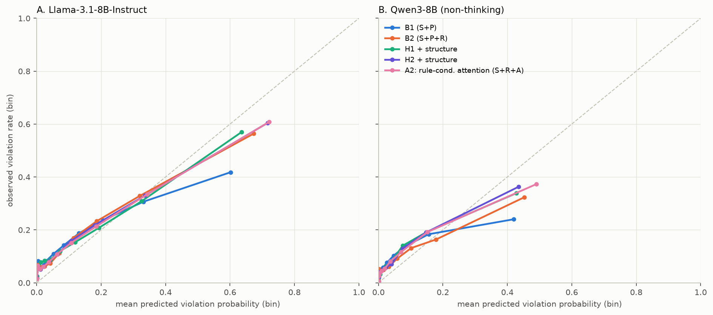
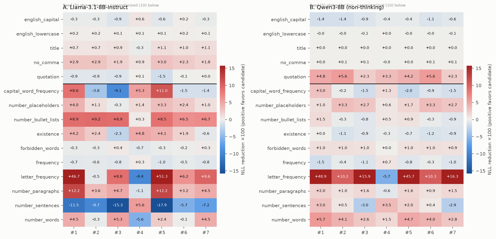
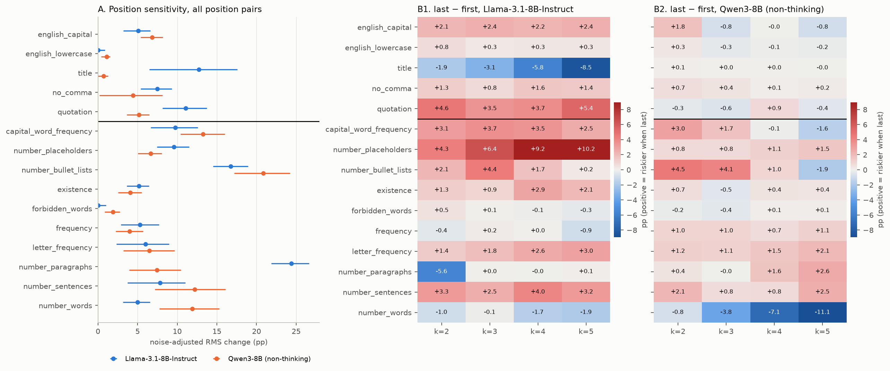
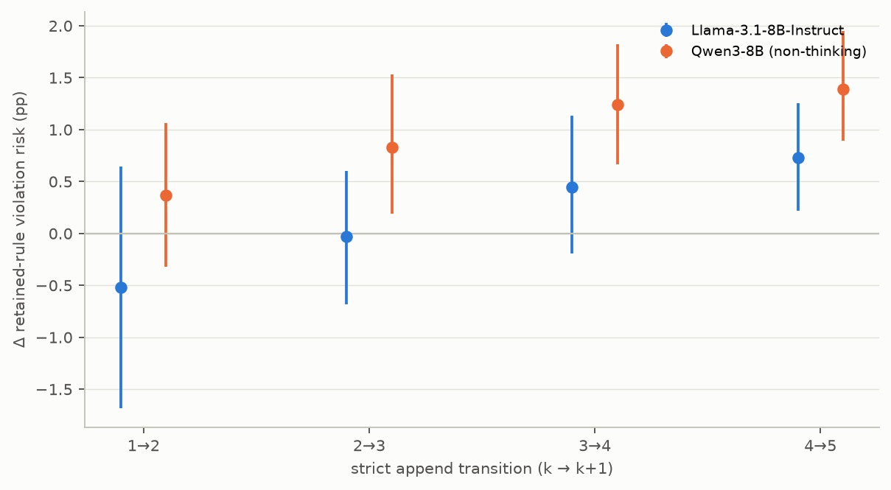
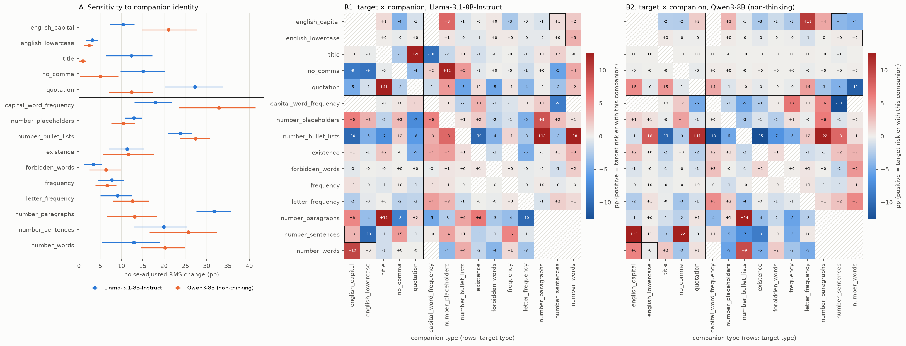
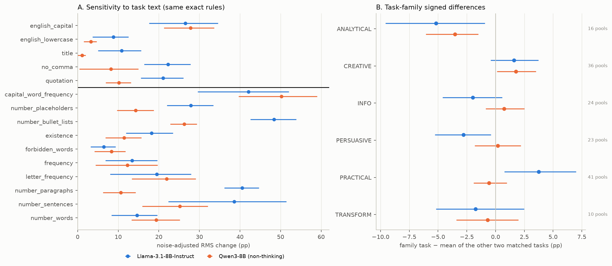
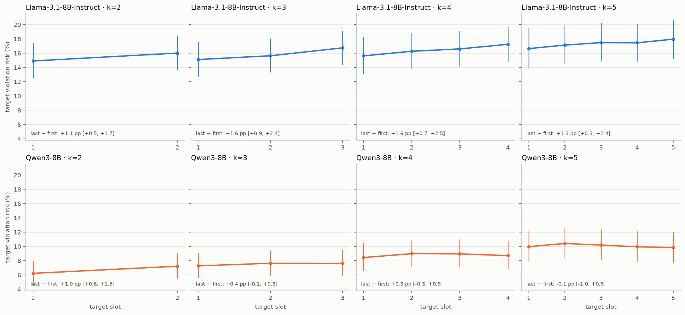
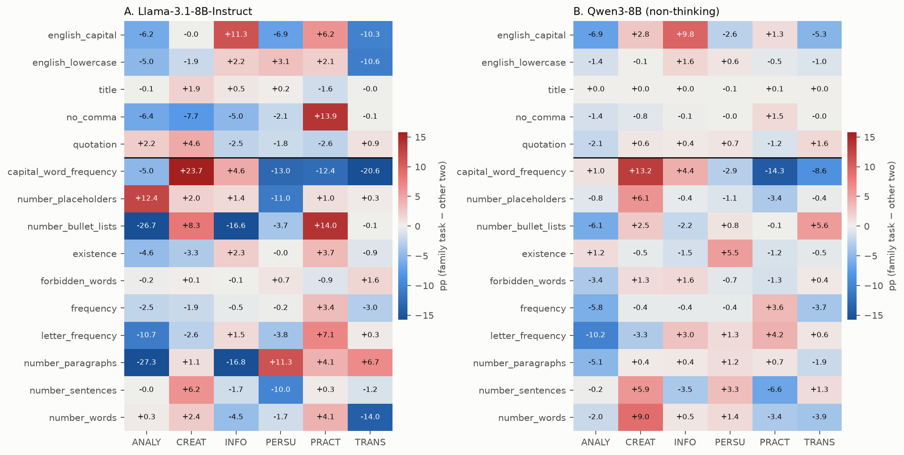

# ManyIFEval — PRELIMINARY results following the evaluation plan (S3 TRAIN, grouped-CV out-of-fold)

> **Interim exhibit set for the 24 Nov 2026 course submission.** Every exhibit below follows the structure, order, metrics, matching and weighting of `manyifeval_s3_complete_evaluation_analysis_and_reporting_plan.md` (unchanged), but is computed on the **50 S3 TRAIN rule pools** with **grouped 5-fold out-of-fold (OOF) predictions** instead of the 22 S3 TEST pools with frozen refits. These are **not held-out TEST results**: the same folds selected settings, penalties and layers, so predictive numbers may be optimistic. Descriptive (observed-outcome) results are exploratory TRAIN findings. Final TEST results will replace every number here. Provenance: `README.md`.

**Global substitutions versus the plan.** 22 TEST pools → 50 TRAIN pools (paired cluster bootstrap, B = 10,000, seed 20261203; Evaluation 1 Objective 2 uses B = 2,000). TEST design (456 configurations per task, 30,096 prompts) → TRAIN design (246 configurations per task, 36,900 prompts). Frozen TEST predictions → V2 S3 OOF predictions at the CV-selected setting (`results/v2_s3/predictions/`). ECE/calibration bins: deciles of the same OOF predictions (the plan fixes TEST bins from TRAIN OOF; on TRAIN they coincide). All intervals are paired, pointwise, unadjusted 95% percentile intervals. Positive differences favour the candidate (right of the arrow).

## Table 1 — Inventory and controlled coverage (TRAIN, per generator)

| Generator | Rule pools | Tasks | Prompts | Prompt–rule rows | Responses (20/prompt, all present) | Rule outcomes | Violations |
|---|---:|---:|---:|---:|---:|---:|---:|
| Llama-3.1-8B-Instruct | 50 | 150 | 36,900 | 153,900 | 738,000 | 3,078,000 | 519,012 |
| Qwen3-8B (non-thinking) | 50 | 150 | 36,900 | 153,900 | 738,000 | 3,078,000 | 287,105 |

| Matched design (metadata only; identical for both generators) | Count |
|---|---:|
| A Position: contexts / target position-pairs (k2–5) | 12,600 / 76,500 (by k: {'2': 1800, '3': 8100, '4': 21600, '5': 45000}) |
| B1 Strict append: prompt pairs / retained-rule targets | 14,400 / 39,600 (targets by transition: {'1->2': 1800, '2->3': 7200, '3->4': 16200, '4->5': 14400}) |
| C2 Strict companion replacement: target contrasts | 84,600 (by k: {'2': 1800, '3': 10800, '5': 72000}; **no strict replacements exist at k = 4 in the TRAIN design**) |
| D Task: prompt pairs / exact-rule target contrasts | 36,900 / 153,900 |

Plan's TEST-design counts for reference: position 57,420; append 69,300; companion 177,408; task 115,236.

## Evaluation 1, Objective 1

### Table 2 — Rule-level violation-risk prediction (§4.4), TRAIN OOF

NLL reduction in nats per response × rule outcome, pooled over 153,900 TRAIN prompt–rule rows per generator; AUROC gain ×100 on response-level binary outcomes; types improved = strictly positive per-type NLL reduction (descriptive, not 15 significance tests). 95% CIs: paired 50-pool cluster bootstrap.

**Panel A — Llama-3.1-8B-Instruct**

| Method comparison (comparator → candidate) | NLL reduction [95% CI] ↑ | AUROC gain [95% CI] ↑ | Types improved (of 15) ↑ |
|---|---:|---:|---:|
| **#1 B1 → H1 + structure** | **0.0683 [0.0379, 0.1027]** | 5.9 [3.8, 7.9] | 10/15 |
| **#2 B2 → H2 + structure** | **0.0079 [-0.0022, 0.0182]** | 1.3 [0.5, 2.1] | 7/15 |
| **#3 B2 → rule-conditioned attention** | **0.0116 [-0.0039, 0.0275]** | 1.3 [0.4, 2.3] | 8/15 |
| **#4 H2 + structure → attention** | **0.0037 [-0.0104, 0.0199]** | 0.0 [-0.8, 0.9] | 5/15 |
| #5 B1 → B1 + H | 0.0690 [0.0291, 0.1130] | 7.4 [4.6, 10.3] | 10/15 |
| #6 B2 → B2 + H | 0.0163 [0.0078, 0.0254] | 1.8 [1.1, 2.6] | 9/15 |
| #7 B2 → B2 + A | 0.0192 [0.0083, 0.0314] | 2.3 [1.4, 3.3] | 10/15 |

**Panel B — Qwen3-8B (non-thinking)**

| Method comparison (comparator → candidate) | NLL reduction [95% CI] ↑ | AUROC gain [95% CI] ↑ | Types improved (of 15) ↑ |
|---|---:|---:|---:|
| **#1 B1 → H1 + structure** | **0.0583 [0.0267, 0.0944]** | 7.7 [4.2, 11.6] | 11/15 |
| **#2 B2 → H2 + structure** | **0.0186 [0.0038, 0.0346]** | 4.0 [2.1, 6.0] | 8/15 |
| **#3 B2 → rule-conditioned attention** | **0.0186 [0.0012, 0.0384]** | 4.4 [2.2, 6.6] | 7/15 |
| **#4 H2 + structure → attention** | **0.0000 [-0.0129, 0.0130]** | 0.3 [-0.7, 1.3] | 5/15 |
| #5 B1 → B1 + H | 0.0525 [0.0252, 0.0845] | 7.1 [3.8, 10.7] | 9/15 |
| #6 B2 → B2 + H | 0.0186 [0.0039, 0.0344] | 4.0 [2.0, 6.0] | 8/15 |
| #7 B2 → B2 + A | 0.0192 [0.0018, 0.0392] | 4.4 [2.2, 6.6] | 7/15 |

Sensitivity (A4): NLL reduction t(49) interval and leave-one-pool-out range.

| Generator | Comparison | t(49) 95% interval (nats) | Leave-one-pool-out range (nats) |
|---|---:|---:|---:|
| llama | #1 B1 → H1 + structure | [0.0341, 0.1024] | 0.0589 to 0.0709 |
| llama | #2 B2 → H2 + structure | [-0.0027, 0.0185] | 0.0055 to 0.0096 |
| llama | #3 B2 → rule-conditioned attention | [-0.0047, 0.0279] | 0.0079 to 0.0150 |
| llama | #4 H2 + structure → attention | [-0.0122, 0.0196] | -0.0014 to 0.0059 |
| llama | #5 B1 → B1 + H | [0.0253, 0.1126] | 0.0574 to 0.0737 |
| llama | #6 B2 → B2 + H | [0.0071, 0.0255] | 0.0139 to 0.0179 |
| llama | #7 B2 → B2 + A | [0.0073, 0.0310] | 0.0160 to 0.0210 |
| qwen | #1 B1 → H1 + structure | [0.0229, 0.0937] | 0.0471 to 0.0640 |
| qwen | #2 B2 → H2 + structure | [0.0027, 0.0345] | 0.0147 to 0.0213 |
| qwen | #3 B2 → rule-conditioned attention | [-0.0007, 0.0379] | 0.0134 to 0.0214 |
| qwen | #4 H2 + structure → attention | [-0.0134, 0.0134] | -0.0030 to 0.0027 |
| qwen | #5 B1 → B1 + H | [0.0213, 0.0836] | 0.0422 to 0.0564 |
| qwen | #6 B2 → B2 + H | [0.0029, 0.0343] | 0.0149 to 0.0211 |
| qwen | #7 B2 → B2 + A | [-0.0002, 0.0387] | 0.0140 to 0.0220 |

### Appendix A1 — Complete overall metrics (Objective 1)

| Generator | Predictor | NLL | Brier | AUROC ×100 | ECE ×100 |
|---|---:|---:|---:|---:|---:|
| llama | Structure only (ref.) | 0.5035 [0.4310, 0.5849] | 0.1392 [0.1236, 0.1548] | 69.5 [65.5, 73.4] | 6.70 [5.12, 8.47] |
| llama | B1 (S+P) | 0.4820 [0.4116, 0.5599] | 0.1347 [0.1190, 0.1502] | 71.5 [67.2, 75.8] | 6.50 [4.98, 8.24] |
| llama | B2 (S+P+R) | 0.4013 [0.3497, 0.4548] | 0.1153 [0.1005, 0.1302] | 78.9 [75.5, 82.2] | 4.58 [3.19, 6.24] |
| llama | H1 + structure | 0.4138 [0.3618, 0.4692] | 0.1176 [0.1039, 0.1315] | 77.4 [73.6, 80.9] | 4.23 [2.97, 5.79] |
| llama | H2 + structure | 0.3934 [0.3431, 0.4468] | 0.1123 [0.0984, 0.1269] | 80.2 [76.8, 83.5] | 4.44 [3.16, 6.05] |
| llama | Rule-cond. attention | 0.3897 [0.3422, 0.4409] | 0.1113 [0.0982, 0.1247] | 80.2 [76.9, 83.4] | 4.37 [3.22, 5.78] |
| llama | B1 + H | 0.4131 [0.3651, 0.4617] | 0.1183 [0.1043, 0.1324] | 79.0 [75.7, 82.0] | 5.39 [4.11, 6.97] |
| llama | B2 + H | 0.3849 [0.3380, 0.4344] | 0.1111 [0.0972, 0.1253] | 80.8 [77.5, 83.8] | 4.36 [3.03, 5.93] |
| llama | B2 + A | 0.3821 [0.3344, 0.4321] | 0.1096 [0.0959, 0.1235] | 81.2 [78.2, 84.1] | 4.44 [3.28, 5.91] |
| qwen | Structure only (ref.) | 0.3560 [0.2856, 0.4334] | 0.0913 [0.0752, 0.1082] | 70.9 [65.1, 76.5] | 5.63 [4.17, 7.47] |
| qwen | B1 (S+P) | 0.3404 [0.2758, 0.4111] | 0.0885 [0.0736, 0.1042] | 72.5 [67.0, 78.0] | 5.36 [3.73, 7.11] |
| qwen | B2 (S+P+R) | 0.2927 [0.2402, 0.3494] | 0.0769 [0.0633, 0.0910] | 77.1 [72.2, 82.0] | 3.74 [2.49, 5.23] |
| qwen | H1 + structure | 0.2822 [0.2370, 0.3311] | 0.0767 [0.0639, 0.0900] | 80.3 [76.3, 83.9] | 3.76 [2.63, 4.97] |
| qwen | H2 + structure | 0.2741 [0.2292, 0.3220] | 0.0744 [0.0619, 0.0876] | 81.2 [77.1, 84.9] | 3.37 [2.25, 4.60] |
| qwen | Rule-cond. attention | 0.2741 [0.2291, 0.3230] | 0.0731 [0.0610, 0.0857] | 81.5 [77.3, 85.3] | 3.83 [2.68, 5.05] |
| qwen | B1 + H | 0.2880 [0.2416, 0.3379] | 0.0783 [0.0651, 0.0921] | 79.6 [75.7, 83.2] | 3.91 [2.79, 5.10] |
| qwen | B2 + H | 0.2741 [0.2291, 0.3219] | 0.0745 [0.0620, 0.0876] | 81.1 [77.1, 84.8] | 3.35 [2.24, 4.59] |
| qwen | B2 + A | 0.2734 [0.2286, 0.3221] | 0.0729 [0.0609, 0.0856] | 81.5 [77.4, 85.4] | 3.77 [2.61, 4.99] |

Contrasts for all seven comparisons (Brier reduction):

| Generator | Comparison | Brier reduction [95% CI] |
|---|---:|---:|
| llama | #1 B1 → H1 + structure | 0.0170 [0.0106, 0.0239] |
| llama | #2 B2 → H2 + structure | 0.0029 [-0.0002, 0.0061] |
| llama | #3 B2 → rule-conditioned attention | 0.0040 [-0.0009, 0.0089] |
| llama | #4 H2 + structure → attention | 0.0011 [-0.0030, 0.0057] |
| llama | #5 B1 → B1 + H | 0.0164 [0.0092, 0.0238] |
| llama | #6 B2 → B2 + H | 0.0042 [0.0017, 0.0066] |
| llama | #7 B2 → B2 + A | 0.0057 [0.0023, 0.0096] |
| qwen | #1 B1 → H1 + structure | 0.0118 [0.0061, 0.0178] |
| qwen | #2 B2 → H2 + structure | 0.0025 [-0.0008, 0.0056] |
| qwen | #3 B2 → rule-conditioned attention | 0.0038 [-0.0006, 0.0090] |
| qwen | #4 H2 + structure → attention | 0.0014 [-0.0025, 0.0056] |
| qwen | #5 B1 → B1 + H | 0.0102 [0.0054, 0.0153] |
| qwen | #6 B2 → B2 + H | 0.0024 [-0.0009, 0.0055] |
| qwen | #7 B2 → B2 + A | 0.0039 [-0.0004, 0.0092] |

### Appendix A2 — Calibration (Objective 1)

Per-bin support, mean prediction and observed rate for every predictor: `tables/eval1_calibration.csv`. ECE for every predictor is in A1.

### Appendix A3 — Per-rule-type NLL reduction heatmap (5 fixed above 10 parameterised types)

**Llama-3.1-8B-Instruct** — NLL reduction (nats) by type (columns = comparisons)

| Rule type | #1 | #2 | #3 | #4 | #5 | #6 | #7 | Pools |
|---|---:|---:|---:|---:|---:|---:|---:|---:|
| english_capital (fixed) | -0.0032 | -0.0032 | -0.0095 | -0.0062 | -0.0065 | 0.0021 | -0.0027 | 18 |
| english_lowercase (fixed) | 0.0019 | 0.0019 | 0.0013 | -0.0006 | 0.0009 | 0.0016 | 0.0009 | 10 |
| title (fixed) | 0.0067 | 0.0067 | 0.0094 | 0.0027 | 0.0113 | 0.0097 | 0.0112 | 26 |
| no_comma (fixed) | 0.0287 | 0.0287 | 0.0195 | -0.0092 | 0.0305 | 0.0235 | 0.0175 | 27 |
| quotation (fixed) | -0.0085 | -0.0085 | -0.0095 | -0.0009 | -0.0148 | -0.0010 | 0.0004 | 22 |
| capital_word_frequency | 0.0864 | -0.0380 | -0.0914 | -0.0534 | 0.1105 | -0.0147 | -0.0143 | 12 |
| number_placeholders | 0.0403 | 0.0108 | -0.0034 | -0.0142 | 0.0327 | 0.0243 | 0.0102 | 27 |
| number_bullet_lists | 0.0893 | 0.0916 | 0.0889 | -0.0028 | 0.0854 | 0.0648 | 0.0668 | 25 |
| existence | 0.0417 | 0.0242 | -0.0234 | -0.0476 | 0.0414 | 0.0190 | -0.0055 | 15 |
| forbidden_words | -0.0028 | -0.0028 | 0.0044 | 0.0072 | -0.0030 | -0.0015 | 0.0027 | 29 |
| frequency | -0.0071 | -0.0058 | -0.0084 | -0.0026 | -0.0098 | -0.0045 | -0.0082 | 18 |
| letter_frequency | 0.4665 | -0.0054 | 0.0883 | 0.0937 | 0.5126 | 0.0625 | 0.0961 | 29 |
| number_paragraphs | 0.1223 | 0.0356 | 0.0469 | 0.0114 | 0.1219 | 0.0323 | 0.0448 | 17 |
| number_sentences | -0.1147 | -0.0968 | -0.1526 | -0.0558 | -0.1795 | -0.0573 | -0.0715 | 11 |
| number_words | 0.0453 | -0.0034 | 0.0529 | 0.0563 | 0.0243 | -0.0013 | 0.0451 | 14 |

**Qwen3-8B (non-thinking)** — NLL reduction (nats) by type (columns = comparisons)

| Rule type | #1 | #2 | #3 | #4 | #5 | #6 | #7 | Pools |
|---|---:|---:|---:|---:|---:|---:|---:|---:|
| english_capital (fixed) | -0.0139 | -0.0136 | -0.0092 | 0.0043 | -0.0043 | -0.0108 | -0.0063 | 18 |
| english_lowercase (fixed) | 0.0000 | -0.0003 | -0.0006 | -0.0003 | -0.0002 | -0.0004 | -0.0007 | 10 |
| title (fixed) | 0.0000 | 0.0000 | 0.0000 | 0.0000 | 0.0000 | 0.0000 | 0.0000 | 26 |
| no_comma (fixed) | 0.0002 | 0.0005 | 0.0008 | 0.0002 | 0.0004 | 0.0006 | 0.0008 | 27 |
| quotation (fixed) | 0.0479 | 0.0564 | 0.0230 | -0.0334 | 0.0422 | 0.0558 | 0.0229 | 22 |
| capital_word_frequency | 0.0296 | -0.0025 | -0.0154 | -0.0130 | -0.0199 | -0.0089 | -0.0147 | 12 |
| number_placeholders | 0.0100 | 0.0325 | 0.0270 | -0.0055 | 0.0172 | 0.0335 | 0.0274 | 27 |
| number_bullet_lists | 0.0147 | -0.0031 | -0.0081 | -0.0050 | 0.0087 | -0.0035 | -0.0086 | 25 |
| existence | 0.0002 | -0.0114 | -0.0085 | 0.0028 | -0.0071 | -0.0122 | -0.0094 | 15 |
| forbidden_words | 0.0101 | 0.0099 | 0.0096 | -0.0003 | 0.0098 | 0.0099 | 0.0094 | 29 |
| frequency | -0.0150 | -0.0043 | -0.0109 | -0.0067 | -0.0077 | -0.0032 | -0.0098 | 18 |
| letter_frequency | 0.4893 | 0.1021 | 0.1595 | 0.0573 | 0.4567 | 0.1035 | 0.1630 | 29 |
| number_paragraphs | 0.0196 | 0.0098 | 0.0160 | 0.0062 | 0.0163 | 0.0091 | 0.0154 | 17 |
| number_sentences | 0.0302 | 0.0050 | -0.0296 | -0.0346 | 0.0196 | 0.0044 | -0.0286 | 11 |
| number_words | 0.0570 | 0.0414 | 0.0259 | -0.0155 | 0.0473 | 0.0405 | 0.0282 | 14 |

Supplementary CSV with all 210 rows (per-type NLLs, reductions, paired 95% CIs, pools, outcomes, flags): `tables/eval1_per_type.csv`.

### Appendix A3b — Fixed versus parameterised NLL improvement (Objective 1 only)

*NLL reductions (nats) of the same seven comparisons, calculated separately on rule-level outcomes from the five fixed and ten parameterised rule types. Fixed-minus-parameterised compares improvements, not raw violation rates. Paired pointwise 95% intervals from resampling the 50 TRAIN pools; all subgroup differences are exploratory.*

**Panel A — Llama-3.1-8B-Instruct** (observed violation rate: fixed 9.4% of 1,056,780 outcomes; parameterised 20.8% of 2,021,220)

| Comparator → candidate | Fixed (5 types): ΔNLL ↑ | Parameterised (10 types): ΔNLL ↑ | Fixed − parameterised | Type-equal-weight sensitivity (fixed / param.) |
|---|---:|---:|---:|---:|
| **#1 B1 → H1 + structure** | 0.0070 [0.0014, 0.0129] | 0.1003 [0.0532, 0.1541] | -0.0933 [-0.1487, -0.0438] | 0.0051 / 0.0767 |
| **#2 B2 → H2 + structure** | 0.0070 [0.0014, 0.0129] | 0.0083 [-0.0071, 0.0246] | -0.0013 [-0.0194, 0.0163] | 0.0051 / 0.0010 |
| **#3 B2 → rule-conditioned attention** | 0.0039 [-0.0007, 0.0087] | 0.0156 [-0.0090, 0.0402] | -0.0117 [-0.0377, 0.0147] | 0.0022 / 0.0002 |
| **#4 H2 + structure → attention** | -0.0031 [-0.0071, 0.0011] | 0.0073 [-0.0147, 0.0318] | -0.0104 [-0.0356, 0.0130] | -0.0029 / -0.0008 |
| #5 B1 → B1 + H | 0.0066 [-0.0022, 0.0160] | 0.1016 [0.0403, 0.1705] | -0.0949 [-0.1667, -0.0315] | 0.0043 / 0.0737 |
| #6 B2 → B2 + H | 0.0089 [0.0033, 0.0149] | 0.0202 [0.0069, 0.0349] | -0.0113 [-0.0284, 0.0044] | 0.0072 / 0.0124 |
| #7 B2 → B2 + A | 0.0071 [0.0023, 0.0120] | 0.0255 [0.0085, 0.0444] | -0.0183 [-0.0390, 0.0005] | 0.0055 / 0.0166 |

**Panel B — Qwen3-8B (non-thinking)** (observed violation rate: fixed 3.7% of 1,056,780 outcomes; parameterised 12.3% of 2,021,220)

| Comparator → candidate | Fixed (5 types): ΔNLL ↑ | Parameterised (10 types): ΔNLL ↑ | Fixed − parameterised | Type-equal-weight sensitivity (fixed / param.) |
|---|---:|---:|---:|---:|
| **#1 B1 → H1 + structure** | 0.0079 [-0.0004, 0.0185] | 0.0846 [0.0367, 0.1408] | -0.0768 [-0.1327, -0.0278] | 0.0068 / 0.0646 |
| **#2 B2 → H2 + structure** | 0.0098 [0.0010, 0.0192] | 0.0232 [0.0015, 0.0469] | -0.0134 [-0.0378, 0.0096] | 0.0086 / 0.0180 |
| **#3 B2 → rule-conditioned attention** | 0.0034 [-0.0044, 0.0107] | 0.0265 [0.0000, 0.0572] | -0.0231 [-0.0544, 0.0052] | 0.0028 / 0.0165 |
| **#4 H2 + structure → attention** | -0.0063 [-0.0190, 0.0017] | 0.0033 [-0.0149, 0.0218] | -0.0097 [-0.0313, 0.0105] | -0.0058 / -0.0014 |
| #5 B1 → B1 + H | 0.0083 [0.0023, 0.0159] | 0.0755 [0.0341, 0.1251] | -0.0672 [-0.1173, -0.0253] | 0.0076 / 0.0541 |
| #6 B2 → B2 + H | 0.0101 [0.0017, 0.0193] | 0.0230 [0.0013, 0.0464] | -0.0128 [-0.0368, 0.0101] | 0.0090 / 0.0173 |
| #7 B2 → B2 + A | 0.0039 [-0.0041, 0.0112] | 0.0273 [0.0006, 0.0579] | -0.0233 [-0.0547, 0.0052] | 0.0033 / 0.0172 |

### Appendix A4 — Technical uncertainty / QC

| Generator | Rows | Outcomes | Pools | Prompts | Rows clipped to [1e-6, 1−1e-6] per predictor |
|---|---:|---:|---:|---:|---:|
| llama | 153900 | 3078000 | 50 | 36900 | B1: 0, B2: 0, H1: 15, H2: 15, RCAP: 13, B1+H1: 143, B2+H1: 6, B2+A1: 6 |
| qwen | 153900 | 3078000 | 50 | 36900 | B1: 630, B2: 670, H1: 604, H2: 604, RCAP: 175, B1+H1: 554, B2+H1: 601, B2+A1: 173 |

Every prompt has 20 verified responses (checked). Each OOF prediction's stored fold equals the fold of its pool in `results/cv_s3/folds.json` (checked for every row and predictor). Low-support per-type flags (< 8 pools): 0 of 210 per-type rows. Sparse-head fallbacks fired during fitting are listed in `results/v2_s3/tables/fallbacks_fired.csv`.

## Evaluation 1, Objective 2

### Table 3 — Prompt-level expected violated-rule fraction (§4.6), TRAIN OOF

One observation per prompt (36,900 TRAIN prompts per generator). RMSE reduction in percentage points; Spearman gain ×100. Paired 50-pool cluster bootstrap, B = 2,000.

**Panel A — Llama-3.1-8B-Instruct**

| Method comparison (comparator → candidate) | RMSE reduction [95% CI] (pp) ↑ | Spearman gain [95% CI] ↑ |
|---|---:|---:|
| **#1 B1 → H1 + structure** | **1.94 [0.84, 3.06]** | 28.6 [17.5, 39.7] |
| **#2 B2 → H2 + structure** | **0.60 [0.04, 1.18]** | 8.5 [3.4, 14.5] |
| **#3 B2 → rule-conditioned attention** | **0.76 [0.06, 1.45]** | 8.3 [2.4, 14.9] |
| **#4 H2 + structure → attention** | **0.16 [-0.44, 0.72]** | -0.1 [-4.4, 4.2] |
| #5 B1 → B1 + H | 1.92 [0.80, 3.05] | 28.4 [17.4, 39.6] |
| #6 B2 → B2 + H | 0.54 [-0.03, 1.14] | 8.4 [3.6, 14.2] |
| #7 B2 → B2 + A | 0.75 [0.07, 1.44] | 8.2 [2.3, 14.8] |

**Panel B — Qwen3-8B (non-thinking)**

| Method comparison (comparator → candidate) | RMSE reduction [95% CI] (pp) ↑ | Spearman gain [95% CI] ↑ |
|---|---:|---:|
| **#1 B1 → H1 + structure** | **0.76 [-0.11, 1.61]** | 12.1 [4.7, 20.4] |
| **#2 B2 → H2 + structure** | **0.49 [-0.45, 1.35]** | 11.3 [3.8, 18.9] |
| **#3 B2 → rule-conditioned attention** | **0.50 [-0.04, 1.05]** | 10.5 [4.8, 16.5] |
| **#4 H2 + structure → attention** | **0.01 [-0.58, 0.72]** | -0.8 [-4.9, 3.3] |
| #5 B1 → B1 + H | 0.75 [-0.11, 1.58] | 12.0 [4.7, 20.2] |
| #6 B2 → B2 + H | 0.46 [-0.29, 1.19] | 11.4 [4.7, 18.3] |
| #7 B2 → B2 + A | 0.31 [-0.06, 0.69] | 9.0 [4.2, 14.0] |

### Appendix A5 — Complete overall metric scores (Objective 2)

| Generator | Predictor | RMSE (pp) | MAE (pp) | MSE ×10⁴ | Pearson ×100 | Spearman ×100 | ECE (pp) |
|---|---:|---:|---:|---:|---:|---:|---:|
| llama | B1 (S+P) | 14.62 [13.53, 15.70] | 11.59 [10.69, 12.54] | 213.6 [183.1, 246.3] | 31.4 [21.5, 41.1] | 32.9 [22.8, 43.1] | 1.94 [1.13, 3.62] |
| llama | B2 (S+P+R) | 13.27 [12.21, 14.35] | 10.27 [9.41, 11.13] | 176.1 [149.0, 205.9] | 48.9 [42.1, 55.4] | 51.5 [43.8, 58.1] | 1.25 [0.87, 2.78] |
| llama | H1 + structure | 12.67 [11.57, 13.75] | 9.40 [8.53, 10.35] | 160.6 [134.0, 189.1] | 57.5 [50.4, 64.8] | 61.5 [54.3, 68.0] | 2.50 [1.52, 3.71] |
| llama | H2 + structure | 12.67 [11.64, 13.73] | 9.64 [8.83, 10.51] | 160.5 [135.6, 188.6] | 55.7 [49.3, 62.2] | 60.0 [53.3, 65.7] | 1.69 [0.86, 3.10] |
| llama | Rule-cond. attention | 12.51 [11.42, 13.75] | 9.50 [8.70, 10.38] | 156.6 [130.5, 189.1] | 57.5 [51.2, 63.6] | 59.9 [53.7, 65.3] | 1.65 [0.93, 3.20] |
| llama | B1 + H | 12.69 [11.59, 13.78] | 9.42 [8.54, 10.36] | 161.2 [134.4, 189.8] | 57.3 [50.2, 64.7] | 61.3 [54.2, 68.0] | 2.51 [1.55, 3.74] |
| llama | B2 + H | 12.73 [11.63, 13.90] | 9.61 [8.77, 10.58] | 162.0 [135.2, 193.1] | 55.3 [48.9, 62.1] | 59.9 [53.2, 65.6] | 1.77 [0.92, 3.24] |
| llama | B2 + A | 12.52 [11.43, 13.76] | 9.51 [8.72, 10.40] | 156.7 [130.7, 189.3] | 57.4 [51.1, 63.5] | 59.7 [53.7, 65.2] | 1.62 [0.89, 3.19] |
| llama | Structure only (ref.) | 14.77 [13.72, 15.80] | 11.78 [10.90, 12.70] | 218.3 [188.3, 249.7] | 28.8 [18.2, 38.9] | 29.9 [19.3, 40.4] | 2.21 [1.36, 3.86] |
| qwen | B1 (S+P) | 11.80 [10.59, 12.91] | 8.73 [7.84, 9.64] | 139.3 [112.1, 166.6] | 30.2 [18.0, 42.4] | 35.0 [23.4, 45.6] | 1.70 [0.94, 3.14] |
| qwen | B2 (S+P+R) | 11.50 [10.18, 12.78] | 8.41 [7.51, 9.32] | 132.2 [103.7, 163.3] | 36.0 [20.4, 49.3] | 36.0 [24.2, 46.9] | 1.57 [0.95, 3.14] |
| qwen | H1 + structure | 11.04 [9.76, 12.16] | 7.78 [6.84, 8.66] | 121.9 [95.2, 148.0] | 46.1 [35.1, 56.5] | 47.1 [38.8, 54.7] | 1.82 [0.97, 3.08] |
| qwen | H2 + structure | 11.01 [9.71, 12.14] | 7.76 [6.81, 8.64] | 121.2 [94.3, 147.3] | 46.4 [35.6, 56.6] | 47.3 [38.9, 54.9] | 1.83 [0.94, 3.10] |
| qwen | Rule-cond. attention | 11.00 [9.78, 12.20] | 7.91 [7.03, 8.74] | 121.1 [95.7, 148.7] | 44.7 [33.6, 55.5] | 46.5 [38.1, 54.2] | 1.56 [0.73, 2.85] |
| qwen | B1 + H | 11.06 [9.76, 12.19] | 7.79 [6.84, 8.67] | 122.2 [95.2, 148.5] | 45.8 [35.0, 56.1] | 47.0 [38.7, 54.6] | 1.83 [0.97, 3.09] |
| qwen | B2 + H | 11.04 [9.71, 12.23] | 7.77 [6.81, 8.67] | 121.9 [94.3, 149.6] | 45.9 [35.2, 56.4] | 47.4 [38.7, 55.2] | 1.99 [1.04, 3.24] |
| qwen | B2 + A | 11.19 [9.86, 12.47] | 7.98 [7.03, 8.88] | 125.1 [97.2, 155.5] | 42.3 [29.5, 53.8] | 45.0 [35.8, 53.1] | 1.78 [0.88, 3.15] |
| qwen | Structure only (ref.) | 11.84 [10.63, 12.96] | 8.79 [7.88, 9.69] | 140.2 [113.0, 168.0] | 29.8 [17.9, 41.7] | 34.4 [23.2, 44.9] | 1.78 [1.01, 3.21] |

All seven contrasts, secondary metrics:

| Generator | Comparison | MAE reduction (pp) | MSE reduction ×10⁴ | Pearson gain ×100 |
|---|---:|---:|---:|---:|
| llama | #1 B1 → H1 + structure | 2.19 [1.19, 3.25] | 53.1 [22.2, 84.4] | 26.1 [15.6, 37.8] |
| llama | #2 B2 → H2 + structure | 0.63 [0.12, 1.18] | 15.6 [0.9, 30.7] | 6.8 [2.0, 12.9] |
| llama | #3 B2 → rule-conditioned attention | 0.77 [0.23, 1.36] | 19.5 [1.5, 37.8] | 8.6 [2.3, 15.1] |
| llama | #4 H2 + structure → attention | 0.14 [-0.28, 0.56] | 3.9 [-11.4, 18.1] | 1.8 [-3.7, 6.5] |
| llama | #5 B1 → B1 + H | 2.18 [1.17, 3.24] | 52.5 [21.7, 83.9] | 25.9 [15.3, 37.7] |
| llama | #6 B2 → B2 + H | 0.66 [0.18, 1.21] | 14.0 [-0.7, 29.5] | 6.5 [1.7, 12.6] |
| llama | #7 B2 → B2 + A | 0.76 [0.23, 1.35] | 19.3 [1.8, 37.5] | 8.5 [2.1, 15.1] |
| qwen | #1 B1 → H1 + structure | 0.95 [0.33, 1.58] | 17.4 [-2.5, 36.9] | 16.0 [5.6, 26.7] |
| qwen | #2 B2 → H2 + structure | 0.66 [0.03, 1.27] | 11.0 [-10.1, 31.0] | 10.4 [-1.3, 22.7] |
| qwen | #3 B2 → rule-conditioned attention | 0.50 [0.10, 0.91] | 11.2 [-1.0, 23.8] | 8.8 [0.8, 17.6] |
| qwen | #4 H2 + structure → attention | -0.15 [-0.54, 0.28] | 0.2 [-13.0, 15.9] | -1.7 [-8.6, 5.6] |
| qwen | #5 B1 → B1 + H | 0.94 [0.33, 1.56] | 17.1 [-2.6, 36.1] | 15.7 [5.3, 26.4] |
| qwen | #6 B2 → B2 + H | 0.65 [0.09, 1.20] | 10.4 [-6.6, 26.8] | 9.9 [0.5, 20.4] |
| qwen | #7 B2 → B2 + A | 0.43 [0.12, 0.74] | 7.1 [-1.5, 15.7] | 6.3 [0.9, 12.7] |

### Appendix A6 — Fraction calibration (Objective 2; key predictors B2, H2, RCAP)

| Generator | Predictor | Decile bins: mean predicted → mean observed fraction (pp) | Min prompts per bin |
|---|---:|---:|---:|
| llama | B2 (S+P+R) | 5.9→6.2 · 8.7→7.6 · 10.5→10.3 · 12.2→13.0 · 13.7→14.3 · 15.6→17.5 · 17.9→21.0 · 20.6→21.8 · 24.4→24.8 · 33.6→30.6 | 3690 |
| llama | H2 + structure | 4.6→4.6 · 7.0→6.8 · 8.8→8.4 · 10.7→11.8 · 12.7→14.4 · 15.1→17.1 · 17.6→20.5 · 20.6→23.4 · 25.2→27.3 · 36.2→32.7 | 3690 |
| llama | Rule-cond. attention | 4.3→4.8 · 7.1→7.2 · 8.8→8.9 · 10.6→11.3 · 12.5→14.0 · 14.7→17.8 · 17.2→20.4 · 20.2→22.3 · 24.8→26.2 · 37.8→34.1 | 3690 |
| qwen | B2 (S+P+R) | 2.0→2.5 · 3.1→4.1 · 4.1→5.9 · 5.2→8.5 · 6.5→8.7 · 7.7→8.6 · 9.1→8.8 · 11.2→11.5 · 14.7→14.9 · 22.3→17.0 | 3690 |
| qwen | H2 + structure | 1.3→2.0 · 2.3→3.5 · 3.1→4.6 · 4.1→5.9 · 5.2→7.4 · 6.4→9.0 · 8.0→9.7 · 10.3→11.9 · 13.9→14.4 · 26.3→22.0 | 3690 |
| qwen | Rule-cond. attention | 1.3→1.7 · 2.5→3.5 · 3.5→4.9 · 4.6→6.2 · 5.8→7.7 · 7.2→9.0 · 8.6→10.6 · 10.7→12.4 · 14.2→14.5 · 23.6→20.0 | 3690 |

All predictors: `tables/obj2_eval1_calibration.csv` (no separate figure was drawn tonight).

### Appendix A7 — Trivial and derived reference predictions

| Generator | Reference | RMSE (pp) | Spearman ×100 |
|---|---:|---:|---:|
| llama | Training-fold mean (constant within fold) | 15.34 | undefined within fold (constant) |
| llama | Mean of Objective 1 H2 p̂ | 12.22 | 62.7 |
| llama | Mean of Objective 1 B2 p̂ | 13.02 | 58.5 |
| llama | Mean of Objective 1 RCAP p̂ | 12.50 | 61.5 |
| llama | Objective 2 H2 head | 12.67 | 60.0 |
| qwen | Training-fold mean (constant within fold) | 12.31 | undefined within fold (constant) |
| qwen | Mean of Objective 1 H2 p̂ | 11.02 | 48.1 |
| qwen | Mean of Objective 1 B2 p̂ | 11.17 | 42.8 |
| qwen | Mean of Objective 1 RCAP p̂ | 10.86 | 49.7 |
| qwen | Objective 2 H2 head | 11.01 | 47.3 |

The training-fold mean is constant within each fold; across the pooled OOF set it takes five values, so its pooled Spearman (negative) is an artefact and is not interpreted. Paired contrasts: `tables/obj2_eval1_contrasts.csv` rows refA (training mean → H2) and refB (mean of Objective 1 H2 → Objective 2 H2).

## Evaluation 2, Objective 1 — controlled factors (observed effects first, then shared Table 4)

Noise-adjusted RMS = √max(0, weighted mean of (d² − V)), V the binomial variance of the observed difference; the estimator and its 50-pool interval were validated by simulation (`tables/noise_validation_synthetic.csv`: ≤0.1 pp bias when true RMS ≥ 3 pp, +0.5–1 pp upward bias at an exact null from truncation, 91–100% coverage). Weights: equal per k (or transition), then pool → task → context → pair, as in the plan's §6.3 proposal.

### Figure E2-Pos — Position (§5.2)

**Panel A — noise-adjusted RMS positional sensitivity over all position pairs, by target type (pp)**

| Target type | Llama RMS [95% CI] (pools) | Qwen RMS [95% CI] (pools) |
|---|---:|---:|
| english_capital (fixed) | 5.1 [3.2, 6.6] (18) | 6.8 [5.4, 8.2] (18) |
| english_lowercase (fixed) | 0.0 [0.0, 0.9] (10) † | 1.1 [0.4, 1.6] (10) |
| title (fixed) | 12.7 [6.5, 17.6] (26) | 0.7 [0.0, 1.3] (26) |
| no_comma (fixed) | 7.5 [5.4, 9.3] (27) | 4.4 [0.2, 8.1] (27) |
| quotation (fixed) | 11.1 [8.2, 13.7] (22) | 5.2 [3.7, 6.5] (22) |
| capital_word_frequency | 9.8 [6.6, 12.6] (12) | 13.3 [10.4, 16.0] (12) |
| number_placeholders | 9.6 [7.4, 11.5] (27) | 6.7 [5.0, 8.1] (27) |
| number_bullet_lists | 16.7 [14.5, 19.0] (25) | 20.9 [17.2, 24.2] (25) |
| existence | 5.2 [3.6, 6.4] (15) | 4.1 [2.5, 5.5] (15) |
| forbidden_words | 0.0 [0.0, 1.0] (29) † | 1.9 [0.8, 2.8] (29) |
| frequency | 5.3 [2.9, 7.7] (18) | 4.0 [2.2, 5.7] (18) |
| letter_frequency | 6.0 [2.3, 9.0] (29) | 6.5 [3.2, 9.7] (29) |
| number_paragraphs | 24.4 [21.9, 26.6] (17) | 7.5 [4.0, 10.5] (17) |
| number_sentences | 7.8 [3.7, 11.0] (11) | 12.2 [7.2, 16.1] (11) |
| number_words | 5.0 [3.1, 6.6] (14) | 11.9 [7.8, 15.3] (14) |

† corrected squared estimate ≤ 0, truncated to 0.

**Panel B — signed first→last change by type × k (pp; positive = last slot riskier)**

*Llama-3.1-8B-Instruct*

| Target type | k=2 | k=3 | k=4 | k=5 |
|---|---:|---:|---:|---:|
| english_capital | 2.1 [-0.5, 5.0] (18) | 2.4 [0.9, 4.0] (18) | 2.2 [0.6, 4.3] (18) | 2.4 [0.8, 4.2] (18) |
| english_lowercase | 0.8 [-0.8, 1.9] (10) | 0.3 [-0.3, 0.9] (10) | 0.3 [0.0, 0.7] (10) | 0.3 [-0.1, 0.8] (10) |
| title | -1.9 [-4.7, 0.0] (26) | -3.1 [-6.4, -0.5] (26) | -5.8 [-11.1, -1.4] (26) | -8.5 [-16.2, -2.3] (26) |
| no_comma | 1.3 [-0.8, 3.7] (27) | 0.8 [-0.9, 2.6] (27) | 1.6 [0.3, 3.0] (27) | 1.4 [0.3, 2.6] (27) |
| quotation | 4.6 [2.4, 7.2] (22) | 3.5 [1.4, 5.4] (22) | 3.7 [1.7, 5.9] (22) | 5.4 [2.5, 9.0] (22) |
| capital_word_frequency | 3.1 [-0.2, 6.0] (12) | 3.7 [1.0, 6.7] (12) | 3.5 [0.3, 7.1] (12) | 2.5 [-1.9, 7.0] (12) |
| number_placeholders | 4.3 [2.6, 6.1] (27) | 6.4 [4.0, 9.0] (27) | 9.2 [6.3, 12.2] (27) | 10.2 [7.3, 13.3] (27) |
| number_bullet_lists | 2.1 [-1.1, 5.5] (25) | 4.4 [-0.3, 9.7] (25) | 1.7 [-3.0, 6.5] (25) | 0.2 [-5.7, 5.6] (25) |
| existence | 1.3 [-0.5, 3.3] (15) | 0.9 [-0.6, 2.5] (15) | 2.9 [1.1, 4.9] (15) | 2.1 [0.2, 4.4] (15) |
| forbidden_words | 0.5 [0.0, 1.2] (29) | 0.1 [-0.2, 0.3] (29) | -0.1 [-0.3, 0.1] (29) | -0.3 [-0.6, -0.1] (29) |
| frequency | -0.4 [-1.8, 0.9] (18) | 0.2 [-1.1, 1.4] (18) | 0.0 [-1.4, 1.4] (18) | -0.9 [-3.0, 0.7] (18) |
| letter_frequency | 1.4 [0.3, 2.6] (29) | 1.8 [0.2, 3.9] (29) | 2.6 [0.4, 6.1] (29) | 3.0 [0.1, 7.3] (29) |
| number_paragraphs | -5.6 [-13.1, 1.6] (17) | 0.0 [-6.8, 7.1] (17) | 0.0 [-6.5, 6.4] (17) | 0.1 [-7.0, 7.9] (17) |
| number_sentences | 3.3 [0.7, 6.1] (11) | 2.5 [0.5, 5.3] (11) | 4.0 [1.0, 7.4] (11) | 3.2 [0.8, 5.8] (11) |
| number_words | -1.0 [-2.7, 0.5] (14) | -0.1 [-2.1, 1.7] (14) | -1.7 [-4.1, 0.6] (14) | -1.9 [-4.7, 0.4] (14) |

(pools in parentheses)

*Qwen3-8B (non-thinking)*

| Target type | k=2 | k=3 | k=4 | k=5 |
|---|---:|---:|---:|---:|
| english_capital | 1.8 [-0.2, 3.8] (18) | -0.8 [-1.9, 0.3] (18) | 0.0 [-2.1, 2.1] (18) | -0.8 [-2.9, 1.2] (18) |
| english_lowercase | 0.3 [-0.8, 1.4] (10) | -0.3 [-0.6, 0.0] (10) | -0.1 [-0.4, 0.1] (10) | -0.2 [-0.5, 0.1] (10) |
| title | 0.1 [0.0, 0.3] (26) | 0.0 [0.0, 0.0] (26) | 0.0 [0.0, 0.2] (26) | 0.0 [0.0, 0.0] (26) |
| no_comma | 0.7 [0.0, 2.1] (27) | 0.4 [0.0, 1.4] (27) | 0.1 [0.0, 0.5] (27) | 0.2 [0.0, 0.5] (27) |
| quotation | -0.3 [-1.2, 0.4] (22) | -0.6 [-1.8, 0.4] (22) | 0.9 [0.0, 2.0] (22) | -0.4 [-1.0, 0.1] (22) |
| capital_word_frequency | 3.0 [0.4, 6.0] (12) | 1.7 [-1.4, 5.2] (12) | -0.1 [-4.5, 4.8] (12) | -1.6 [-8.2, 4.8] (12) |
| number_placeholders | 0.8 [-0.2, 2.0] (27) | 0.8 [-0.6, 2.1] (27) | 1.1 [-0.8, 2.8] (27) | 1.5 [-1.3, 4.0] (27) |
| number_bullet_lists | 4.5 [0.7, 9.1] (25) | 4.1 [-0.5, 8.6] (25) | 1.0 [-3.5, 5.0] (25) | -1.9 [-9.8, 5.7] (25) |
| existence | 0.7 [-0.1, 1.4] (15) | -0.5 [-2.4, 0.9] (15) | 0.4 [-0.6, 1.5] (15) | 0.4 [-1.4, 1.9] (15) |
| forbidden_words | -0.2 [-0.9, 0.6] (29) | -0.4 [-1.1, 0.1] (29) | 0.1 [-0.2, 0.5] (29) | 0.1 [-0.3, 0.6] (29) |
| frequency | 1.0 [0.2, 2.2] (18) | 1.0 [0.3, 1.9] (18) | 0.7 [0.0, 1.5] (18) | 1.1 [-0.5, 2.8] (18) |
| letter_frequency | 1.2 [-0.1, 2.8] (29) | 1.1 [0.2, 2.2] (29) | 1.5 [0.3, 3.1] (29) | 2.1 [0.5, 4.1] (29) |
| number_paragraphs | 0.4 [-0.2, 1.1] (17) | 0.0 [-2.5, 1.9] (17) | 1.6 [-0.8, 4.4] (17) | 2.6 [0.3, 5.8] (17) |
| number_sentences | 2.1 [-3.4, 7.5] (11) | 0.8 [-2.2, 3.9] (11) | 0.8 [-1.1, 3.2] (11) | 2.5 [0.5, 4.6] (11) |
| number_words | -0.8 [-2.4, 0.8] (14) | -3.8 [-8.4, 0.6] (14) | -7.1 [-13.4, -1.7] (14) | -11.1 [-19.4, -3.7] (14) |

(pools in parentheses)

### Figure E2-Append — Strict append (§5.3)

| Generator | Transition | Mean retained-rule change (pp) [95% CI] | Pools | Prompt pairs | Retained targets |
|---|---:|---:|---:|---:|---:|
| Llama-3.1-8B-Instruct | 1->2 | -0.52 [-1.68, 0.65] | 50 | 1,800 | 1,800 |
| Llama-3.1-8B-Instruct | 2->3 | -0.03 [-0.69, 0.60] | 50 | 3,600 | 7,200 |
| Llama-3.1-8B-Instruct | 3->4 | 0.44 [-0.19, 1.13] | 50 | 5,400 | 16,200 |
| Llama-3.1-8B-Instruct | 4->5 | 0.73 [0.22, 1.26] | 50 | 3,600 | 14,400 |
| Qwen3-8B (non-thinking) | 1->2 | 0.37 [-0.32, 1.06] | 50 | 1,800 | 1,800 |
| Qwen3-8B (non-thinking) | 2->3 | 0.83 [0.19, 1.53] | 50 | 3,600 | 7,200 |
| Qwen3-8B (non-thinking) | 3->4 | 1.24 [0.67, 1.82] | 50 | 5,400 | 16,200 |
| Qwen3-8B (non-thinking) | 4->5 | 1.39 [0.89, 1.95] | 50 | 3,600 | 14,400 |

### Figure E2-Companion — Strict companion replacement (§5.5)

**Panel A — noise-adjusted RMS by target type (pp), earlier and later companions, k = 2, 3, 5 (no TRAIN k = 4 pairs)**

| Target type | Llama RMS [95% CI] (pools) | Qwen RMS [95% CI] (pools) |
|---|---:|---:|
| english_capital (fixed) | 10.4 [7.4, 13.0] (18) | 21.1 [14.8, 27.7] (18) |
| english_lowercase (fixed) | 3.1 [1.6, 4.5] (10) | 2.4 [1.2, 3.3] (10) |
| title (fixed) | 12.3 [6.3, 17.2] (26) | 0.9 [0.0, 1.7] (26) |
| no_comma (fixed) | 15.1 [9.7, 20.3] (27) | 5.1 [0.3, 9.3] (27) |
| quotation (fixed) | 27.3 [20.3, 33.8] (22) | 12.4 [7.1, 17.4] (22) |
| capital_word_frequency | 18.0 [13.1, 21.9] (12) | 32.9 [23.5, 41.5] (12) |
| number_placeholders | 12.9 [10.8, 14.9] (27) | 10.5 [7.6, 13.2] (27) |
| number_bullet_lists | 23.8 [20.8, 26.5] (25) | 27.4 [23.7, 30.8] (25) |
| existence | 11.3 [7.0, 15.3] (15) | 11.6 [5.6, 17.7] (15) |
| forbidden_words | 3.4 [1.3, 5.3] (29) | 6.4 [2.5, 9.9] (29) |
| frequency | 7.7 [4.5, 10.6] (18) | 6.6 [3.9, 8.8] (18) |
| letter_frequency | 9.0 [5.0, 12.4] (29) | 12.6 [8.1, 16.4] (29) |
| number_paragraphs | 31.8 [27.6, 35.7] (17) | 13.1 [6.5, 18.4] (17) |
| number_sentences | 19.9 [12.9, 25.4] (11) | 25.7 [16.6, 32.4] (11) |
| number_words | 12.9 [5.4, 19.0] (14) | 20.3 [14.6, 24.9] (14) |

† corrected squared estimate ≤ 0, truncated to 0.

**Panel B — signed target × companion effects** (companion minus mean of the other eligible companions in the same fixed context): 388 supported directed cells across both generators; unsupported cells are absent, not zero. Full numerical matrix with CIs, pools, tasks, contexts and mean alternatives: `tables/eval2_companion_signed_matrix.csv` (Appendix C-A). Cells with ≥ 3 pools whose interval excludes zero: 87 (pointwise, unadjusted; exploratory).

### Figure E2-Task — Task context (§5.8)

**Panel A — noise-adjusted RMS task sensitivity by target type (pp)**

| Target type | Llama RMS [95% CI] (pools) | Qwen RMS [95% CI] (pools) |
|---|---:|---:|
| english_capital (fixed) | 26.5 [17.6, 34.6] (18) | 27.9 [21.3, 33.7] (18) |
| english_lowercase (fixed) | 8.8 [3.7, 12.5] (10) | 3.3 [1.5, 4.7] (10) |
| title (fixed) | 10.9 [5.0, 15.7] (26) | 1.1 [0.0, 2.0] (26) |
| no_comma (fixed) | 22.3 [16.4, 27.9] (27) | 8.2 [0.4, 15.0] (27) |
| quotation (fixed) | 21.1 [15.6, 26.1] (22) | 10.2 [6.9, 13.1] (22) |
| capital_word_frequency | 42.1 [29.6, 52.1] (12) | 50.2 [39.7, 59.0] (12) |
| number_placeholders | 27.9 [22.0, 33.4] (27) | 14.3 [9.7, 18.8] (27) |
| number_bullet_lists | 48.4 [42.6, 53.8] (25) | 26.3 [22.8, 29.4] (25) |
| existence | 18.2 [11.9, 23.5] (15) | 11.5 [6.9, 15.7] (15) |
| forbidden_words | 6.5 [3.2, 9.4] (29) | 8.4 [4.1, 11.8] (29) |
| frequency | 13.4 [6.9, 19.6] (18) | 12.3 [4.4, 19.7] (18) |
| letter_frequency | 19.5 [8.0, 28.0] (29) | 21.9 [13.4, 29.1] (29) |
| number_paragraphs | 40.5 [36.2, 44.7] (17) | 10.7 [6.2, 14.3] (17) |
| number_sentences | 38.6 [22.3, 51.4] (11) | 25.2 [15.9, 32.1] (11) |
| number_words | 14.6 [8.3, 19.6] (14) | 19.4 [13.3, 25.2] (14) |

† corrected squared estimate ≤ 0, truncated to 0.

**Panel B — signed family-vs-other-two matched-task differences (pp; descriptive associations, not causal)**

| Generator | Task family | Signed difference [95% CI] | Supporting pools |
|---|---:|---:|---:|
| Llama-3.1-8B-Instruct | PRACTICAL | 3.76 [0.76, 7.01] | 41 |
| Llama-3.1-8B-Instruct | CREATIVE | 1.61 [-0.42, 3.73] | 36 |
| Llama-3.1-8B-Instruct | INFO | -1.97 [-4.59, 0.57] | 24 |
| Llama-3.1-8B-Instruct | PERSUASIVE | -2.80 [-5.26, -0.41] | 23 |
| Llama-3.1-8B-Instruct | ANALYTICAL | -5.19 [-9.56, -0.92] | 16 |
| Llama-3.1-8B-Instruct | TRANSFORM | -1.74 [-5.18, 2.48] | 10 |
| Qwen3-8B (non-thinking) | PRACTICAL | -0.56 [-1.91, 0.97] | 41 |
| Qwen3-8B (non-thinking) | CREATIVE | 1.77 [0.13, 3.52] | 36 |
| Qwen3-8B (non-thinking) | INFO | 0.75 [-0.86, 2.50] | 24 |
| Qwen3-8B (non-thinking) | PERSUASIVE | 0.20 [-1.81, 2.19] | 23 |
| Qwen3-8B (non-thinking) | ANALYTICAL | -3.52 [-6.06, -1.49] | 16 |
| Qwen3-8B (non-thinking) | TRANSFORM | -0.68 [-3.42, 1.99] | 10 |

### Table 4 — Evaluation 2 predictor skill: paired Δ-MSE reduction ×10⁴ [95% CI], all seven comparisons

**Llama-3.1-8B-Instruct**

| Comparison | Position (equal-k, k2–5) | Strict append (4 transitions) | Companion (k 2, 3, 5) | Task (k1–5) |
|---|---:|---:|---:|---:|
| **#1 B1 → H1 + structure** | 2.0 [-3.2, 7.4] | -21.9 [-41.2, -5.3] | -37.5 [-67.0, -10.9] | 161.8 [81.0, 247.8] |
| **#2 B2 → H2 + structure** | 6.1 [2.5, 10.1] | 2.9 [-3.1, 8.6] | 8.2 [-1.3, 17.9] | 127.1 [48.7, 206.7] |
| **#3 B2 → rule-conditioned attention** | -37.3 [-55.8, -21.3] | -22.2 [-36.3, -9.2] | -19.4 [-34.5, -4.9] | 57.4 [-20.1, 138.2] |
| **#4 H2 + structure → attention** | -43.4 [-60.7, -28.8] | -25.1 [-38.3, -13.2] | -27.6 [-44.4, -12.0] | -69.8 [-102.8, -38.8] |
| #5 B1 → B1 + H | 1.1 [-5.9, 8.3] | -17.7 [-36.4, -0.9] | -32.1 [-66.5, -2.2] | 112.8 [14.8, 211.7] |
| #6 B2 → B2 + H | 6.8 [3.1, 11.1] | 8.1 [3.0, 13.2] | 15.7 [7.7, 23.5] | 114.0 [50.7, 179.4] |
| #7 B2 → B2 + A | -16.5 [-28.8, -5.5] | 0.5 [-9.2, 10.6] | 7.0 [-4.2, 19.4] | 73.4 [12.9, 138.2] |
| Zero-change reference MSE (×10⁴) | 137.4 | 235.3 | 325.4 | 748.8 |

**Qwen3-8B (non-thinking)**

| Comparison | Position (equal-k, k2–5) | Strict append (4 transitions) | Companion (k 2, 3, 5) | Task (k1–5) |
|---|---:|---:|---:|---:|
| **#1 B1 → H1 + structure** | -6.2 [-12.4, -2.1] | -16.6 [-29.4, -5.2] | -33.9 [-64.7, -8.1] | 23.1 [-18.6, 65.7] |
| **#2 B2 → H2 + structure** | -5.3 [-10.7, -1.8] | -5.1 [-12.6, 2.4] | -14.4 [-33.2, 3.7] | -30.6 [-53.6, -8.1] |
| **#3 B2 → rule-conditioned attention** | -18.8 [-26.3, -12.1] | -12.4 [-22.0, -3.0] | -6.0 [-21.9, 8.8] | -18.5 [-45.3, 8.4] |
| **#4 H2 + structure → attention** | -13.5 [-21.0, -6.1] | -7.3 [-14.3, -0.4] | 8.4 [-7.1, 25.9] | 12.1 [-9.5, 34.6] |
| #5 B1 → B1 + H | -3.9 [-8.1, -1.0] | -9.0 [-18.2, -0.5] | -21.1 [-42.4, -2.2] | 16.9 [-20.7, 58.0] |
| #6 B2 → B2 + H | -5.0 [-10.1, -1.6] | -4.0 [-11.4, 3.3] | -12.9 [-31.4, 4.8] | -30.5 [-53.5, -8.3] |
| #7 B2 → B2 + A | -17.4 [-24.5, -11.1] | -10.6 [-19.8, -1.6] | -3.9 [-19.8, 11.0] | -16.8 [-42.7, 9.1] |
| Zero-change reference MSE (×10⁴) | 87.0 | 180.7 | 262.2 | 376.4 |

### Appendix Pos-A — Position profiles at every slot and all 20 pair strata

| Generator | k | Slot pair | Signed change (pp) | Pools | Contexts |
|---|---:|---:|---:|---:|---:|
| llama | 2 | 1→2 | 1.11 [0.48, 1.71] | 50 | 1800 |
| llama | 5 | 1→2 | 0.50 [0.01, 0.97] | 50 | 4500 |
| llama | 5 | 1→3 | 0.84 [0.13, 1.51] | 50 | 4500 |
| llama | 5 | 1→4 | 0.81 [-0.09, 1.66] | 50 | 4500 |
| llama | 5 | 1→5 | 1.32 [0.25, 2.39] | 50 | 4500 |
| llama | 5 | 2→3 | 0.35 [0.05, 0.64] | 50 | 4500 |
| llama | 5 | 2→4 | 0.32 [-0.20, 0.84] | 50 | 4500 |
| llama | 5 | 2→5 | 0.83 [0.05, 1.62] | 50 | 4500 |
| llama | 5 | 3→4 | -0.03 [-0.32, 0.28] | 50 | 4500 |
| llama | 5 | 3→5 | 0.48 [-0.17, 1.12] | 50 | 4500 |
| llama | 5 | 4→5 | 0.51 [0.04, 0.95] | 50 | 4500 |
| llama | 4 | 1→2 | 0.65 [0.15, 1.12] | 50 | 3600 |
| llama | 4 | 1→3 | 0.98 [0.31, 1.63] | 50 | 3600 |
| llama | 4 | 1→4 | 1.62 [0.73, 2.52] | 50 | 3600 |
| llama | 4 | 2→3 | 0.33 [0.01, 0.66] | 50 | 3600 |
| llama | 4 | 2→4 | 0.98 [0.33, 1.64] | 50 | 3600 |
| llama | 4 | 3→4 | 0.64 [0.16, 1.12] | 50 | 3600 |
| llama | 3 | 1→2 | 0.53 [-0.02, 1.06] | 50 | 2700 |
| llama | 3 | 1→3 | 1.63 [0.90, 2.36] | 50 | 2700 |
| llama | 3 | 2→3 | 1.11 [0.60, 1.62] | 50 | 2700 |
| qwen | 2 | 1→2 | 0.99 [0.57, 1.45] | 50 | 1800 |
| qwen | 5 | 1→2 | 0.44 [0.01, 0.91] | 50 | 4500 |
| qwen | 5 | 1→3 | 0.22 [-0.42, 0.90] | 50 | 4500 |
| qwen | 5 | 1→4 | -0.02 [-0.76, 0.75] | 50 | 4500 |
| qwen | 5 | 1→5 | -0.13 [-1.01, 0.76] | 50 | 4500 |
| qwen | 5 | 2→3 | -0.22 [-0.56, 0.16] | 50 | 4500 |
| qwen | 5 | 2→4 | -0.46 [-0.97, 0.07] | 50 | 4500 |
| qwen | 5 | 2→5 | -0.57 [-1.24, 0.08] | 50 | 4500 |
| qwen | 5 | 3→4 | -0.23 [-0.53, 0.08] | 50 | 4500 |
| qwen | 5 | 3→5 | -0.35 [-0.79, 0.06] | 50 | 4500 |
| qwen | 5 | 4→5 | -0.12 [-0.35, 0.11] | 50 | 4500 |
| qwen | 4 | 1→2 | 0.54 [0.17, 0.95] | 50 | 3600 |
| qwen | 4 | 1→3 | 0.52 [0.03, 1.03] | 50 | 3600 |
| qwen | 4 | 1→4 | 0.27 [-0.30, 0.87] | 50 | 3600 |
| qwen | 4 | 2→3 | -0.03 [-0.27, 0.22] | 50 | 3600 |
| qwen | 4 | 2→4 | -0.27 [-0.64, 0.10] | 50 | 3600 |
| qwen | 4 | 3→4 | -0.25 [-0.51, 0.00] | 50 | 3600 |
| qwen | 3 | 1→2 | 0.37 [0.05, 0.71] | 50 | 2700 |
| qwen | 3 | 1→3 | 0.36 [-0.06, 0.80] | 50 | 2700 |
| qwen | 3 | 2→3 | -0.01 [-0.34, 0.32] | 50 | 2700 |

Slot risk curves: `tables/eval2_position_slot_risk.csv`.

### Appendix Pos-B — position predictor skill by k (Δ-MSE ×10⁴ [95% CI]; Δ-MAE ×10² point estimates)

| Generator | Comparison | k 2 | k 3 | k 4 | k 5 |
|---|---:|---:|---:|---:|---:|
| llama | #1 B1 → H1 + structure | 2.0 [-10.4, 14.9]; ΔMAE -0.37 | 1.0 [-4.4, 6.6]; ΔMAE -0.14 | 2.2 [-1.8, 6.2]; ΔMAE -0.05 | 2.8 [-1.1, 7.1]; ΔMAE -0.02 |
| llama | #2 B2 → H2 + structure | 10.9 [2.0, 21.4]; ΔMAE -0.11 | 6.0 [1.9, 10.5]; ΔMAE 0.02 | 4.0 [0.7, 7.5]; ΔMAE 0.03 | 3.6 [0.2, 7.3]; ΔMAE 0.04 |
| llama | #3 B2 → rule-conditioned attention | -77.1 [-118.3, -40.3]; ΔMAE -1.97 | -36.2 [-55.7, -19.4]; ΔMAE -1.35 | -23.8 [-36.7, -12.1]; ΔMAE -0.92 | -12.1 [-21.5, -3.0]; ΔMAE -0.65 |
| llama | #4 H2 + structure → attention | -88.0 [-127.1, -53.6]; ΔMAE -1.85 | -42.2 [-60.4, -26.9]; ΔMAE -1.37 | -27.8 [-39.5, -17.0]; ΔMAE -0.96 | -15.7 [-24.3, -7.5]; ΔMAE -0.69 |
| llama | #5 B1 → B1 + H | -2.9 [-19.1, 13.9]; ΔMAE -0.55 | 0.1 [-7.1, 7.8]; ΔMAE -0.24 | 2.6 [-3.4, 8.7]; ΔMAE -0.09 | 4.6 [-1.4, 10.9]; ΔMAE 0.00 |
| llama | #6 B2 → B2 + H | 11.0 [2.7, 20.9]; ΔMAE -0.08 | 6.9 [2.4, 11.8]; ΔMAE 0.04 | 4.9 [1.4, 8.6]; ΔMAE 0.06 | 4.6 [1.4, 8.2]; ΔMAE 0.07 |
| llama | #7 B2 → B2 + A | -42.6 [-68.6, -18.2]; ΔMAE -1.30 | -15.5 [-29.9, -2.6]; ΔMAE -0.75 | -7.7 [-16.6, 0.6]; ΔMAE -0.39 | -0.1 [-7.0, 7.0]; ΔMAE -0.17 |
| llama | zero-change MSE ×10⁴ | 181.3 | 140.2 | 117.6 | 110.5 |
| qwen | #1 B1 → H1 + structure | -14.8 [-31.4, -5.2]; ΔMAE -0.69 | -6.9 [-11.7, -3.0]; ΔMAE -0.41 | -2.6 [-5.1, -0.3]; ΔMAE -0.24 | -0.4 [-3.6, 2.7]; ΔMAE -0.13 |
| qwen | #2 B2 → H2 + structure | -13.4 [-27.4, -5.1]; ΔMAE -0.73 | -5.9 [-10.1, -2.5]; ΔMAE -0.42 | -1.7 [-3.9, 0.3]; ΔMAE -0.23 | -0.3 [-3.1, 2.4]; ΔMAE -0.13 |
| qwen | #3 B2 → rule-conditioned attention | -23.6 [-38.6, -9.0]; ΔMAE -1.15 | -19.3 [-27.3, -12.1]; ΔMAE -1.00 | -18.9 [-25.5, -13.1]; ΔMAE -0.84 | -13.4 [-19.7, -8.0]; ΔMAE -0.62 |
| qwen | #4 H2 + structure → attention | -10.2 [-26.6, 7.3]; ΔMAE -0.42 | -13.4 [-21.2, -6.0]; ΔMAE -0.58 | -17.2 [-23.7, -11.4]; ΔMAE -0.61 | -13.1 [-19.2, -7.6]; ΔMAE -0.50 |
| qwen | #5 B1 → B1 + H | -11.6 [-24.0, -4.1]; ΔMAE -0.58 | -3.9 [-6.7, -1.5]; ΔMAE -0.29 | -0.7 [-2.6, 1.0]; ΔMAE -0.16 | 0.6 [-1.9, 3.2]; ΔMAE -0.07 |
| qwen | #6 B2 → B2 + H | -13.0 [-26.6, -4.9]; ΔMAE -0.71 | -5.5 [-9.5, -2.3]; ΔMAE -0.40 | -1.4 [-3.6, 0.5]; ΔMAE -0.22 | -0.2 [-2.9, 2.5]; ΔMAE -0.12 |
| qwen | #7 B2 → B2 + A | -22.2 [-36.5, -8.3]; ΔMAE -1.10 | -17.8 [-25.4, -11.0]; ΔMAE -0.95 | -17.4 [-23.4, -12.0]; ΔMAE -0.80 | -12.1 [-18.1, -7.1]; ΔMAE -0.59 |
| qwen | zero-change MSE ×10⁴ | 105.1 | 84.9 | 77.0 | 81.0 |

### Appendix K-B — append predictor skill by transition (Δ-MSE ×10⁴ [95% CI]; Δ-MAE ×10² point estimates)

| Generator | Comparison | transition 1->2 | transition 2->3 | transition 3->4 | transition 4->5 |
|---|---:|---:|---:|---:|---:|
| llama | #1 B1 → H1 + structure | -44.0 [-87.6, -8.4]; ΔMAE -0.50 | -20.6 [-46.3, 1.7]; ΔMAE -0.28 | -12.2 [-26.3, 0.2]; ΔMAE -0.22 | -11.0 [-24.2, 0.2]; ΔMAE -0.21 |
| llama | #2 B2 → H2 + structure | -1.2 [-13.5, 10.8]; ΔMAE -0.19 | 4.2 [-5.5, 13.7]; ΔMAE -0.06 | 4.9 [-0.2, 10.0]; ΔMAE -0.02 | 3.6 [-0.7, 8.1]; ΔMAE -0.03 |
| llama | #3 B2 → rule-conditioned attention | -30.2 [-64.2, 3.2]; ΔMAE -0.66 | -26.5 [-46.8, -7.6]; ΔMAE -0.59 | -20.1 [-31.0, -10.4]; ΔMAE -0.59 | -12.2 [-22.4, -2.8]; ΔMAE -0.51 |
| llama | #4 H2 + structure → attention | -29.0 [-62.3, 3.6]; ΔMAE -0.47 | -30.7 [-46.1, -16.5]; ΔMAE -0.53 | -25.0 [-36.8, -14.5]; ΔMAE -0.57 | -15.8 [-27.4, -5.8]; ΔMAE -0.49 |
| llama | #5 B1 → B1 + H | -57.0 [-97.3, -21.2]; ΔMAE -0.62 | -9.9 [-34.4, 12.8]; ΔMAE -0.02 | -3.7 [-16.9, 8.9]; ΔMAE -0.02 | -0.2 [-12.6, 11.2]; ΔMAE 0.01 |
| llama | #6 B2 → B2 + H | 5.9 [-5.6, 17.3]; ΔMAE 0.00 | 9.8 [1.3, 18.6]; ΔMAE 0.10 | 8.8 [4.5, 13.1]; ΔMAE 0.12 | 7.7 [4.3, 11.4]; ΔMAE 0.11 |
| llama | #7 B2 → B2 + A | -1.6 [-28.4, 25.9]; ΔMAE -0.20 | -2.6 [-18.1, 12.0]; ΔMAE -0.12 | 0.8 [-5.5, 7.2]; ΔMAE -0.11 | 5.2 [-1.7, 12.7]; ΔMAE -0.05 |
| llama | zero-change MSE ×10⁴ | 263.1 | 227.5 | 238.8 | 211.9 |
| qwen | #1 B1 → H1 + structure | -23.5 [-49.2, -1.9]; ΔMAE -0.30 | -21.0 [-40.8, -3.3]; ΔMAE -0.26 | -13.0 [-22.7, -4.3]; ΔMAE -0.19 | -9.1 [-18.4, -0.5]; ΔMAE -0.15 |
| qwen | #2 B2 → H2 + structure | -10.2 [-25.2, 4.2]; ΔMAE -0.03 | -10.7 [-21.8, -0.6]; ΔMAE 0.03 | -2.7 [-10.0, 4.6]; ΔMAE 0.11 | 3.3 [-5.2, 12.5]; ΔMAE 0.16 |
| qwen | #3 B2 → rule-conditioned attention | -14.5 [-33.4, 4.0]; ΔMAE 0.01 | -12.5 [-23.6, -2.5]; ΔMAE 0.00 | -9.2 [-19.1, 1.1]; ΔMAE 0.01 | -13.2 [-23.8, -3.1]; ΔMAE -0.20 |
| qwen | #4 H2 + structure → attention | -4.3 [-22.3, 13.3]; ΔMAE 0.04 | -1.8 [-11.0, 8.0]; ΔMAE -0.02 | -6.5 [-13.5, 0.5]; ΔMAE -0.11 | -16.5 [-26.8, -7.9]; ΔMAE -0.35 |
| qwen | #5 B1 → B1 + H | -16.3 [-35.5, 0.3]; ΔMAE -0.14 | -13.9 [-28.4, -1.4]; ΔMAE -0.10 | -5.4 [-12.4, 0.9]; ΔMAE 0.01 | -0.3 [-6.6, 5.8]; ΔMAE 0.10 |
| qwen | #6 B2 → B2 + H | -9.4 [-23.9, 4.9]; ΔMAE -0.01 | -9.9 [-20.5, -0.3]; ΔMAE 0.05 | -1.5 [-8.7, 5.7]; ΔMAE 0.15 | 4.7 [-3.5, 13.8]; ΔMAE 0.19 |
| qwen | #7 B2 → B2 + A | -13.2 [-31.1, 4.6]; ΔMAE 0.04 | -10.8 [-21.4, -1.1]; ΔMAE 0.04 | -7.4 [-17.0, 2.8]; ΔMAE 0.05 | -10.9 [-21.2, -1.1]; ΔMAE -0.15 |
| qwen | zero-change MSE ×10⁴ | 163.5 | 167.1 | 199.7 | 192.4 |

### Appendix C-B — companion predictor skill by k (Δ-MSE ×10⁴ [95% CI]; Δ-MAE ×10² point estimates)

| Generator | Comparison | k 2 | k 3 | k 5 |
|---|---:|---:|---:|---:|
| llama | #1 B1 → H1 + structure | -68.7 [-132.3, -15.2]; ΔMAE -0.54 | -27.8 [-65.4, 4.0]; ΔMAE -0.42 | -16.1 [-34.0, 0.1]; ΔMAE -0.27 |
| llama | #2 B2 → H2 + structure | 16.3 [-3.3, 36.6]; ΔMAE 0.31 | 1.4 [-10.9, 13.2]; ΔMAE -0.11 | 7.0 [-1.4, 15.3]; ΔMAE 0.03 |
| llama | #3 B2 → rule-conditioned attention | -23.0 [-58.1, 14.5]; ΔMAE -0.15 | -27.5 [-48.5, -7.8]; ΔMAE -0.60 | -7.7 [-19.4, 4.3]; ΔMAE -0.43 |
| llama | #4 H2 + structure → attention | -39.3 [-75.2, -3.4]; ΔMAE -0.45 | -28.9 [-50.9, -6.6]; ΔMAE -0.49 | -14.7 [-30.8, 1.3]; ΔMAE -0.45 |
| llama | #5 B1 → B1 + H | -73.8 [-145.4, -15.0]; ΔMAE -0.41 | -22.8 [-57.3, 9.0]; ΔMAE -0.22 | 0.5 [-15.9, 16.8]; ΔMAE 0.10 |
| llama | #6 B2 → B2 + H | 22.8 [8.2, 37.8]; ΔMAE 0.46 | 9.9 [-0.9, 20.0]; ΔMAE 0.13 | 14.2 [7.3, 21.2]; ΔMAE 0.22 |
| llama | #7 B2 → B2 + A | 9.9 [-16.6, 41.3]; ΔMAE 0.35 | -1.6 [-13.6, 9.6]; ΔMAE -0.04 | 12.5 [3.3, 22.4]; ΔMAE 0.10 |
| llama | zero-change MSE ×10⁴ | 355.2 | 318.0 | 303.1 |
| qwen | #1 B1 → H1 + structure | -76.9 [-146.1, -22.6]; ΔMAE -0.70 | -26.3 [-54.5, -0.6]; ΔMAE -0.25 | 1.4 [-14.9, 18.4]; ΔMAE 0.02 |
| qwen | #2 B2 → H2 + structure | -46.2 [-85.5, -13.1]; ΔMAE -0.13 | -15.3 [-32.8, 1.7]; ΔMAE 0.09 | 18.4 [0.3, 41.9]; ΔMAE 0.47 |
| qwen | #3 B2 → rule-conditioned attention | 4.2 [-23.2, 33.3]; ΔMAE 0.54 | -27.9 [-50.3, -7.7]; ΔMAE 0.08 | 5.7 [-12.1, 25.1]; ΔMAE 0.19 |
| qwen | #4 H2 + structure → attention | 50.5 [7.8, 99.5]; ΔMAE 0.67 | -12.6 [-31.2, 6.6]; ΔMAE -0.01 | -12.7 [-29.1, 2.4]; ΔMAE -0.28 |
| qwen | #5 B1 → B1 + H | -58.6 [-107.8, -18.3]; ΔMAE -0.51 | -15.6 [-35.2, 2.2]; ΔMAE -0.03 | 11.0 [-1.4, 25.4]; ΔMAE 0.26 |
| qwen | #6 B2 → B2 + H | -44.5 [-82.1, -12.6]; ΔMAE -0.12 | -14.0 [-31.0, 2.6]; ΔMAE 0.12 | 19.8 [1.8, 43.4]; ΔMAE 0.50 |
| qwen | #7 B2 → B2 + A | 5.7 [-22.3, 35.3]; ΔMAE 0.56 | -25.6 [-47.4, -6.0]; ΔMAE 0.12 | 8.4 [-9.6, 27.9]; ΔMAE 0.24 |
| qwen | zero-change MSE ×10⁴ | 218.4 | 252.1 | 316.1 |

### Appendix D-C — task predictor skill by k (Δ-MSE ×10⁴ [95% CI]; Δ-MAE ×10² point estimates)

| Generator | Comparison | k 1 | k 2 | k 3 | k 4 | k 5 |
|---|---:|---:|---:|---:|---:|---:|
| llama | #1 B1 → H1 + structure | 214.2 [89.4, 345.5]; ΔMAE 2.21 | 144.0 [45.9, 245.8]; ΔMAE 1.93 | 148.5 [69.5, 231.8]; ΔMAE 1.81 | 150.9 [77.6, 229.9]; ΔMAE 1.75 | 151.3 [82.1, 228.0]; ΔMAE 1.69 |
| llama | #2 B2 → H2 + structure | 202.6 [76.9, 338.7]; ΔMAE 1.13 | 119.1 [20.1, 220.0]; ΔMAE 0.89 | 111.5 [38.2, 186.6]; ΔMAE 0.71 | 105.4 [42.1, 172.2]; ΔMAE 0.63 | 96.9 [43.1, 154.9]; ΔMAE 0.55 |
| llama | #3 B2 → rule-conditioned attention | 83.4 [-79.2, 247.9]; ΔMAE 0.36 | 11.4 [-89.7, 110.0]; ΔMAE -0.03 | 53.1 [-14.8, 122.9]; ΔMAE 0.23 | 64.2 [11.3, 122.1]; ΔMAE 0.37 | 74.7 [30.0, 125.3]; ΔMAE 0.42 |
| llama | #4 H2 + structure → attention | -119.3 [-207.9, -34.8]; ΔMAE -0.77 | -107.7 [-165.2, -56.6]; ΔMAE -0.91 | -58.5 [-92.1, -25.9]; ΔMAE -0.48 | -41.1 [-68.9, -12.9]; ΔMAE -0.26 | -22.3 [-47.6, 3.1]; ΔMAE -0.13 |
| llama | #5 B1 → B1 + H | 137.5 [-9.9, 288.6]; ΔMAE 1.75 | 111.5 [-0.5, 224.2]; ΔMAE 1.72 | 111.5 [16.6, 206.5]; ΔMAE 1.60 | 106.3 [16.2, 199.2]; ΔMAE 1.34 | 97.1 [12.2, 184.5]; ΔMAE 1.04 |
| llama | #6 B2 → B2 + H | 171.0 [75.5, 275.7]; ΔMAE 0.99 | 114.2 [34.3, 195.8]; ΔMAE 0.90 | 104.0 [44.2, 164.3]; ΔMAE 0.71 | 96.2 [43.5, 150.2]; ΔMAE 0.63 | 84.7 [38.8, 131.1]; ΔMAE 0.55 |
| llama | #7 B2 → B2 + A | 115.5 [-9.3, 247.5]; ΔMAE 0.68 | 56.5 [-24.0, 137.7]; ΔMAE 0.51 | 67.1 [11.7, 125.1]; ΔMAE 0.64 | 64.7 [23.1, 109.3]; ΔMAE 0.61 | 63.0 [28.6, 100.7]; ΔMAE 0.57 |
| llama | zero-change MSE ×10⁴ | 904.9 | 753.5 | 715.3 | 686.9 | 683.3 |
| qwen | #1 B1 → H1 + structure | -4.1 [-69.4, 57.7]; ΔMAE 0.07 | 16.7 [-29.8, 63.2]; ΔMAE 0.36 | 23.7 [-19.4, 70.1]; ΔMAE 0.40 | 39.9 [1.0, 82.7]; ΔMAE 0.51 | 39.2 [5.2, 78.1]; ΔMAE 0.46 |
| qwen | #2 B2 → H2 + structure | -22.4 [-66.8, 25.4]; ΔMAE -1.03 | -39.8 [-66.1, -15.8]; ΔMAE -1.15 | -39.5 [-66.9, -14.2]; ΔMAE -1.18 | -26.0 [-48.0, -4.7]; ΔMAE -1.01 | -25.3 [-45.5, -6.0]; ΔMAE -0.97 |
| qwen | #3 B2 → rule-conditioned attention | 7.3 [-54.2, 71.7]; ΔMAE -0.69 | -15.7 [-50.2, 16.5]; ΔMAE -0.80 | -32.6 [-57.0, -10.4]; ΔMAE -0.90 | -27.7 [-51.7, -5.7]; ΔMAE -0.80 | -23.8 [-45.9, -3.1]; ΔMAE -0.70 |
| qwen | #4 H2 + structure → attention | 29.7 [-20.9, 89.1]; ΔMAE 0.34 | 24.1 [-3.7, 54.8]; ΔMAE 0.36 | 6.9 [-18.7, 31.1]; ΔMAE 0.29 | -1.7 [-24.6, 19.1]; ΔMAE 0.21 | 1.6 [-23.5, 25.3]; ΔMAE 0.28 |
| qwen | #5 B1 → B1 + H | -11.5 [-63.8, 38.7]; ΔMAE -0.01 | 11.9 [-28.8, 56.4]; ΔMAE 0.36 | 22.4 [-19.8, 67.7]; ΔMAE 0.45 | 31.9 [-6.6, 75.6]; ΔMAE 0.47 | 29.7 [-4.2, 69.4]; ΔMAE 0.40 |
| qwen | #6 B2 → B2 + H | -22.9 [-65.0, 23.2]; ΔMAE -1.03 | -39.9 [-66.3, -15.8]; ΔMAE -1.13 | -38.8 [-66.3, -13.6]; ΔMAE -1.15 | -25.8 [-47.9, -4.5]; ΔMAE -0.99 | -25.0 [-45.1, -5.9]; ΔMAE -0.96 |
| qwen | #7 B2 → B2 + A | 8.0 [-52.0, 71.2]; ΔMAE -0.68 | -14.6 [-48.2, 16.8]; ΔMAE -0.74 | -29.9 [-52.9, -8.5]; ΔMAE -0.83 | -25.7 [-48.5, -4.8]; ΔMAE -0.75 | -21.8 [-43.1, -2.0]; ΔMAE -0.66 |
| qwen | zero-change MSE ×10⁴ | 315.2 | 354.8 | 365.5 | 403.0 | 443.7 |

### Appendix Pos-C — Numerical RMS components, noise floors and support

| Generator | Type | Corrected sq. ×10⁴ | Raw sq. ×10⁴ | Noise floor ×10⁴ | Baseline risk (%) | Pools | Comparisons |
|---|---:|---:|---:|---:|---:|---:|---:|
| llama | english_capital | 26.0 | 75.5 | 49.4 | 14.4 | 18 | 4,590 |
| llama | english_lowercase | -0.8 | 12.4 | 13.3 | 2.2 | 10 | 2,550 |
| llama | title | 161.9 | 164.8 | 2.9 | 3.2 | 26 | 6,630 |
| llama | no_comma | 55.7 | 75.1 | 19.4 | 6.9 | 27 | 6,885 |
| llama | quotation | 122.8 | 161.1 | 38.3 | 19.0 | 22 | 5,610 |
| llama | capital_word_frequency | 95.3 | 137.8 | 42.5 | 27.3 | 12 | 3,060 |
| llama | number_placeholders | 92.1 | 137.7 | 45.7 | 21.7 | 27 | 6,885 |
| llama | number_bullet_lists | 280.0 | 332.1 | 52.1 | 28.2 | 25 | 6,375 |
| llama | existence | 26.8 | 57.8 | 31.1 | 8.7 | 15 | 3,825 |
| llama | forbidden_words | -1.4 | 7.8 | 9.2 | 1.8 | 29 | 7,395 |
| llama | frequency | 28.1 | 44.7 | 16.6 | 4.6 | 18 | 4,590 |
| llama | letter_frequency | 35.8 | 47.3 | 11.5 | 34.9 | 29 | 7,395 |
| llama | number_paragraphs | 595.5 | 666.3 | 70.8 | 50.4 | 17 | 4,335 |
| llama | number_sentences | 61.3 | 96.3 | 35.0 | 19.6 | 11 | 2,805 |
| llama | number_words | 25.1 | 39.4 | 14.3 | 9.2 | 14 | 3,570 |
| qwen | english_capital | 46.8 | 83.2 | 36.4 | 14.6 | 18 | 4,590 |
| qwen | english_lowercase | 1.2 | 5.4 | 4.1 | 0.8 | 10 | 2,550 |
| qwen | title | 0.5 | 0.7 | 0.2 | 0.0 | 26 | 6,630 |
| qwen | no_comma | 19.7 | 19.9 | 0.2 | 0.1 | 27 | 6,885 |
| qwen | quotation | 26.6 | 35.7 | 9.1 | 5.0 | 22 | 5,610 |
| qwen | capital_word_frequency | 175.8 | 202.8 | 27.0 | 27.1 | 12 | 3,060 |
| qwen | number_placeholders | 44.2 | 57.6 | 13.4 | 6.4 | 27 | 6,885 |
| qwen | number_bullet_lists | 435.6 | 452.0 | 16.4 | 15.3 | 25 | 6,375 |
| qwen | existence | 16.6 | 29.1 | 12.5 | 4.6 | 15 | 3,825 |
| qwen | forbidden_words | 3.6 | 12.4 | 8.8 | 2.2 | 29 | 7,395 |
| qwen | frequency | 16.0 | 23.1 | 7.1 | 2.5 | 18 | 4,590 |
| qwen | letter_frequency | 42.0 | 51.7 | 9.8 | 31.7 | 29 | 7,395 |
| qwen | number_paragraphs | 55.7 | 61.2 | 5.5 | 5.0 | 17 | 4,335 |
| qwen | number_sentences | 148.8 | 163.9 | 15.1 | 10.8 | 11 | 2,805 |
| qwen | number_words | 141.6 | 169.1 | 27.5 | 17.1 | 14 | 3,570 |

### Appendix K-A — Observed append effect by retained slot × transition

| Generator | Transition | Retained slot | Change (pp) [95% CI] | Pools | Targets |
|---|---:|---:|---:|---:|---:|
| llama | 1->2 | 1 | -0.52 [-1.68, 0.65] | 50 | 1800 |
| llama | 2->3 | 1 | 0.30 [-0.35, 0.93] | 50 | 3600 |
| llama | 2->3 | 2 | -0.36 [-1.11, 0.37] | 50 | 3600 |
| llama | 3->4 | 1 | 0.56 [-0.19, 1.34] | 50 | 5400 |
| llama | 3->4 | 2 | 0.69 [0.03, 1.40] | 50 | 5400 |
| llama | 3->4 | 3 | 0.08 [-0.62, 0.82] | 50 | 5400 |
| llama | 4->5 | 1 | 1.38 [0.65, 2.11] | 50 | 3600 |
| llama | 4->5 | 2 | 0.89 [0.12, 1.77] | 50 | 3600 |
| llama | 4->5 | 3 | 0.50 [-0.28, 1.35] | 50 | 3600 |
| llama | 4->5 | 4 | 0.12 [-0.54, 0.81] | 50 | 3600 |
| qwen | 1->2 | 1 | 0.37 [-0.32, 1.06] | 50 | 1800 |
| qwen | 2->3 | 1 | 1.10 [0.38, 1.91] | 50 | 3600 |
| qwen | 2->3 | 2 | 0.55 [-0.11, 1.26] | 50 | 3600 |
| qwen | 3->4 | 1 | 1.12 [0.50, 1.74] | 50 | 5400 |
| qwen | 3->4 | 2 | 1.41 [0.73, 2.12] | 50 | 5400 |
| qwen | 3->4 | 3 | 1.18 [0.62, 1.77] | 50 | 5400 |
| qwen | 4->5 | 1 | 1.59 [0.95, 2.27] | 50 | 3600 |
| qwen | 4->5 | 2 | 1.40 [0.66, 2.28] | 50 | 3600 |
| qwen | 4->5 | 3 | 1.49 [0.89, 2.13] | 50 | 3600 |
| qwen | 4->5 | 4 | 1.06 [0.51, 1.67] | 50 | 3600 |

Coverage note: every TRAIN chain prefix has an exact strict append for 1→2 and 2→3; 3→4 and 4→5 exist only for COA orders whose first k rules equal the shorter prompt's order (counts in Table 1).

### Appendix C-A — Companion observed effects, heterogeneity and coverage

| Generator | Type | Corrected sq. ×10⁴ | Raw sq. ×10⁴ | Noise floor ×10⁴ | Baseline risk (%) | Pools | Comparisons |
|---|---:|---:|---:|---:|---:|---:|---:|
| llama | english_capital | 107.5 | 201.9 | 94.4 | 14.4 | 18 | 5,076 |
| llama | english_lowercase | 9.9 | 34.1 | 24.2 | 2.2 | 10 | 2,820 |
| llama | title | 151.5 | 158.0 | 6.4 | 3.4 | 26 | 7,332 |
| llama | no_comma | 227.2 | 264.2 | 37.1 | 6.8 | 27 | 7,614 |
| llama | quotation | 742.9 | 821.2 | 78.3 | 20.3 | 22 | 6,204 |
| llama | capital_word_frequency | 322.3 | 402.6 | 80.3 | 26.8 | 12 | 3,384 |
| llama | number_placeholders | 167.0 | 259.5 | 92.5 | 22.7 | 27 | 7,614 |
| llama | number_bullet_lists | 568.6 | 672.4 | 103.8 | 28.3 | 25 | 7,050 |
| llama | existence | 128.3 | 188.0 | 59.7 | 8.6 | 15 | 4,230 |
| llama | forbidden_words | 11.7 | 29.2 | 17.5 | 1.8 | 29 | 8,178 |
| llama | frequency | 59.9 | 92.5 | 32.6 | 4.6 | 18 | 5,076 |
| llama | letter_frequency | 81.5 | 104.5 | 23.0 | 35.0 | 29 | 8,178 |
| llama | number_paragraphs | 1009.0 | 1142.1 | 133.1 | 50.8 | 17 | 4,794 |
| llama | number_sentences | 397.8 | 464.9 | 67.1 | 19.7 | 11 | 3,102 |
| llama | number_words | 167.3 | 200.5 | 33.2 | 10.3 | 14 | 3,948 |
| qwen | english_capital | 443.3 | 514.7 | 71.3 | 15.0 | 18 | 5,076 |
| qwen | english_lowercase | 5.7 | 12.8 | 7.2 | 0.7 | 10 | 2,820 |
| qwen | title | 0.8 | 1.2 | 0.4 | 0.0 | 26 | 7,332 |
| qwen | no_comma | 25.8 | 26.3 | 0.5 | 0.1 | 27 | 7,614 |
| qwen | quotation | 153.8 | 174.5 | 20.7 | 5.4 | 22 | 6,204 |
| qwen | capital_word_frequency | 1081.4 | 1133.8 | 52.4 | 27.1 | 12 | 3,384 |
| qwen | number_placeholders | 110.4 | 139.4 | 29.0 | 6.9 | 27 | 7,614 |
| qwen | number_bullet_lists | 751.8 | 789.5 | 37.6 | 16.7 | 25 | 7,050 |
| qwen | existence | 134.4 | 160.8 | 26.4 | 4.8 | 15 | 4,230 |
| qwen | forbidden_words | 41.0 | 58.3 | 17.2 | 2.3 | 29 | 8,178 |
| qwen | frequency | 44.1 | 58.1 | 14.0 | 2.4 | 18 | 5,076 |
| qwen | letter_frequency | 158.2 | 176.9 | 18.6 | 31.6 | 29 | 8,178 |
| qwen | number_paragraphs | 171.7 | 184.7 | 13.0 | 5.3 | 17 | 4,794 |
| qwen | number_sentences | 659.5 | 688.9 | 29.4 | 11.2 | 11 | 3,102 |
| qwen | number_words | 411.1 | 470.5 | 59.4 | 18.3 | 14 | 3,948 |

| Generator | k | Companion placement | Noise-adj. RMS (pp) | Comparisons | Pools |
|---|---:|---:|---:|---:|---:|
| llama | 2 | earlier | 18.4 [15.8, 21.0] | 900 | 50 |
| llama | 2 | later | 16.3 [13.7, 19.1] | 900 | 50 |
| llama | 2 | both | 17.4 [15.0, 19.9] | 1800 | 50 |
| llama | 3 | earlier | 17.2 [15.4, 18.8] | 5400 | 50 |
| llama | 3 | later | 15.1 [13.3, 17.0] | 5400 | 50 |
| llama | 3 | both | 16.2 [14.5, 17.8] | 10800 | 50 |
| llama | 5 | earlier | 16.0 [14.3, 17.7] | 36000 | 50 |
| llama | 5 | later | 15.1 [13.3, 17.1] | 36000 | 50 |
| llama | 5 | both | 15.6 [13.9, 17.4] | 72000 | 50 |
| llama | macro | earlier | 17.2 [15.5, 18.9] | 42300 | 50 |
| llama | macro | later | 15.5 [13.8, 17.3] | 42300 | 50 |
| qwen | 2 | earlier | 15.4 [12.6, 18.0] | 900 | 50 |
| qwen | 2 | later | 12.7 [10.2, 15.1] | 900 | 50 |
| qwen | 2 | both | 14.1 [11.8, 16.4] | 1800 | 50 |
| qwen | 3 | earlier | 15.9 [13.8, 18.0] | 5400 | 50 |
| qwen | 3 | later | 14.3 [11.9, 16.6] | 5400 | 50 |
| qwen | 3 | both | 15.1 [13.0, 17.2] | 10800 | 50 |
| qwen | 5 | earlier | 17.4 [15.0, 19.8] | 36000 | 50 |
| qwen | 5 | later | 16.4 [14.4, 18.3] | 36000 | 50 |
| qwen | 5 | both | 16.9 [14.8, 19.0] | 72000 | 50 |
| qwen | macro | earlier | 16.3 [14.3, 18.1] | 42300 | 50 |
| qwen | macro | later | 14.5 [12.8, 16.2] | 42300 | 50 |

### Appendix C-C — Companion implementation checks

Strict replacement: same pool, task, k, target rule and slot, every other slot identical, exactly one companion differs; both earlier and later replacements included. TRAIN design yields replacements only at k = 2, 3 and 5. Pairs are oriented by prompt_id (unordered); RMS is orientation-free. Signed matrix: companion versus mean of the other available companions in the same fixed context (mean alternatives per context: 1.00).

### Appendix D-A — Task sensitivity by type × k (noise-adjusted RMS, pp)

| Generator | Target type | k=1 | k=2 | k=3 | k=4 | k=5 |
|---|---:|---:|---:|---:|---:|---:|
| llama | english_capital | 29.2 [17.3, 38.6] | 28.5 [17.0, 38.3] | 24.9 [14.1, 33.9] | 24.8 [15.4, 33.0] | 24.9 [14.4, 33.3] |
| llama | english_lowercase | 14.7 [2.0, 23.2] | 7.7 [4.1, 10.4] | 6.1 [3.2, 8.2] | 6.3 [2.1, 9.8] | 6.0 [1.8, 9.1] |
| llama | title | 0.0 [0.0, 0.0] | 7.1 [0.0, 11.4] | 11.9 [4.1, 17.8] | 13.1 [6.0, 19.0] | 15.0 [8.1, 20.9] |
| llama | no_comma | 24.8 [15.4, 32.7] | 19.6 [13.1, 25.8] | 22.9 [15.4, 29.5] | 22.1 [15.0, 28.8] | 21.8 [12.9, 29.8] |
| llama | quotation | 13.5 [3.3, 22.3] | 25.2 [18.3, 31.3] | 22.7 [16.1, 28.6] | 20.9 [14.9, 26.2] | 21.4 [15.3, 26.8] |
| llama | capital_word_frequency | 39.7 [26.4, 50.0] | 43.8 [30.6, 54.6] | 43.4 [30.0, 53.9] | 42.6 [29.7, 52.8] | 40.7 [27.1, 51.4] |
| llama | number_placeholders | 27.1 [20.1, 33.0] | 27.3 [20.2, 33.8] | 28.1 [21.2, 34.5] | 27.7 [22.2, 32.8] | 29.2 [23.6, 34.1] |
| llama | number_bullet_lists | 61.6 [54.7, 67.6] | 49.9 [42.4, 56.6] | 45.1 [38.6, 51.2] | 42.0 [35.1, 48.8] | 40.2 [33.2, 46.7] |
| llama | existence | 19.9 [9.5, 29.1] | 16.2 [10.4, 20.8] | 18.0 [11.7, 23.2] | 18.3 [12.3, 23.5] | 18.5 [11.5, 24.4] |
| llama | forbidden_words | 5.8 [3.0, 8.2] | 7.1 [2.6, 10.4] | 7.8 [3.2, 12.2] | 5.6 [2.5, 8.5] | 5.7 [2.5, 8.7] |
| llama | frequency | 16.2 [2.9, 28.5] | 14.4 [6.3, 21.9] | 12.5 [5.9, 17.7] | 12.0 [7.2, 16.2] | 11.5 [7.3, 15.2] |
| llama | letter_frequency | 21.6 [5.2, 32.0] | 18.9 [5.2, 27.8] | 18.9 [6.9, 27.7] | 19.3 [8.6, 27.8] | 18.6 [8.0, 26.5] |
| llama | number_paragraphs | 50.0 [41.5, 57.5] | 41.0 [36.0, 46.0] | 38.6 [34.1, 42.8] | 36.3 [31.5, 40.9] | 34.9 [29.1, 40.2] |
| llama | number_sentences | 40.1 [22.0, 53.2] | 36.4 [17.5, 50.9] | 36.7 [18.2, 50.9] | 38.9 [21.9, 52.0] | 40.6 [21.3, 54.5] |
| llama | number_words | 1.6 [0.0, 2.8] | 8.5 [1.9, 12.8] | 13.7 [6.8, 19.2] | 19.0 [10.8, 25.5] | 21.0 [12.2, 27.9] |
| qwen | english_capital | 25.8 [11.0, 36.9] | 28.2 [18.8, 36.5] | 28.0 [20.0, 34.9] | 28.2 [22.1, 33.4] | 29.0 [20.8, 36.1] |
| qwen | english_lowercase | 4.6 [0.0, 8.4] | 2.5 [1.0, 3.5] | 1.6 [0.8, 2.2] | 3.4 [0.8, 5.5] | 3.6 [0.9, 5.9] |
| qwen | title | 0.0 [0.0, 0.0] | 1.0 [0.0, 1.8] | 1.1 [0.0, 2.1] | 1.7 [0.0, 3.1] | 0.8 [0.0, 1.5] |
| qwen | no_comma | 15.8 [0.0, 28.9] | 7.9 [0.0, 14.4] | 3.8 [0.0, 6.8] | 1.8 [0.2, 3.1] | 2.8 [0.3, 5.0] |
| qwen | quotation | 1.3 [0.0, 2.3] | 7.9 [2.0, 12.8] | 9.8 [4.9, 14.1] | 12.8 [8.8, 16.2] | 14.0 [9.2, 18.2] |
| qwen | capital_word_frequency | 52.6 [37.4, 64.7] | 52.4 [39.3, 63.1] | 48.2 [35.2, 59.0] | 48.1 [36.7, 57.9] | 49.7 [38.0, 59.8] |
| qwen | number_placeholders | 6.2 [2.4, 10.1] | 9.9 [4.3, 14.8] | 14.3 [9.8, 18.2] | 17.3 [11.4, 23.2] | 19.5 [13.6, 24.9] |
| qwen | number_bullet_lists | 19.4 [0.0, 31.9] | 24.6 [16.8, 31.0] | 27.3 [21.7, 32.3] | 28.1 [23.9, 32.1] | 30.5 [26.2, 34.7] |
| qwen | existence | 1.5 [0.0, 2.8] | 13.9 [3.0, 24.7] | 10.3 [5.8, 14.6] | 12.6 [8.4, 16.0] | 14.1 [8.0, 19.4] |
| qwen | forbidden_words | 10.3 [2.4, 17.6] | 6.9 [3.1, 9.6] | 8.7 [3.6, 13.4] | 8.4 [4.7, 11.6] | 6.9 [4.0, 9.4] |
| qwen | frequency | 11.1 [0.0, 20.1] | 14.0 [2.4, 24.2] | 12.1 [3.1, 19.8] | 12.5 [4.9, 19.3] | 11.3 [6.2, 15.4] |
| qwen | letter_frequency | 24.9 [11.4, 35.2] | 20.9 [10.9, 28.9] | 21.5 [11.3, 29.5] | 21.7 [12.6, 29.0] | 20.5 [11.7, 27.6] |
| qwen | number_paragraphs | 5.0 [0.0, 7.9] | 2.5 [1.0, 3.7] | 11.1 [4.7, 15.8] | 13.8 [7.6, 18.9] | 14.9 [8.5, 20.1] |
| qwen | number_sentences | 17.4 [1.9, 29.6] | 29.9 [15.1, 41.2] | 21.0 [11.1, 28.2] | 24.6 [11.9, 34.6] | 30.4 [12.8, 43.4] |
| qwen | number_words | 4.2 [0.0, 6.7] | 12.3 [7.0, 17.2] | 22.9 [15.4, 29.6] | 24.5 [15.9, 32.5] | 24.3 [16.6, 31.1] |

### Appendix D-B — Rule type × task family signed effects (pp)

Numerical cells with CIs and pool support: `tables/eval2_task_type_family.csv`; supported family-pair contrasts (≥ 3 pools): `tables/eval2_task_family_pairs.csv`. Family is confounded with task text.

### Appendix D-D — Task matching and limitations

Each pool's 246 configurations appear with its three tasks (one per family); every target in every configuration gives three unordered task pairs. Families: `configs/task_families_v1.csv` (our proposed taxonomy). No within-family matched comparison exists.

| Generator | Type | Corrected sq. ×10⁴ | Raw sq. ×10⁴ | Noise floor ×10⁴ | Baseline risk (%) | Pools | Comparisons |
|---|---:|---:|---:|---:|---:|---:|---:|
| llama | english_capital | 704.3 | 800.3 | 96.0 | 14.4 | 18 | 9,234 |
| llama | english_lowercase | 77.8 | 104.1 | 26.3 | 2.2 | 10 | 5,130 |
| llama | title | 118.3 | 123.7 | 5.4 | 3.2 | 26 | 13,338 |
| llama | no_comma | 497.0 | 536.6 | 39.6 | 6.9 | 27 | 13,851 |
| llama | quotation | 444.7 | 510.6 | 65.9 | 18.9 | 22 | 11,286 |
| llama | capital_word_frequency | 1769.2 | 1852.1 | 82.8 | 27.3 | 12 | 6,156 |
| llama | number_placeholders | 778.1 | 868.5 | 90.4 | 21.7 | 27 | 13,851 |
| llama | number_bullet_lists | 2338.8 | 2437.1 | 98.3 | 28.2 | 25 | 12,825 |
| llama | existence | 332.5 | 391.5 | 59.0 | 8.7 | 15 | 7,695 |
| llama | forbidden_words | 41.8 | 58.8 | 17.0 | 1.8 | 29 | 14,877 |
| llama | frequency | 180.5 | 211.0 | 30.5 | 4.6 | 18 | 9,234 |
| llama | letter_frequency | 379.5 | 402.4 | 22.9 | 34.9 | 29 | 14,877 |
| llama | number_paragraphs | 1641.5 | 1771.5 | 130.0 | 50.4 | 17 | 8,721 |
| llama | number_sentences | 1488.4 | 1555.4 | 67.0 | 19.6 | 11 | 5,643 |
| llama | number_words | 213.6 | 241.1 | 27.5 | 9.1 | 14 | 7,182 |
| qwen | english_capital | 775.8 | 844.3 | 68.5 | 14.6 | 18 | 9,234 |
| qwen | english_lowercase | 10.9 | 17.9 | 7.0 | 0.8 | 10 | 5,130 |
| qwen | title | 1.2 | 1.5 | 0.3 | 0.0 | 26 | 13,338 |
| qwen | no_comma | 67.6 | 68.4 | 0.7 | 0.1 | 27 | 13,851 |
| qwen | quotation | 104.0 | 120.9 | 16.8 | 5.0 | 22 | 11,286 |
| qwen | capital_word_frequency | 2523.5 | 2581.4 | 57.9 | 27.1 | 12 | 6,156 |
| qwen | number_placeholders | 204.4 | 231.4 | 27.0 | 6.4 | 27 | 13,851 |
| qwen | number_bullet_lists | 689.6 | 721.7 | 32.1 | 15.2 | 25 | 12,825 |
| qwen | existence | 131.7 | 154.4 | 22.7 | 4.6 | 15 | 7,695 |
| qwen | forbidden_words | 69.8 | 87.5 | 17.7 | 2.2 | 29 | 14,877 |
| qwen | frequency | 150.1 | 164.3 | 14.2 | 2.5 | 18 | 9,234 |
| qwen | letter_frequency | 481.7 | 501.0 | 19.3 | 31.7 | 29 | 14,877 |
| qwen | number_paragraphs | 113.9 | 127.6 | 13.8 | 5.0 | 17 | 8,721 |
| qwen | number_sentences | 634.3 | 661.1 | 26.8 | 10.7 | 11 | 5,643 |
| qwen | number_words | 376.2 | 425.8 | 49.7 | 17.0 | 14 | 7,182 |

### §5.9 Factor E — TRAIN-defined difficulty terciles (descriptive stratification)

| Generator | Type | TRAIN k=1 violation rate (%) | Tercile | Position RMS | Companion RMS | Task RMS |
|---|---:|---:|---:|---:|---:|---:|
| llama | title | 0.0 | easy | 12.7 | 12.3 | 10.9 |
| llama | number_words | 0.2 | easy | 5.0 | 12.9 | 14.6 |
| llama | forbidden_words | 2.1 | easy | 0.0 | 3.4 | 6.5 |
| llama | quotation | 3.5 | easy | 11.1 | 27.3 | 21.1 |
| llama | frequency | 3.7 | easy | 5.3 | 7.7 | 13.4 |
| llama | english_lowercase | 5.5 | medium | 0.0 | 3.1 | 8.8 |
| llama | no_comma | 8.6 | medium | 7.5 | 15.1 | 22.3 |
| llama | existence | 8.8 | medium | 5.2 | 11.3 | 18.2 |
| llama | number_placeholders | 13.5 | medium | 9.6 | 12.9 | 27.9 |
| llama | english_capital | 18.1 | medium | 5.1 | 10.4 | 26.5 |
| llama | number_sentences | 21.7 | hard | 7.8 | 19.9 | 38.6 |
| llama | letter_frequency | 34.4 | hard | 6.0 | 9.0 | 19.5 |
| llama | capital_word_frequency | 34.4 | hard | 9.8 | 18.0 | 42.1 |
| llama | number_bullet_lists | 34.5 | hard | 16.7 | 23.8 | 48.4 |
| llama | number_paragraphs | 47.0 | hard | 24.4 | 31.8 | 40.5 |
| qwen | title | 0.0 | easy | 0.7 | 0.9 | 1.1 |
| qwen | quotation | 0.2 | easy | 5.2 | 12.4 | 10.2 |
| qwen | existence | 0.3 | easy | 4.1 | 11.6 | 11.5 |
| qwen | english_lowercase | 0.7 | easy | 1.1 | 2.4 | 3.3 |
| qwen | number_words | 1.1 | easy | 11.9 | 20.3 | 19.4 |
| qwen | number_paragraphs | 1.2 | medium | 7.5 | 13.1 | 10.7 |
| qwen | no_comma | 1.4 | medium | 4.4 | 5.1 | 8.2 |
| qwen | number_placeholders | 1.5 | medium | 6.7 | 10.5 | 14.3 |
| qwen | frequency | 1.9 | medium | 4.0 | 6.6 | 12.3 |
| qwen | number_bullet_lists | 2.3 | medium | 20.9 | 27.4 | 26.3 |
| qwen | forbidden_words | 2.9 | hard | 1.9 | 6.4 | 8.4 |
| qwen | number_sentences | 3.9 | hard | 12.2 | 25.7 | 25.2 |
| qwen | english_capital | 10.7 | hard | 6.8 | 21.1 | 27.9 |
| qwen | capital_word_frequency | 24.4 | hard | 13.3 | 32.9 | 50.2 |
| qwen | letter_frequency | 31.8 | hard | 6.5 | 12.6 | 21.9 |

On TRAIN the terciles are defined on the same data they stratify (on TEST they would be defined out of sample).

## Evaluation 2, Objective 2 — PRELIMINARY design (not decided in the plan, §8.2 "remain undecided")

Prompt-level pairs from the same metadata manifests; outcome = whole-prompt fraction violated q̂. Position: every pair of COA orders of the same rule set and task. Append: k→k+1 strict prefix, new rule included (denominator changes). Companion: strict one-rule replacement. Task: same configuration, other task. Noise-adjusted RMS uses the response-level variance of the violated fraction / 20.

| Generator | Factor | Prompt pairs | Observed RMS (pp) | Signed mean (pp) | Zero-change MSE ×10⁴ | Δ-MSE #1 | Δ-MSE #2 | Δ-MSE #3 | Δ-MSE #4 |
|---|---:|---:|---:|---:|---:|---:|---:|---:|---:|
| llama | position | 244,800 | 6.9 [6.0, 7.7] | -0.08 [-0.35, 0.22] | 65.4 | -6.2 [-9.9, -2.3] | -3.7 [-5.9, -1.6] | -15.3 [-22.3, -8.9] | -11.6 [-17.3, -6.4] |
| llama | append | 14,400 | 15.4 [14.1, 16.6] | 0.49 [-0.02, 1.01] | 259.8 | 57.8 [39.9, 76.4] | 16.1 [6.2, 26.8] | 14.4 [0.3, 28.8] | -1.7 [-15.3, 10.7] |
| llama | companion | 25,200 | 16.7 [15.3, 18.1] | -0.22 [-1.12, 0.74] | 299.5 | 54.2 [29.6, 79.9] | 26.0 [14.4, 39.0] | 15.0 [-0.8, 32.7] | -11.0 [-24.7, 2.1] |
| llama | task | 36,900 | 18.8 [16.9, 20.5] | -0.42 [-2.12, 1.22] | 376.3 | -3.1 [-42.1, 37.9] | 9.2 [-14.7, 34.1] | 13.5 [-28.3, 56.1] | 4.3 [-29.1, 35.0] |
| qwen | position | 244,800 | 6.1 [5.4, 6.8] | 0.06 [-0.07, 0.20] | 45.1 | -5.6 [-8.9, -2.8] | -5.6 [-8.7, -2.8] | -6.2 [-9.3, -3.6] | -0.6 [-2.6, 1.3] |
| qwen | append | 14,400 | 12.0 [10.5, 13.4] | 1.09 [0.72, 1.48] | 152.2 | 17.0 [8.6, 26.5] | 7.0 [-3.3, 17.2] | 9.8 [-0.4, 21.8] | 2.8 [-5.4, 11.1] |
| qwen | companion | 25,200 | 13.4 [11.7, 15.0] | 0.28 [-0.53, 1.17] | 188.0 | 20.7 [10.7, 32.2] | 12.7 [0.7, 25.6] | 6.5 [-4.3, 18.3] | -6.3 [-15.2, 1.9] |
| qwen | task | 36,900 | 12.6 [10.8, 14.2] | -0.44 [-1.67, 0.72] | 166.9 | -12.2 [-29.1, 2.9] | -11.8 [-28.9, 3.7] | -4.3 [-19.9, 12.2] | 7.5 [-3.8, 20.5] |

Secondary comparisons and per-stratum values: `tables/obj2_eval2.csv`.

## Not available tonight / deviations

- Anything on the 22 S3 TEST pools (sealed by design); independent evaluation of frozen refits.
- Companion strict replacements at k = 4 (absent from the TRAIN design); the TEST expansion adds them.
- Objective 2 fraction-calibration figure (numbers in A6 only); Evaluation 2 leave-one-pool-out sensitivity (t/LOO columns exist in the `*_skill.csv` macro rows only).
- Response-quality sensitivity (truncation, repetition, english_capital verifier) not rerun for this report.
- Model-selection optimism: settings, penalties and layers were chosen on the same grouped folds.

